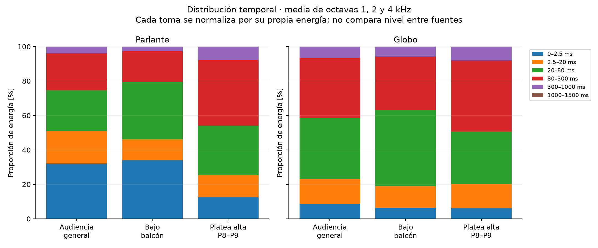
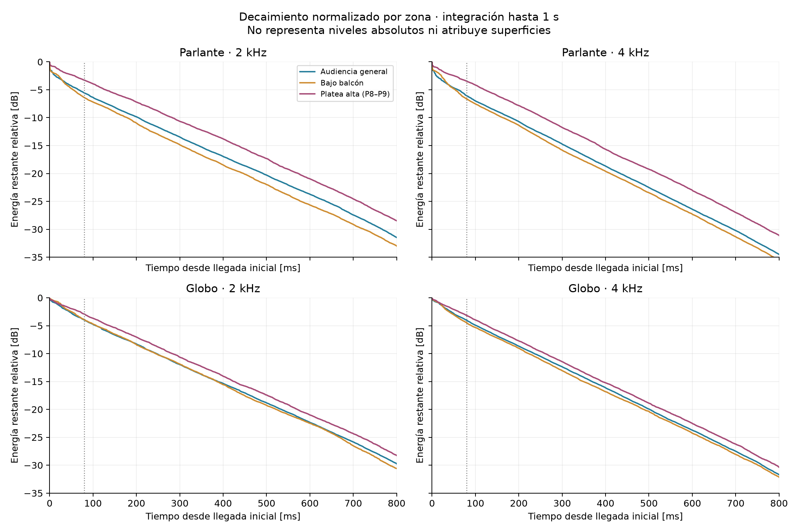
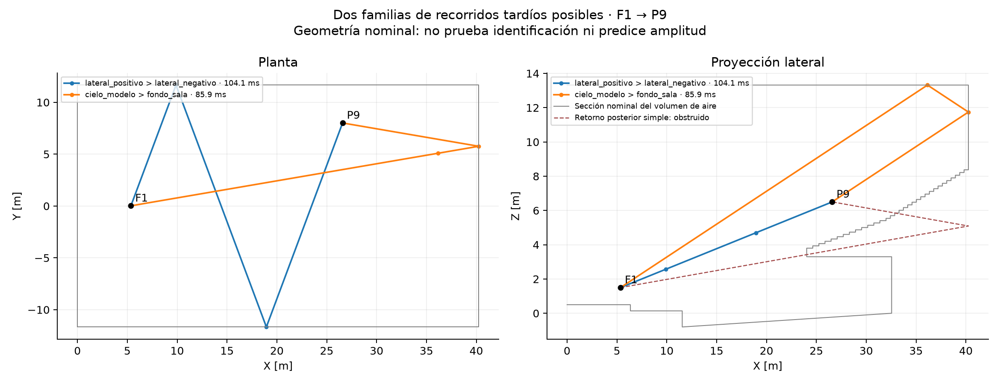
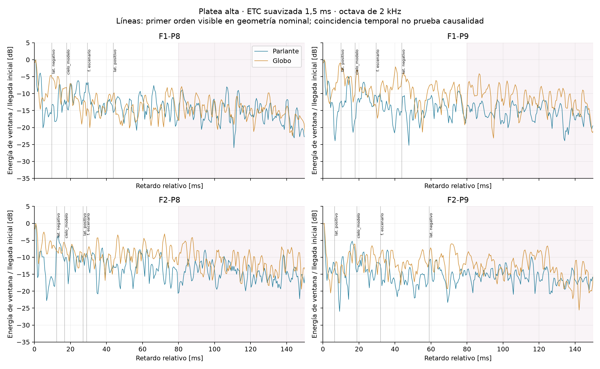

# Diagnóstico de energía tardía en la platea alta

Fecha: 19 de octubre de 2026. Teatro Aula Magna UTFSM.

## Conclusión para el proyecto

Los registros confirman que P8 y P9 reciben una proporción mayor de energía posterior a 80 ms que el piso abierto y la zona bajo balcón. El comportamiento aparece tanto con el parlante como con el globo; el contraste es mayor con el parlante. La hipótesis de trabajo es una combinación de menor peso de la llegada directa y participación de un campo reflejado persistente, especialmente entre 80 y 300 ms. No se demuestra una fuente localizada de «agudos atrapados», un eco único ni una reverberación independiente del resto de la sala.

El contraste geométrico permite ordenar candidatos, pero no atribuir porcentajes de la cola a cada pared. Las dos familias de recorridos tardíos de interés son rebotes entre laterales y un recorrido cielo → parte alta del muro posterior. El retorno simple del muro posterior, aunque arroja un tiempo tentador de 73–79 ms al usar un plano infinito, queda obstruido por las gradas en el modelo. No debe usarse como explicación automática.

La propuesta defendible sin acceso al recinto es un anteproyecto por alternativas: conservar la reverberación musical general, estudiar control localizado de retornos múltiples y diseñar cobertura específica. No se dispone de base para especificar ahora número, superficie o altura definitiva de absorbentes suspendidos.

## 1. Material revisado y trazabilidad

- 18 WAV de barrido, en `datos/Sweep IR (WAV)`.
- 18 WAV de globo, en `datos/Globo IR (WAV)`; se excluyen F1-P3 y F2-P6, siguiendo el control previo de duplicados. Quedan 16 tomas útiles de globo. La elección de etiqueta descartada debe revisarse si aparece la bitácora; P8/P9 no forman parte de esos duplicados.
- Planta y corte originales, y planta marcada con receptores, en los dos PDF de `datos/`.
- Malla de `modelo-3d/geometria.json`, supuestos de `modelo-3d/LEEME.md` y coordenadas heredadas de `analisis/sala.py`.
- Parámetros previamente calculados en `analisis/salida/ir_parlante.json` e `ir_globo.json`, usados como contraste de los decaimientos, no como sustituto del nuevo análisis de energía desde WAV.

`inventario_wav.json` registra SHA-256, frecuencia de muestreo, duración y alineación de los 36 WAV. Los archivos originales y la web no se modificaron.

Se acepta la corrección del responsable de la campaña: P8/P9 corresponden a la platea alta o nivel elevado de audiencia. Las etiquetas antiguas «gradería inferior» no deben interpretarse como receptores en el piso abierto. La planta marcada sitúa P8/P9 en el primer bloque de filas del nivel elevado; existe otro bloque más atrás, que esos dos puntos no representan.

## 2. Tratamiento de las respuestas al impulso

Se procesan las octavas de 500 Hz, 1, 2, 4 y 8 kHz con el filtro de fase cero del proyecto. Cada toma se alinea con la función existente `hallar_t0`, basada en su pico y umbral de llegada. Esa alineación es aproximada: no se dispone de referencia temporal absoluta, y el globo tiene una excitación de duración y espectro variables.

Se estima ruido y cruce mediante el método de Lundeby implementado en el proyecto. Se integra la energía tras restar el ruido y limitar valores negativos a cero, hasta el menor de: cruce estimado, final disponible y 1,5 s después de la llegada. Las ventanas son 0–2,5; 2,5–20; 20–80; 80–300; 300–1000 y 1000–1500 ms. Todas las proporciones se calculan dentro de cada toma antes de promediar: no se suman niveles de explosiones diferentes como si fueran una fuente repetible.

Los gráficos de decaimiento usan otro horizonte explícito de 1 s. Se emplean para comparar forma temporal y no para reajustar T30. El horizonte de las tablas de energía es hasta 1,5 s o el cruce, según corresponda. La energía después de 1 s aporta menos del 0,05 % en los promedios de zona y bandas 1–4 kHz de este análisis.

La energía de una ventana de pocos milisegundos es un **indicador de llegada inicial**, no una separación exacta entre sonido directo y reflexiones. Incluye respuesta de la fuente, filtrado y posibles contribuciones próximas. Se comprueba sensibilidad con ventanas que terminan a 1, 3 y 5 ms.

La ETC se agrupa cada 0,5 ms y suaviza con 1,5 ms para identificar máximos. Se conservan picos con al menos 2,5 dB sobre la mediana local. La selección depende de la banda y del suavizado; se exportan todos los resultados, no solo coincidencias favorables.

## 3. Resultados que sostienen la hipótesis

Media aritmética de las proporciones de cada toma en las octavas 1, 2 y 4 kHz; redondeo a una decimal. «Tardía» se usa aquí para energía posterior a 80 ms, como convención de C80: no implica que esa energía sea perjudicial para música.

| Zona | Tomas de parlante | Energía >80 ms, parlante | Tomas de globo | Energía >80 ms, globo |
|---|---:|---:|---:|---:|
| Audiencia general | 8 | 25,2 % | 8 | 41,2 % |
| Bajo balcón | 6 | 20,6 % | 4 | 37,0 % |
| Platea alta, P8/P9 | 4 | 46,0 % | 4 | 49,3 % |

La diferencia entre platea alta y piso abierto es de 20,7 puntos porcentuales con parlante y 8,1 con globo. Es una diferencia descriptiva, con pocas posiciones y sin repetición estadística de cada combinación. No debe presentarse como un intervalo de confianza ni como una encuesta de toda la platea alta.



### 3.1 Llegada inicial y cola

El cociente entre energía de llegada inicial (-0,5 a 3 ms) y energía entre 80 y 1000 ms es:

| Zona | Parlante | Globo |
|---|---:|---:|
| Audiencia general | +1,6 dB | -6,0 dB |
| Bajo balcón | +2,8 dB | -7,0 dB |
| Platea alta | -4,6 dB | -8,3 dB |

El déficit relativo de la llegada inicial de la platea alta respecto del piso es de aproximadamente 6,2 dB con parlante y 2,3 dB con globo. La conclusión de menor peso inicial se conserva al cambiar el final de ventana a 1 o 5 ms. Estos valores no son una medición normalizada de relación directo/reverberante ni permiten comparar potencia entre fuentes.

En los WAV del parlante, la energía inicial registrada arriba es en promedio unos 5,9 dB menor que en el piso, mientras la de 80–1000 ms difiere solo unos +0,4 dB. Esa comparación de unidades digitales solo es interpretable si se mantuvo la ganancia y excitación entre tomas: los TXT indican el mismo nivel de barrido, pero no documentan toda la cadena. La mayor distancia explica parte de la caída directa; tras una corrección exploratoria de 20 log10(distancia), la diferencia inicial respecto del piso baja a unos 1,7 dB. Las coordenadas y la directividad siguen siendo inciertas. No se aplica la ley 1/r a la cola difusa para justificar niveles.

Por tanto, no hay evidencia firme de que la cola absoluta sea mucho más intensa arriba. La evidencia más sólida es que pesa más **en relación con la llegada inicial**.

### 3.2 La diferencia tampoco se reduce a los primeros milisegundos

El cociente E(80–300 ms)/E(20–80 ms), que no utiliza la ventana directa, es:

| Zona | Parlante | Globo |
|---|---:|---:|
| Audiencia general | -0,45 dB | -0,13 dB |
| Bajo balcón | -2,72 dB | -1,45 dB |
| Platea alta | +1,32 dB | +1,39 dB |

La platea alta tiene un desplazamiento temporal hacia 80–300 ms incluso al excluir el directo. La diferencia respecto del piso es moderada: aproximadamente 1,8 dB y 1,5 dB. Puede intervenir una menor contribución de reflexiones tempranas además de recorridos tardíos; esta razón tampoco mide energía absoluta ni identifica superficies.

El cociente E(300–1000)/E(80–300) difiere menos: con parlante es -6,92 dB arriba y -7,50 dB en piso; con globo -7,19 y -7,50 dB. No aparece una cola superior completamente desacoplada o radicalmente distinta. Los T30 disponibles y las curvas normalizadas son compatibles con un volumen compartido que se percibe de distinta manera según receptor.



## 4. Relación con la planta y el modelo

La lectura de las marcas y cotas es compatible, como aproximación, con X desde el fondo del escenario hacia la audiencia, Y transversal y Z vertical. F1/F2 están dentro del escenario; P8/P9 se sitúan aproximadamente en X=26,6 m, Y=±8,1 m y Z=6,5 m. Las distancias fuente-receptor de estos cuatro pares son 21,8–25,2 m.

Para explorar recorridos se adopta **H0: ejes y origen de XY aproximadamente coincidentes con el modelo**. No se ha demostrado un registro global exacto: P5 sigue siendo discrepante y no se usa para atribuciones geométricas. La planta sirve para comprobar plausibilidad, no para certificar precisión centimétrica.

La frontera nominal conserva ancho 23,33 m, muro posterior en X=40,25 m y cielo horizontal en Z=13,32 m. Este último es una simplificación importante: el corte real muestra elementos escalonados y el modelo no reproduce la geometría completa del cielo, proscenio, corredores ni molduras.

Se calculan fuentes imagen de primer y segundo orden para los dos laterales, fondo del escenario, fondo de sala y cielo nominal. Se reconstruyen puntos de rebote y se comprueba pertenencia a la frontera y ausencia de obstáculos con intersecciones contra los triángulos de la malla. No se asignan coeficientes de reflexión, absorción, dispersión ni directividad; no se predicen amplitudes.

| Familia de recorrido | Retardo nominal respecto del directo | Resultado |
|---|---:|---|
| Lateral cercano, primer orden | 6,5–12,4 ms | Visible en el modelo. Es temprano; no explica por sí solo E>80 ms. |
| Cielo nominal, primer orden | 16,8–18,8 ms | Visible. Tiempo muy dependiente de la geometría real del cielo; también temprano. |
| Lateral opuesto, primer orden | 27,0–59,1 ms | Visible. Puede participar en coloración o espacialidad, pero no es directamente la cola >80 ms. |
| Fondo de escenario, primer orden | 29,0–31,9 ms | Visible en el modelo simplificado. No es exclusivo de platea alta y depende del montaje escénico. |
| Fondo de sala, primer orden | 73,1–78,5 ms | **Obstruido por las gradas.** La coincidencia con un pico no valida el recorrido. |
| Dos laterales, rama de recorrido largo | 95,3–111,6 ms | Visible. Familia candidata a energía posterior a 80 ms. |
| Cielo → parte alta del fondo de sala | 82,2–87,9 ms | Visible con el cielo nominal. Candidato condicionado por las simplificaciones del cielo. |



### 4.1 Qué muestran y qué no muestran las coincidencias

Hay llegadas compatibles con reflexiones laterales tempranas y energía distribuida en las franjas de los recorridos de orden superior. Por ejemplo, el lateral opuesto en F2-P9 predice 59,1 ms y los máximos seleccionados a 2 kHz se sitúan en torno a 59,8 ms con ambas fuentes. Esa es una coincidencia útil para la plausibilidad de la geometría lateral, pero sigue siendo temprana y no atribuye la energía posterior a 80 ms.

Para el rebote lateral largo de F1-P9, la predicción nominal es 104,1 ms y los máximos próximos son 105,3 ms con parlante y 102,3 ms con globo. Sin embargo, otras combinaciones fuente-receptor no coinciden igual: en F2-P8 se predicen 111,6 ms, con máximos seleccionados próximos en 105,3 y 110,8 ms. No se obtiene una identificación inequívoca repetida en todas las tomas.

El recorrido cielo → fondo predice 82–88 ms. Hay máximos próximos en parte de los registros, pero no un retorno claramente repetido en los cuatro pares y ambas fuentes. En F2-P9 la predicción nominal es 87,9 ms y el máximo seleccionado del parlante más cercano es 101,3 ms: no debe ocultarse ese desacuerdo.

La ETC contiene muchos máximos, por lo que una coincidencia aislada de pocos milisegundos tiene escaso valor identificador. No se ajustaron coordenadas ni alturas para hacer coincidir picos. Las tablas exportan también discrepancias y recorridos rechazados. No se realizó una prueba estadística de identificación ni se asigna probabilidad causal a una pared.



### 4.2 Sensibilidad geométrica

Se exploran 400 perturbaciones por recorrido visible: coordenadas nominales ±0,3 m; incertidumbre vertical adicional del receptor ±0,4 m; laterales ±0,3 m; fondo ±1 m; velocidad 340–345 m/s. Para el cielo se ensayan planos efectivos entre 9,5 y 13,32 m, como escenarios de sensibilidad y no como cotas verificadas del reflector.

Los percentiles 5–95 exportados son rangos de esos escenarios uniformes, **no intervalos de confianza**. No se vuelve a verificar visibilidad en cada geometría perturbada. La familia lateral larga cambia normalmente pocos milisegundos; el recorrido cielo → fondo varía cerca de una decena y puede cruzar el límite de 80 ms. La atribución al cielo es, por ello, menos estable. Esta sensibilidad no cubre cambios completos de forma, reflexiones difusas, difracción ni corredores omitidos.

## 5. Hipótesis jerarquizadas y consecuencias de diseño

### H1. Menor peso directo y temprano en P8/P9 frente a un campo reflejado compartido

**Respaldo alto para la diferencia relativa; causa física no separada por completo.** Aparece con ambas fuentes, persiste al variar la ventana inicial y no requiere un eco aislado. La distancia y directividad pueden contribuir. Para el refuerzo, la cobertura específica de platea alta debe ser parte del anteproyecto. Si el uso es orquestal sin amplificación, los altavoces no son la solución principal a la acústica natural.

### H2. Recorridos múltiples entre muros laterales

**Plausibilidad geométrica media; atribución a picos tardíos baja a media.** Los laterales admiten recorridos repetidos de duración compatible y sus primeras reflexiones tienen algunas coincidencias útiles. No se ha medido cuánta energía aporta cada pared.

Es importante la ubicación de los rebotes: en F1-P9, la rama larga toca aproximadamente (X=9,9; Y=+11,7; Z=2,6) y (X=18,9; Y=-11,7; Z=4,7) m. En F2-P8, aproximadamente (11,4; -11,7; 2,9) y (19,7; +11,7; 4,8) m. **No están ambos sobre las últimas filas de la platea alta.** Colgar absorbentes únicamente en el fondo alto no necesariamente interceptaría esos recorridos. Una intervención lateral debe preservar reflexiones musicales útiles para el resto de la sala.

### H3. Recorrido por el cielo posterior y el muro posterior alto

**Plausibilidad geométrica media en el modelo nominal; identificación baja en los registros.** En el ejemplo F1-P9 el rebote nominal en cielo está cerca de (36,1; 5,1; 13,3) m y el posterior en (40,3; 5,8; 11,7) m. Estas ubicaciones sí son coherentes con estudiar una intervención en la parte posterior alta. Su exactitud depende de corregir el cielo y el cierre posterior reales.

Puede plantearse como alternativa una solución limitada y modular en esa región, comparando difusión, absorción parcial y configuración mixta. No se puede afirmar que esas superficies sean las responsables dominantes, que una nube porosa allí resuelva la molestia, ni que el público de abajo no se vea afectado.

### H4. Eco simple del muro posterior o «agudos atrapados arriba»

**Sin respaldo suficiente como diagnóstico actual.** El retorno posterior simple se rechaza en la malla nominal; las reflexiones de primer orden cercanas son tempranas y el campo tardío pertenece a un volumen comunicado. Tampoco hay calibración de SPL que pruebe exceso absoluto de agudos. Los resultados no excluyen otras reflexiones omitidas por el modelo.

## 6. Decisión de anteproyecto sin nuevas mediciones

1. Conservar el objetivo de reverberación musical general; no prescribir una reducción global a partir de dos receptores altos.
2. Mantener los apoyos bajo balcón como solución de cobertura, con control independiente de nivel, espectro y alineación temporal. Este diagnóstico no dimensiona su cantidad ni directividad.
3. Plantear cobertura específica de platea alta para los usos amplificados, pues la diferencia directo/tardío está respaldada por los datos.
4. Para acondicionamiento, comparar dos alternativas documentadas: control parcial de recorridos laterales y control limitado del conjunto cielo posterior/muro posterior alto. No tratar indiscriminadamente el lateral cercano solo por su proximidad.
5. Preferir una solución reversible o variable si se desarrolla el proyecto con incertidumbre: paneles desmontables o tratamiento regulable, dimensionados después de completar geometría y propiedades. La difusión es candidata cuando se busca reducir concentración conservando energía; la absorción es candidata cuando se necesita atenuar la energía de recorridos concretos. Ninguna se garantiza solo por este análisis temporal.

El resultado entregado permite justificar y comparar hipótesis con los datos existentes. No requiere acceso actual al recinto para avanzar al anteproyecto. La especificación definitiva de materiales, posiciones y superficies sigue condicionada por la geometría real y por el desempeño de las alternativas, que no se ha simulado aquí.

## 7. Archivos y reproducción

Ejecutar desde la raíz del proyecto:

```powershell
py -B analisis/diagnosticar_platea_alta.py
```

Requisitos: numpy, soundfile, matplotlib. El script añade resultados en esta carpeta y no regenera la web ni el modelo.

- `energia_por_ventanas.csv`: 170 filas, 34 tomas × 5 octavas; energías, razones y sensibilidad de ventana directa.
- `resumen_zonas.csv`: promedios por fuente, zona y banda.
- `picos_platea_alta.csv`: máximos seleccionados en P8/P9, con banda, nivel relativo y prominencia.
- `recorridos_geometricos.csv`: primer y segundo orden, visibilidad, puntos de rebote y máximo seleccionado más cercano de cada fuente a 2 kHz. La búsqueda del máximo cercano no prueba causalidad.
- `sensibilidad_retardos.csv`: escenarios geométricos exploratorios.
- `inventario_wav.json`: identificación y huellas de los archivos procesados.
- Cinco PNG: distribución de energía, decaimientos, ETC, primer orden F2-P8 y recorridos tardíos F1-P9.

Se comprueba que hay 36 WAV inventariados, 34 útiles, proporciones sumando 100 %, identidad entre C80 y fracción tardía y recorrido directo visible para los cuatro pares de platea alta. Estas verificaciones son de consistencia del análisis, no validación de exactitud arquitectónica.

## 8. Referencias de método

- Allen y Berkley, método de fuentes imagen; la validez de un recorrido requiere visibilidad y límites de las superficies. Desarrollo y discusión de validez: [An Image Source Method Framework for Arbitrary Reflecting Boundaries](https://arxiv.org/abs/1906.12227).
- [COMSOL: Small Concert Hall Acoustics](https://doc.comsol.com/6.3/doc/com.comsol.help.models.aco.small_concert_hall/small_concert_hall.html): una predicción acústica completa incorpora fuente, directividad, absorción y dispersión, además de geometría y receptores. El cálculo de retardos de este estudio no equivale a esa simulación.
- Las convenciones y limitaciones de filtros, ruido y tomas descartadas se describen en `analisis/README.md`.

## 9. Comprobación adicional: hipótesis de flutter echo

La observación en terreno de una persistencia aguda repetitiva se conserva como antecedente independiente. El análisis anterior de C80 y reparto temporal no basta para confirmar o descartar flutter: este exige estudiar secuencias de repeticiones y los recorridos que las mantienen. La difusión puede interrumpir una secuencia especular aunque no reduzca mucho el tiempo de reverberación global.

Se añade `analisis/diagnosticar_flutter.py`, que reprocesa las 34 tomas útiles en octavas de 2, 4 y 8 kHz. Agrupa energía en ventanas de 1 ms, normaliza por una media móvil de 21 ms y calcula correlación entre envolventes desplazadas de 20 a 180 ms sobre la cola de 40–650 ms. Los resultados se exportan a `periodicidad_flutter.csv`, `periodicidad_flutter.png` y `colas_agudos.png`. Es una exploración, no un detector validado ni una prueba de audibilidad. La normalización local, banda, horizonte y duración disponible condicionan el resultado; el promedio espacial puede ocultar un fenómeno localizado.

Para el ancho nominal W=23,33 m y c=342 m/s, el recorrido W/c equivale a 68,2 ms y la ida y vuelta 2W/c a 136,4 ms. Son referencias geométricas: el intervalo observado depende de las familias de recorridos, posición y orden de reflexión. No se obtiene un periodo dominante estable y común a P8/P9, ambas fuentes y las tres bandas. Los máximos de las correlaciones promediadas de los cuatro pares altos quedan entre 0,05 y 0,08, en retardos distintos según fuente y banda. No existe aquí un umbral validado que convierta esos valores en un diagnóstico negativo. No se confirma un flutter lateral único con estas posiciones; tampoco se excluye el flutter oído en otro asiento o una secuencia más compleja.

Además de los laterales, debe conservarse como hipótesis el conjunto de cielo y gradas: las escaleras y geometrías de retorno múltiple pueden sostener flutter incluso sin dos paredes simples paralelas. El cielo y los peldaños reales están simplificados en la malla actual, por lo que no corresponde asignarles un periodo preciso ni descartarlos.

La decisión de acondicionamiento se afina: para flutter, el objetivo es romper la repetición en alguna superficie del recorrido, mediante absorción localizada, dispersión o cambio de orientación. No es necesario tratar indiscriminadamente todas las paredes. Un tratamiento mixto y localizado es una alternativa de proyecto más robusta frente a la incertidumbre que una prescripción general de difusores o absorbentes de cielo. La elección exacta del paño sigue sin quedar demostrada por estos registros.

Añadir absorbentes al cielo sin interrumpir un eventual recorrido lateral puede reducir el campo que lo enmascara y dejarlo más perceptible; no debe suponerse que cualquier absorción sobre la platea alta eliminará flutter. Esta posibilidad y los bucles que implican escalones se discuten en [AKUTEK: Echoes and flutter-echoes](https://www.akutek.info/research_files/echoes.htm). [Genelec](https://www.genelec.com/en/improving-room-acoustics) describe la combinación de absorción y difusión para controlar flutter entre superficies.
