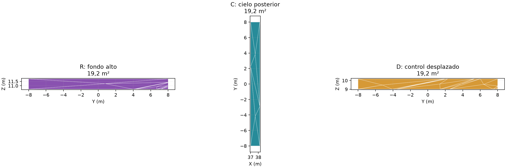
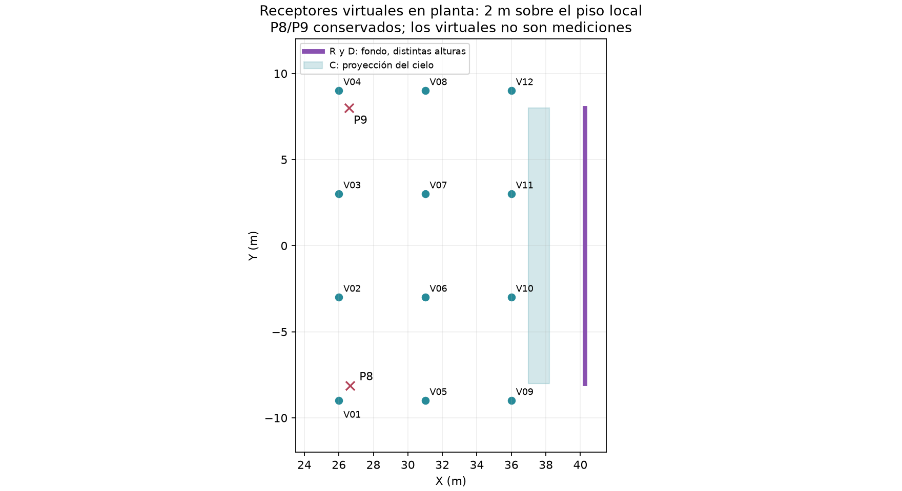

# Paso 3: ensayo de paños localizados en la platea alta

> **Documento archivado el 9 de noviembre de 2026.** Se conserva como antecedente de una etapa o estrategia sustituida; no es el protocolo vigente. Ubicación original: `informes/PASO-3-ENSAYO-DE-PANOS-LOCALIZADOS.md`. Consultar el [plan actual](../../informes/PLAN-DE-ESTUDIO-D50-C80-Y-TRATAMIENTOS-POR-ZONA.md).

**Teatro Aula Magna UTFSM — 9 de noviembre de 2026.**  
**Alcance:** delimitación geométrica y primera exploración de dispersión equivalente. No es diseño definitivo de QRD ni comprobación de eficacia instalada.

## Alcance espectral acordado

La continuación del estudio utiliza **1, 2, 4 y 8 kHz**. Los cálculos anteriores de 16 kHz se conservan como antecedente exploratorio y no forman parte de esta matriz. No se exige una coincidencia perfecta entre predicción y medición; sí una base comparable y una estimación explícita de los límites de cada conclusión.

Este trabajo desarrolla la etapa 3 del [plan general](PLAN-DE-LOCALIZACION-Y-VALIDACION-DEL-TRATAMIENTO.md), apoyándose en el [estudio inicial de grandes paños](RESULTADOS-INICIALES-DISPERSION-PLATEA-ALTA.md) y su [ampliación a agudos](RESULTADOS-DISPERSION-8-Y-16-KHZ.md).

## Qué se ha preparado

Se mantienen la envolvente, las fuentes y los nueve receptores originales. Se subdividen las caras necesarias para delimitar tres paños pequeños, se añaden doce receptores virtuales y se genera una malla de cálculo común a todas las condiciones.

| Condición | Localización nominal en metros | Área tratada |
|---|---|---:|
| Base | Sin cambio de material; misma subdivisión y receptores nuevos | 0 m² |
| R | Fondo: X = 40,25; Y entre −8 y +8; Z entre 10,6 y 11,8 | 19,2 m² |
| C | Cielo posterior: Z ≈ 12,12; X entre 37,0 y 38,2; Y entre −8 y +8 | 19,2 m² |
| RC | Unión de R y C | 38,4 m² |
| D | Control desplazado en el fondo: X = 40,25; Y entre −8 y +8; Z entre 9,0 y 10,2 | 19,2 m² |

La selección se hace recortando las superficies, no asignando triángulos completos por su centro. Las áreas verificadas son 19,2 m² para cada paño individual. RC tiene el doble de superficie: su resultado no se interpreta como superioridad a igual área.

R y C contienen los puntos de la familia candidata cielo posterior → fondo alto previamente identificada para F1/F2–P8/P9. D no contiene esos cuatro rebotes posteriores; podría interceptar otros recorridos y no se considera una superficie acústicamente neutra. La pertenencia geométrica no demuestra que tales reflexiones dominen la respuesta real.

## Receptores y cobertura del experimento

Se conservan P1–P9 y se incorporan V01–V12, con coordenadas en planta X = 26, 31 y 36 m, combinadas con Y = −9, −3, +3 y +9 m. Cada altura se obtiene del piso local modelado y se suma 2 m. Se incluyen sectores de butacas y circulación superior; las tres estaciones longitudinales no representan necesariamente una misma fila física en toda su anchura.

Se verifica que las esferas de radio 0,31 m no intersecten superficies. Los virtuales amplían la comparación espacial; no son puntos medidos ni sustituyen la evidencia de P8/P9.

Los resultados se separarán en P8/P9, posiciones virtuales, piso abierto y bajo balcón. Se conservarán los resultados por fuente y receptor; un promedio favorable no oculta un empeoramiento localizado.

## Verificación geométrica y malla

La subdivisión cambia la discretización de 2.340 vértices y 4.692 caras a **2.473 vértices y 4.958 caras**. Las modificaciones se limitan al fondo y al último cielo, propagando los puntos de corte a sus caras vecinas para mantener continuidad.

Las comprobaciones registran:

- Todas las aristas de la envolvente siguen compartidas por dos caras.
- Se conservan las orientaciones y el área de cada cara original dentro de precisión numérica.
- El volumen geométrico se mantiene en aproximadamente **9.543,734 m³**.
- La malla tetraédrica común contiene **2.595 nodos y 8.022 tetraedros**; sus vecinos son recíprocos y sus caras exteriores tienen referencia de superficie.

Se utiliza TetGen instalado con I-Simpa, con límites de frontera preservados (`-pYa20T1e-10`). La primera tentativa con refinamiento de calidad produjo una malla innecesariamente grande; se descartó antes de las pruebas acústicas. Las cifras anteriores corresponden a la malla utilizada. Su funcionamiento se comprobó primero con un cálculo de 20.000 partículas, separado de la matriz de resultados.

La referencia se vuelve a calcular con la nueva malla y los 21 receptores. Se compara además con la referencia histórica de iguales fuente, banda, semilla y número de partículas para identificar cambios debidos al conjunto remallado/receptores. No se mezclan resultados de las dos referencias al calcular el efecto del tratamiento.

## Materiales: qué variable se modifica

Se conserva la absorción efectiva de cada superficie y se fija **s = 0,60 con ley Lambert** únicamente en el paño intervenido y la banda calculada. El resto del modelo permanece igual. Se crean materiales separados para el muro y el cielo para no copiar la absorción del muro sobre el cielo.

El muro parte de s ≈ 0,05; el cielo parte de s ≈ 0,30. Por tanto, aunque R y C tengan igual área, el incremento de dispersión y sus absorciones de partida son diferentes. Esta comparación evalúa dos intervenciones sobre la base existente, no la eficacia intrínseca de un mismo producto instalado en dos superficies idénticas.

s = 0,60 es una hipótesis experimental que da continuidad al estudio previo. No se presenta como propiedad medida de un QRD ni como valor óptimo. Mantener la absorción efectiva sirve para aislar la sensibilidad a dispersión dentro de cada paño; la sustitución por un panel físico de baja absorción requiere una comparación posterior con propiedades justificadas. Esta limitación es especialmente relevante a 8 kHz.

## Matriz inicial y análisis

Se consideran cinco condiciones × dos fuentes × cuatro bandas: **40 corridas**, de 150.000 partículas y semilla 20261019. F1 y F2 se calculan separadamente, con Lw global de 90 dB, el espectro de referencia, duración de 4 s, paso de 1 ms y los parámetros ambientales existentes.

Es un barrido exploratorio con una sola semilla. No acredita convergencia ni permite seleccionar una solución definitiva por diferencias pequeñas. Las variantes prometedoras requerirán la repetición intermedia de 600.000 partículas y tres semillas, antes de la confirmación de 4,8 millones.

Se calculan energía temprana y tardía, máximo de 10 ms en 80–300 ms, concentración relativa de ese máximo, C80 y T30. Se añaden energía y máximo de 10 ms en **60–120 ms**, para examinar las llegadas candidatas cercanas al corte de 80 ms. Se mantiene el procedimiento de origen temporal e integración del estudio inicial. Los T30 son extrapolaciones del tramo de decaimiento; no son el tiempo medido hasta desaparecer la respuesta ni una duración de solo 30 dB.

Los gráficos utilizan un mismo nivel de referencia para base y variantes de cada fuente/receptor/banda. La concentración de máximos y los mapas espaciales se consideran junto con la energía integrada; aumentar C80 no basta para declarar eliminación de ecos flotantes.

## Archivos preparados

- [Paños con índices, áreas y límites](../../prediccion/estudio-difusion/localizado/panos.json).
- [Receptores virtuales con alturas y distancias a superficies](../../prediccion/estudio-difusion/localizado/receptores-virtuales.json).
- [Verificación de la geometría](../../prediccion/estudio-difusion/localizado/verificacion-geometrica.json) y [verificación tetraédrica](../../prediccion/estudio-difusion/localizado/verificacion-tetra.json).
- [OBJ con grupos originales y paños R/C/D](../../prediccion/estudio-difusion/localizado/modelo-localizado.obj), acompañado de su [archivo de colores](../../prediccion/estudio-difusion/localizado/modelo-localizado.mtl).

El OBJ es una entrega geométrica de revisión: sus colores no contienen coeficientes acústicos ni fuentes y receptores. Las configuraciones SPPS de cada corrida sí incluyen las fuentes, los 21 receptores y las propiedades empleadas. No se ha generado ni comprobado en la interfaz un nuevo proyecto `.proj` para estos paños. El proyecto principal permanece intacto.

## Resultado de la primera exploración

**Se completaron las 40 corridas**, además del piloto independiente. Se obtuvieron 840 registros de indicadores y 672 comparaciones tratamiento–base. No se han ejecutado todavía las repeticiones de estos paños con tres semillas.

Los cambios medios descriptivos en los puntos altos son los siguientes. Cada media combina cambios individuales de F1/F2; no mezcla sus respuestas energéticas. “Virtuales” comprende V01–V12. Una cifra negativa significa menos energía o menor máximo en la ventana, según la columna.

| Paño | Banda | ΔE 80–300 P8/P9 | Δmáximo 10 ms P8/P9 | ΔE 80–300 virtuales | Δmáximo 10 ms virtuales |
|---|---|---:|---:|---:|---:|
| R | 1 kHz | -0.18 dB | +0.05 dB | -0.04 dB | +0.18 dB |
| R | 2 kHz | +0.15 dB | -0.22 dB | +0.04 dB | +0.00 dB |
| R | 4 kHz | +0.03 dB | +0.38 dB | +0.00 dB | -0.06 dB |
| R | 8 kHz | +0.06 dB | +0.01 dB | -0.04 dB | +0.14 dB |
| C | 1 kHz | -0.10 dB | -0.21 dB | -0.15 dB | +0.05 dB |
| C | 2 kHz | -0.07 dB | -0.37 dB | +0.19 dB | +0.19 dB |
| C | 4 kHz | -0.24 dB | -0.25 dB | -0.01 dB | +0.18 dB |
| C | 8 kHz | -0.03 dB | -0.17 dB | -0.05 dB | -0.10 dB |
| RC | 1 kHz | -0.19 dB | +0.03 dB | -0.09 dB | +0.06 dB |
| RC | 2 kHz | -0.46 dB | -0.49 dB | +0.08 dB | +0.07 dB |
| RC | 4 kHz | +0.12 dB | +0.38 dB | -0.15 dB | -0.53 dB |
| RC | 8 kHz | -0.14 dB | -0.66 dB | +0.01 dB | +0.15 dB |
| D | 1 kHz | -0.19 dB | -0.40 dB | -0.08 dB | +0.25 dB |
| D | 2 kHz | +0.05 dB | +0.04 dB | +0.03 dB | +0.05 dB |
| D | 4 kHz | -0.19 dB | +0.26 dB | -0.14 dB | -0.10 dB |
| D | 8 kHz | +0.29 dB | +0.97 dB | +0.01 dB | -0.17 dB |

### Qué permiten concluir estas cifras

- **No aparece una mejora uniforme en toda la platea alta y todas las bandas.** El beneficio depende de fuente, receptor y frecuencia; la reducción de superficie no conserva automáticamente el resultado del fondo completo.
- **C, cielo posterior**, reduce ligeramente la energía tardía y el máximo en el promedio P8/P9 de las cuatro bandas, pero a 2 kHz empeora el promedio de los virtuales. No constituye una solución general demostrada.
- **RC, fondo más cielo**, presenta reducciones descriptivas más marcadas en P8/P9 a 2 y 8 kHz, pero no a 4 kHz; en los virtuales su patrón es diferente. Usa el doble de superficie y no domina de manera consistente a los paños individuales.
- **R, fondo alto pequeño**, no proporciona una reducción consistente al ampliar los receptores y las bandas. Interceptar un recorrido geométrico no garantiza controlar la respuesta total.
- **D, control desplazado**, también modifica los indicadores. No se identifica la responsabilidad exclusiva de la familia cielo–fondo por comparar solo estas medias.

Existen alarmas individuales superiores a +1 dB en máximos de 10 ms para todas las variantes. Por ejemplo, C da aproximadamente +2,19 dB en F1–V04 a 2 kHz y RC aproximadamente +2,52 dB en F1–V05 a 1 kHz. Son resultados numéricos de una sola realización: deben revisarse y repetirse antes de interpretarlos como perjuicio físico real. No se ocultan tras las medias favorables.

### Cambio de referencia por la nueva discretización

La referencia remallada, comparada con la histórica de igual resolución, muestra estos máximos absolutos entre los nueve receptores originales y ambas fuentes:

| Banda | Máximo absoluto ΔE 0–20 ms | Máximo absoluto ΔE 80–300 ms | Máximo absoluto ΔC80 |
|---|---:|---:|---:|
| 1 kHz | 0.40 dB | 0.47 dB | 0.39 dB |
| 2 kHz | 0.49 dB | 0.19 dB | 0.35 dB |
| 4 kHz | 0.61 dB | 0.11 dB | 0.34 dB |
| 8 kHz | 0.26 dB | 0.19 dB | 0.13 dB |

La envolvente y los materiales no cambiaron, pero la discretización y el conjunto de receptores sí. Estas diferencias muestran sensibilidad numérica del procedimiento, no una modificación acústica del teatro ni un intervalo de confianza. Varias mejoras pequeñas del barrido son del mismo orden. Todas las diferencias tratamiento–base del experimento se calculan contra la nueva referencia común, nunca contra la histórica.

### Qué corresponde hacer después

No se selecciona todavía ubicación definitiva ni QRD. La siguiente prueba propuesta es repetir **base, C y RC** con 600.000 partículas y las tres semillas del protocolo, a 1, 2, 4 y 8 kHz: 72 procesos. C permite contrastar la intervención individual en cielo; RC permite comprobar si el efecto combinado justifica la superficie y revisar sus alarmas. Esta elección es una prioridad de investigación, no una declaración de superioridad física. R y D se conservan documentados y podrán reincorporarse si la repetición contradice las hipótesis.

La comparación deberá revisar máximos y energía en 60–120 y 80–300 ms por posición, variación entre semillas y conservación de energía temprana en las tres zonas. Si no aparece una mejora consistente, habrá que desplazar o reducir de otra forma los paños, o revisar familias de recorridos; no forzar la elección de un QRD a partir del C80.

## Resultados consultables

- [Indicadores de las 40 corridas](../../prediccion/estudio-difusion/localizado/resultados/indicadores.csv).
- [Diferencias por fuente, receptor y banda](../../prediccion/estudio-difusion/localizado/resultados/diferencias.csv).
- [Resumen de las cuatro zonas](../../prediccion/estudio-difusion/localizado/resultados/resumen.json).
- [Control de cambio de referencia](../../prediccion/estudio-difusion/localizado/resultados/control-cambio-referencia.csv).
- [Ecogramas F1](../../prediccion/estudio-difusion/localizado/resultados/ecogramas-F1.png) y [F2](../../prediccion/estudio-difusion/localizado/resultados/ecogramas-F2.png).
- [Mapa espacial de cambios en máximos](../../prediccion/estudio-difusion/localizado/resultados/mapa-maximos.png).

Los mapas resumen cambios y no representan una medición perceptual de flutter. Las figuras mantienen una escala común para permitir observar mejoras y empeoramientos. El estudio permanece en etapa de selección experimental; la caracterización del panel físico y la confirmación final siguen pendientes.

## Control final de archivos y ejecución

Se verificaron las 40 configuraciones exploratorias: cuatro frecuencias acordadas, 21 receptores, Lw global de 90 dB, absorción conservada en los materiales equivalentes y huellas de configuración y malla. La pérdida máxima registrada de partículas por bucles o problemas de malla fue aproximadamente 0,0233 %; este control no sustituye el análisis de convergencia.

Las salidas nativas de las 40 corridas y del piloto se archivaron sin pérdida en `salidas-nativas.zip` dentro de cada carpeta, verificando integridad y hashes antes de retirar las copias sueltas. Se conservan configuraciones, logs, metadatos y series energéticas fuera de los archivos comprimidos.

- [Verificación final de configuraciones y enlaces](../../prediccion/estudio-difusion/localizado/resultados/verificacion-final.json).
- [Verificación de las salidas archivadas](../../prediccion/estudio-difusion/localizado/resultados/verificacion-compactacion.json).
- [Comprobación adicional de fronteras y receptores](../../prediccion/estudio-difusion/localizado/verificacion-adicional.json).
