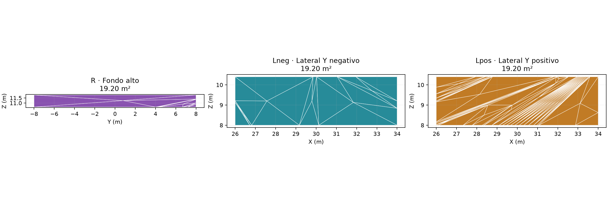
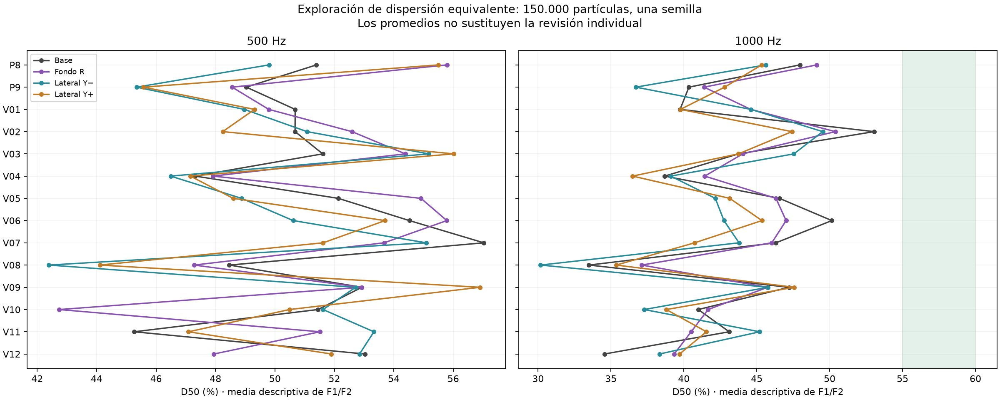
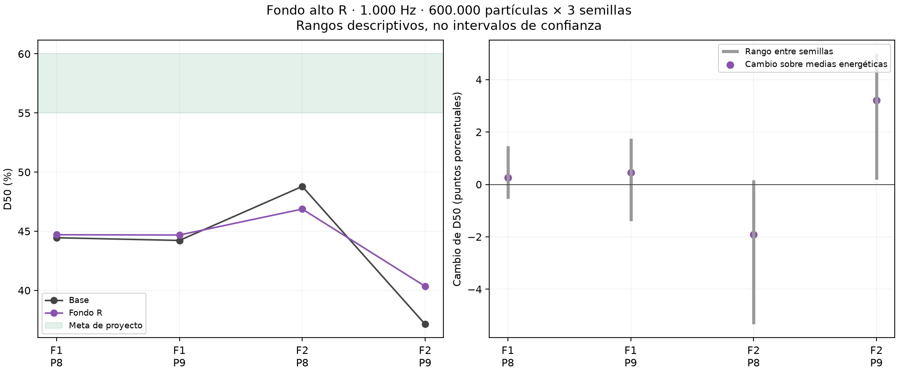

# Primera comparación de dispersión en fondo y laterales de platea alta

> **Documento archivado el 9 de noviembre de 2026.** Ensayo anterior de fondo y laterales altos; se conserva como antecedente negativo. Para el ensayo actual, consultar [laterales bajos y adelantados](../../informes/RESULTADOS-LATERALES-BAJOS-Y-ADELANTADOS.md).

**Proyecto:** Teatro Aula Magna UTFSM.  
**Fecha:** 9 de noviembre de 2026.  
**Alcance:** sensibilidad numérica de tres paños de igual área, con absorción conservada. Se evalúan 500 y 1.000 Hz; no se valida un QRD físico ni una prestación instalada.

## Objetivo y alcance de la tanda

Este trabajo inicia la ejecución del [plan de D50, C80 y tratamientos por zona](../../informes/PLAN-DE-ESTUDIO-D50-C80-Y-TRATAMIENTOS-POR-ZONA.md). La meta de investigación es acercar D50 a 55–60 % a 1.000 Hz en P8/P9, manteniendo C80 en el balance de proyecto de −2 a +2 dB a 500/1.000 Hz y evitando perjuicios relevantes en otras posiciones. Estos valores son metas del proyecto, no límites normativos universales de escucha musical.

La tanda consta de 16 corridas exploratorias de ubicación y 12 corridas de repetición de referencia. Se añaden seis repeticiones del fondo a 1.000 Hz para comprobar si su pequeña mejora exploratoria persiste. El piloto de 20.000 partículas solo verifica funcionamiento y se mantiene separado de los indicadores de la investigación.

Se conservan las fuentes omnidireccionales idealizadas de la base. No se ha identificado ni introducido la directividad real del parlante de los barridos, del globo ni del line array. El resultado representa estas condiciones de emisión; su traslado al teatro requiere reconocer ese límite. Las respuestas medidas no se modifican ni se reajustan materiales para forzar la meta D50.

## Geometría y paños comparados

| Condición | Localización | Área |
|---|---|---:|
| Base | Misma malla y materiales de referencia | Sin tratamiento |
| R | Fondo: X = 40,25 m; Y entre −8 y +8 m; Z entre 10,6 y 11,8 m | 19,20 m² |
| Lneg | Lateral Y ≈ −11,665 m; X entre 26 y 34 m; Z entre 8 y 10,4 m | ≈ 19,20 m² |
| Lpos | Lateral Y ≈ +11,665 m; misma extensión longitudinal y vertical | ≈ 19,20 m² |

Los límites se recortan sobre las caras existentes. La cota superior lateral se ajusta a la coordenada numérica del modelo, Z ≈ 10,3999996 m, para evitar una subdivisión microscópica cerca de un vértice coincidente. El área lateral verificada es 19,199997 m² por lado. No es una diferencia de área relevante para el experimento.

La geometría de referencia pasa de 2.340 vértices y 4.692 caras a **2.836 vértices y 5.684 caras**, por subdivisión coplanar. Se conservan cierre, orientación, área y volumen del recinto, aproximadamente **9.543,734 m³**. La malla tetraédrica común tiene **2.996 nodos y 9.575 tetraedros**. Los estados tratados cambian únicamente la asignación de material en las caras del paño seleccionado; no cambian la forma ni el volumen.

Se conservan P1–P9 y los doce receptores virtuales V01–V12 del estudio localizado, a aproximadamente 2 m sobre el piso local. Se comprueba que sus esferas de radio 0,31 m no intersecten superficies. Las posiciones virtuales no representan mediciones nuevas. Los efectos se separan en P8/P9, posiciones virtuales, piso abierto y bajo balcón.

## Propiedades acústicas y condiciones comunes

Los tres paños pertenecen al mismo material efectivo de muros de la base. Se conserva su absorción y se eleva la dispersión de aproximadamente **s = 0,05 a s = 0,60**, con ley Lambert, en la banda activa. Por ello esta comparación iguala tanto área como propiedades de referencia de los paños; no reproduce todavía un revestimiento físico de prestaciones medidas.

| Banda | Absorción efectiva de muro, mantenida | Dispersión de base | Dispersión de ensayo |
|---|---:|---:|---:|
| 500 Hz | 0,44 | ≈ 0,05 | 0,60 |
| 1.000 Hz | ≈ 0,24795 | ≈ 0,05 | 0,60 |

Estos coeficientes de absorción son efectivos de calibración, no ensayos del concreto. s = 0,60 tampoco es una propiedad demostrada del QRD preliminar, especialmente a 500 Hz. Instalar un panel rígido de menor absorción que la superficie efectiva exigiría otro escenario de comparación; no se puede conservar automáticamente la absorción calibrada y atribuir el resultado a ese panel.

Parámetros comunes: F1/F2 en procesos separados; Lw global de 90 dB con el espectro conservado; 4 s; paso de 1 ms; radio 0,31 m; 18 °C y 57 % de humedad; absorción atmosférica activada; transmisión desactivada y criterio de extinción existente. Se usa el motor SPPS instalado de I-Simpa.

| Bloque | Resolución | Procesos |
|---|---|---:|
| Base, R, Lneg y Lpos; F1/F2; 500 y 1.000 Hz | 150.000 partículas; semilla 20261019 | 16 |
| Base; F1/F2; 500 y 1.000 Hz | 600.000 partículas; semillas 20261019, 20261020 y 20261021 | 12 |
| Fondo R; F1/F2; 1.000 Hz | 600.000 partículas; mismas tres semillas | 6 |

No se ejecuta en esta tanda la confirmación de 4,8 millones ni se repiten los laterales con tres semillas. Las bandas 2, 4 y 8 kHz se mantienen en el plan para comprobar las alternativas pertinentes; sus ensayos anteriores corresponden a otras matrices y no se mezclan con esta referencia como si fueran idénticos.

## Tratamiento de las respuestas

Se calcula D50 integrando directamente la energía anterior a 50 ms y dividiéndola por el total disponible de 4 s. C80 compara energía anterior y posterior a 80 ms. Se mantienen el origen basado en distancia/342 m/s, la ponderación fraccional de intervalos y la captura del frente directo de radio finito del método previo. Las series energéticas no se elevan nuevamente al cuadrado.

Las diferencias exploratorias usan su propia referencia de 150.000 partículas con la misma malla. Las repeticiones usan referencia de 600.000 con los mismos identificadores de semilla. Se promedian energías lineales por fuente y receptor antes de recalcular indicadores; los promedios entre posiciones son únicamente descriptivos. Los rangos entre semillas no son intervalos de confianza ni aseguran trayectorias idénticas entre condiciones.

## Qué puede y qué no puede hacer el fondo sobre D50

Existe una cota temporal independiente de la identificación de un pico. Cualquier recorrido que toque el plano posterior X = 40,25 m debe recorrer al menos la suma de las distancias longitudinales de fuente y receptor a ese plano. Al restar la distancia directa y dividir por 342 m/s, los retardos mínimos así acotados son aproximadamente **67–77 ms** para F1/F2–P8/P9. Incluso considerando el radio receptor, quedan por encima de 50 ms.

Por tanto, cambiar únicamente el material de R **no puede generar físicamente una contribución nueva anterior a 50 ms** en estos cuatro pares. Puede cambiar la energía posterior y, con ello, D50. Una variación numérica de la energía anterior a 50 ms en estas comparaciones no se interpreta como una mejora física del sonido directo o de las primeras reflexiones; es un control importante de muestreo.

Los laterales altos no contienen los ocho puntos de reflexión especular lateral simple identificados previamente para P8/P9. Algunos puntos próximos están alrededor de X = 19–23 m y Z = 4,9–5,8 m, más bajos y adelantados que Lneg/Lpos. Eso no excluye contribuciones tempranas de una reflexión no especular en los paños altos, pero impide justificar su ubicación por aquellas trayectorias especulares concretas.

Como hipótesis geométrica para una etapa posterior se recortó una envolvente lateral X = 19–27 m, Z = 4,2–6,6 m: contiene aproximadamente 17,23 m² de material efectivo de muro por lado, no los 19,2 m² de su rectángulo nominal. **No ha sido simulada ni seleccionada para instalar.** Antes de tratarla se deberán revisar superficies, recorridos y aportes tempranos útiles: dispersar una reflexión temprana beneficiosa también podría reducir D50 en algún asiento.

## Archivos de geometría y configuración

- [Paños y áreas](../../prediccion/estudio-difusion/d50-laterales/panos.json).
- [Verificación de geometría](../../prediccion/estudio-difusion/d50-laterales/verificacion-geometrica.json) y [malla tetraédrica](../../prediccion/estudio-difusion/d50-laterales/verificacion-tetra.json).
- [Receptores virtuales](../../prediccion/estudio-difusion/d50-laterales/receptores-virtuales.json).
- [Geometría OBJ agrupada](../../prediccion/estudio-difusion/d50-laterales/modelo-panos-d50.obj) y [colores de visualización](../../prediccion/estudio-difusion/d50-laterales/modelo-panos-d50.mtl).
- [Cota temporal del fondo](../../prediccion/estudio-difusion/d50-laterales/cota-temporal-fondo.json) y [recorridos laterales simples](../../prediccion/estudio-difusion/d50-laterales/recorridos-laterales-tempranos.json).
- [Hipótesis lateral más baja y adelantada, sin simular](../../prediccion/estudio-difusion/d50-laterales/hipotesis-laterales-adelantados.json).

El OBJ es una entrega de revisión geométrica: los colores no contienen coeficientes acústicos, fuentes ni receptores. Las configuraciones XML de cada corrida y las mallas nativas contienen las condiciones efectivamente calculadas. No se ha generado ni comprobado un nuevo `.proj` de interfaz para estos paños. El proyecto principal y los estudios anteriores permanecen sin modificar en su geometría y resultados.

## Resultados: referencia repetida

**Se completaron 34 corridas de investigación y un piloto separado.** La referencia repetida utiliza 600.000 partículas por fuente y banda y tres semillas. Se promedia primero la respuesta energética de cada par; los valores siguientes son promedios descriptivos de los cuatro pares altos.

| Banda | D50 de referencia | C80 de referencia |
|---|---:|---:|
| 500 Hz | 50.10 % | +1.73 dB |
| 1000 Hz | 43.65 % | +0.49 dB |

Esta referencia pertenece a la malla común de esta tanda. La estimación anterior de D50 ≈ 43,2 % a 1.000 Hz correspondía a otra discretización y menor muestreo; no se interpreta su diferencia con la nueva estimación como cambio físico del recinto. La cercanía de promedios tampoco acredita precisión en cada asiento.

A 1.000 Hz la distribución individual de la referencia repetida es:

| Par | D50 sobre media energética | D50 mínimo–máximo entre semillas | C80 sobre media energética |
|---|---:|---|---:|
| F1–P8 | 44.45 % | 43.21–45.43 % | +0.67 dB |
| F1–P9 | 44.22 % | 42.47–45.84 % | +0.48 dB |
| F2–P8 | 48.79 % | 47.10–51.09 % | +1.17 dB |
| F2–P9 | 37.14 % | 34.83–38.61 % | -0.37 dB |

Ninguno de estos cuatro pares alcanza el 55 % de D50 en la respuesta media. F2–P9 presenta la mayor distancia a la meta. A 500 Hz, aunque el C80 medio está dentro del intervalo adoptado, F1–P8 y F1–P9 dan aproximadamente +2,19 y +2,15 dB; el promedio no demuestra cumplimiento en todos los pares.

## Resultados: exploración de ubicación

Las siguientes diferencias usan exclusivamente la base de 150.000 partículas de esta misma malla y semilla. No se resta la referencia de 600.000 para crear una aparente mejora. Los laterales solo cuentan con esta exploración de una semilla.

| Banda | Condición | D50 P8/P9 | Cambio frente a su base | C80 P8/P9 |
|---|---|---:|---:|---:|
| 500 Hz | base | 50.22 % | — | +1.81 dB |
| 500 Hz | R | 52.17 % | +1.96 puntos | +1.91 dB |
| 500 Hz | Lneg | 47.57 % | -2.64 puntos | +1.04 dB |
| 500 Hz | Lpos | 50.54 % | +0.32 puntos | +1.82 dB |
| 1000 Hz | base | 44.15 % | — | +0.38 dB |
| 1000 Hz | R | 45.25 % | +1.10 puntos | +0.83 dB |
| 1000 Hz | Lneg | 41.16 % | -2.99 puntos | +0.03 dB |
| 1000 Hz | Lpos | 44.07 % | -0.08 puntos | +0.61 dB |

A 1.000 Hz, el fondo R presenta un aumento medio exploratorio de aproximadamente +1,10 puntos, Lneg una disminución de −2,99 y Lpos un cambio cercano a cero. Ninguna condición logra la meta media de 55–60 %. Se repitió R porque era el único indicio positivo de esa exploración. No se declara que Lneg empeore físicamente el recinto de manera confirmada: sus resultados requieren repetición si se desea sostener esa conclusión.

## Resultado de repetir el fondo a 1.000 Hz

| Par | D50 base | D50 con R | Cambio sobre respuestas medias | Rango del cambio entre semillas |
|---|---:|---:|---:|---|
| F1–P8 | 44.45 % | 44.70 % | +0.25 puntos | -0.54 a +1.47 |
| F1–P9 | 44.22 % | 44.68 % | +0.46 puntos | -1.40 a +1.75 |
| F2–P8 | 48.79 % | 46.88 % | -1.91 puntos | -5.34 a +0.17 |
| F2–P9 | 37.14 % | 40.35 % | +3.21 puntos | +0.18 a +4.98 |

El promedio descriptivo pasa de **43.65 % a 44.15 %**: aproximadamente **+0.50 puntos porcentuales**. El cambio medio de C80 es de unos +0.14 dB. Ninguno de los cuatro pares alcanza el 55 % con R.

La mejora no es uniforme: F2–P9 mejora en las tres realizaciones, pero los otros pares cambian de signo entre semillas; F2–P8 tiene una disminución en la respuesta media. Estos rangos muestran variación numérica relevante, no intervalos de confianza ni una demostración de perjuicio real en ese asiento.

### Control temporal del resultado del fondo

La energía anterior a 50 ms de R también cambia algunas décimas de dB en las realizaciones, aunque la cota geométrica indica que debería permanecer físicamente igual en P8/P9. Para separar ese componente se calcula un diagnóstico secundario: conservar la energía temprana de la base y combinarla con la energía posterior de R. No se modifican las respuestas originales ni se reemplazan los indicadores primarios.

Ese control da cambios aproximados de D50 de +0,97, +0,07, −0,45 y +1,75 puntos para F1–P8, F1–P9, F2–P8 y F2–P9, respectivamente. El promedio es cercano a +0,59 puntos. El control tampoco muestra una mejora suficiente ni uniforme para el objetivo. Su interpretación depende de la invariancia temporal demostrada para estos cuatro pares; no se aplica automáticamente al resto de receptores.

### Efectos en las otras zonas a 1.000 Hz

| Zona | Cambio medio D50 | Cambio medio C80 | Cambio medio T30 |
|---|---:|---:|---:|
| Virtuales altos | +1.09 puntos | +0.19 dB | +0.004 s |
| Piso abierto | +0.21 puntos | +0.08 dB | +0.009 s |
| Bajo balcón | +1.15 puntos | +0.14 dB | +0.047 s |

Los promedios inferiores cambian poco en varios indicadores, pero no se demuestra ausencia de efecto: el máximo cambio absoluto individual de D50 llega aproximadamente a 1,63 puntos en piso y 3,46 bajo balcón. Estos valores también requieren interpretación junto con la variabilidad de muestreo. No se mezcla una mejora promedio inferior con un resultado desfavorable superior para declarar éxito general.

## Decisión y siguiente ensayo recomendado

**Los paños altos de 19,2 m² estudiados no proporcionan respaldo suficiente para recomendar un difusor destinado a llevar D50 a 55–60 % en P8/P9 a 1.000 Hz.** El fondo muestra un efecto medio pequeño y heterogéneo; los laterales no muestran en la exploración un acercamiento suficiente a la meta. Esto no demuestra que toda difusión sea inútil, ni invalida su posible función perceptual distinta del objetivo D50.

No se recomienda aumentar el coeficiente de dispersión ni extender paños indiscriminadamente. El siguiente ensayo debe atender a los recorridos y al mecanismo:

1. Consolidar las posiciones deficitarias, especialmente F2–P9, y revisar fuente/directividad antes de convertir una cifra absoluta del modelo en prestación del teatro.
2. Estudiar sectores laterales más bajos y adelantados y su relación con llegadas anteriores a 50 ms. Comparar conservación de reflexión útil, reflexión orientada y dispersión; interceptar una reflexión temprana no implica que convenga difundirla.
3. Comparar absorción localizada o una alternativa mixta solo si la reducción de energía posterior es necesaria, cuantificando pérdida de nivel y efecto sobre el decaimiento. Mantener mínima absorción adicional como preferencia.
4. Subdividir el sector que muestre una mejora consistente y verificar asientos vecinos y zonas inferiores. No elegir una solución por un promedio de P8/P9.
5. Cuando exista un candidato pertinente a 500/1.000 Hz, comprobar 2/4/8 kHz, caracterizar su equivalente físico y pasar a la confirmación de 4,8 millones con tres semillas.

La dispersión puede cambiar la energía que llega a un receptor y los recorridos posteriores, incluyendo la exposición a otros materiales. No representa simplemente repartir una cantidad fija sobre una superficie mayor ni garantiza conservar el nivel en todas las butacas.

## Resultados y verificaciones

- [Indicadores de las 34 corridas](../../prediccion/estudio-difusion/d50-laterales/resultados/indicadores.csv) y [diferencias pareadas](../../prediccion/estudio-difusion/d50-laterales/resultados/diferencias.csv).
- [Resumen exploratorio por zona](../../prediccion/estudio-difusion/d50-laterales/resultados/resumen-exploracion.json).
- [Referencia de tres semillas](../../prediccion/estudio-difusion/d50-laterales/resultados/referencia-tres-semillas.csv).
- [Fondo repetido: resultados y control temporal](../../prediccion/estudio-difusion/d50-laterales/resultados/fondo-repetido-1000Hz.csv).
- [Verificación final](../../prediccion/estudio-difusion/d50-laterales/resultados/verificacion-final.json).

Se verificaron fuentes a Lw global de 90 dB, bandas activas, 21 receptores, conservación de absorción, igualdad de geometría entre variantes, integridad de configuraciones y malla, y series energéticas finitas no negativas. La pérdida máxima de partículas fue aproximadamente 0,0227 %. Este control no sustituye la convergencia de los indicadores.

Las salidas nativas se conservan en archivos comprimidos por corrida, sin pérdida y con verificación de integridad. Configuraciones, logs, metadatos y series energéticas quedan disponibles por separado. El proyecto principal y los datos medidos no se modificaron.
