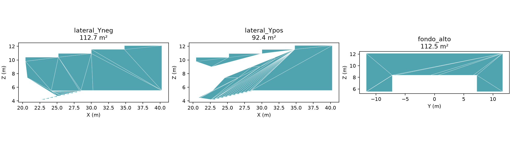
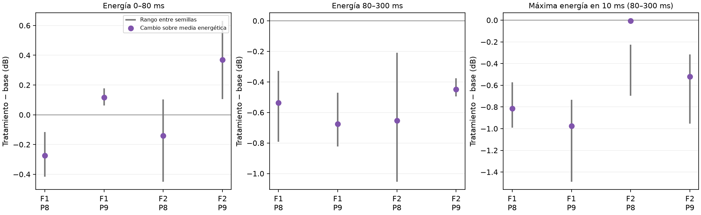
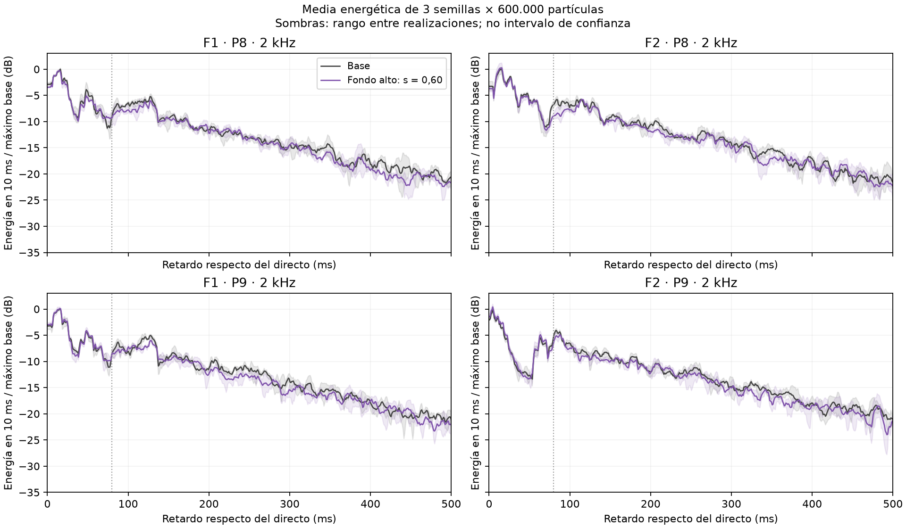

# Resultados iniciales de dispersión localizada en platea alta

> **Documento archivado el 9 de noviembre de 2026.** Se conserva como antecedente de una etapa o estrategia sustituida; no es el protocolo vigente. Ubicación original: `informes/RESULTADOS-INICIALES-DISPERSION-PLATEA-ALTA.md`. Consultar el [plan actual](../../informes/PLAN-DE-ESTUDIO-D50-C80-Y-TRATAMIENTOS-POR-ZONA.md).

**Teatro Aula Magna UTFSM — 21 de octubre de 2026.**  
**Estado:** investigación numérica inicial ejecutada con el motor SPPS instalado de I-Simpa. No es validación de un QRD físico ni especificación para construir.

## 1. Resultado principal

El **muro posterior alto merece prioridad para continuar el estudio**, porque la dispersión equivalente ensayada produce una reducción modesta y consistente entre semillas de la energía de 80–300 ms en P8/P9 a 2 kHz. El cambio medio sobre respuestas promediadas energéticamente es aproximadamente **−0,58 dB**, equivalente a cerca de 12,5 % menos energía como orden de magnitud. La mejora media de C80 es +0,62 dB.

Sin embargo, **no se demuestra eliminación de flutter**: la concentración relativa del máximo de energía en 10 ms dentro de la ventana tardía prácticamente no cambia al promediar los cuatro pares altos. En F2–P8 ese máximo sobre la respuesta media apenas disminuye. Dispersar más tampoco proporciona una mejora monotónica en la exploración.

Estos resultados justifican estudiar una intervención más localizada en el conjunto fondo alto–cielo posterior, pero no justifican todavía revestir toda la pared ni fabricar el QRD de 13 pozos. Los paños ensayados son grandes envolventes exploratorias, no superficies definitivas de instalación.

## 2. Trabajo ejecutado y configuración

Se ejecutaron **42 cálculos nuevos**:

| Etapa | Condiciones | Cálculos |
|---|---|---:|
| Exploración de ubicación | Base, lateral Y negativo, lateral Y positivo y fondo alto; F1/F2; 1, 2 y 4 kHz; 150.000 partículas; semilla 20261019 | 24 |
| Sensibilidad de dispersión | Fondo alto con s = 0,30 y 0,90; F1/F2; 2 kHz; 150.000 partículas | 4 |
| Repetición del candidato | Base y fondo alto con s = 0,60; F1/F2; 2 kHz; 600.000 partículas; semillas 20261019, 20261020 y 20261021 | 12 |
| Control separado de baja absorción | Fondo alto con α = 0,05 y s = 0,60; F1/F2; 2 kHz; 150.000 partículas; una semilla | 2 |

Parámetros comunes: método energético, duración 4 s, paso 1 ms, radio de receptor 0,31 m, extinción exponente 5, absorción atmosférica activada, transmisión desactivada y nueve receptores originales. Se conservó la temperatura de 18 °C y humedad de 57 % de la configuración existente. Cada proceso calculó una fuente y frecuencia por separado.

Se utilizó **Lw global de 90 dB por fuente**, desplazando +10 dB todas las bandas del espectro previo de 80 dB. No se asignaron 90 dB a cada banda.

**No se ejecutó en este estudio el protocolo final de 4,8 millones por semilla.** Los cálculos repetidos de 600.000 constituyen una comprobación intermedia; no se presentan como convergencia definitiva. Las exploraciones de 1 y 4 kHz, de los laterales y de s = 0,30/0,90 tienen una sola semilla.

La comparación sigue el [método documentado](METODO-DE-COMPARACION-DE-DIFUSION.md), priorizando dispersión y mínima absorción adicional. El [plan de trabajo y su estado](../prediccion/estudio-difusion/PLAN.md) distingue la investigación inicial realizada de las etapas posteriores.

## 3. Geometría y paños realmente ensayados

Se empleó la malla nativa de la base predictiva: **2.340 vértices y 4.692 caras**, que incluye detalles posteriores a la exportación geométrica inicial. No se sustituyó por una versión anterior de `geometria.json`.

Se reasignaron materiales sobre caras existentes, sin modificar vértices, conectividad, normales, asignación de receptores de superficie ni tetraedros. Las copias exportadas se releyeron para comprobar estas invariantes. Los nombres Y negativo/positivo evitan confundir izquierda y derecha según la posición del observador.

| Paño | Área | Delimitación |
|---|---:|---|
| Lateral Y negativo | 112,66 m² | Caras de muro en Y ≈ −11,665 m, con todos sus vértices en X ≥ 20,4 m y Z ≥ 4,2 m |
| Lateral Y positivo | 92,35 m² | Mismo criterio en Y ≈ +11,665 m |
| Fondo alto | 112,47 m² | Cierre posterior en X = 40,25 m, entre cotas aproximadas Z = 5,54 y 12,12 m |

Las áreas laterales son distintas porque se seleccionaron triángulos completos contenidos en la región superior. No se hizo una prueba de igual superficie y no se deduce una eficiencia intrínseca por metro cuadrado de este ranking. Las selecciones contienen huecos y límites de la triangulación; no son rectángulos completos.

## 4. Materiales: qué se cambió y qué no

En el ensayo principal se mantuvo exactamente la absorción de la base y se cambió la dispersión del paño de aproximadamente **s = 0,05 a s = 0,60**, con ley Lambert. s = 0,60 es una hipótesis de sensibilidad, no una propiedad calculada ni medida del QRD propuesto.

La base tiene absorción efectiva de muros de α = 0,24795 a 1 kHz, 0,17 a 2 kHz y 0,11 a 4 kHz. Estos valores proceden de calibración equivalente; no identifican el material rígido real.

Por tanto, conservar α es útil para aislar el efecto de la dispersión, pero **no equivale a predecir un QRD poco absorbente colocado sobre el muro real**. Incluso sin cambiar α en el paño, la energía total recibida puede variar: la dispersión cambia recorridos y exposición a las otras superficies y al aire.

## 5. Exploración de ubicaciones

Cambios medios descriptivos en los cuatro pares F1/F2–P8/P9, con 150.000 partículas y una semilla. Valores negativos de ΔE significan menos energía en esa ventana. Estos promedios de cambios en dB son resúmenes espaciales; no representan una respuesta acústica obtenida mezclando fuentes y receptores.

| Paño | Frecuencia | ΔE 80–300 ms | ΔC80 |
|---|---:|---:|---:|
| Lateral Y negativo | 1 kHz | −0,06 dB | +0,27 dB |
| Lateral Y negativo | 2 kHz | +0,12 dB | −0,02 dB |
| Lateral Y negativo | 4 kHz | −0,19 dB | +0,29 dB |
| Lateral Y positivo | 1 kHz | −0,22 dB | +0,19 dB |
| Lateral Y positivo | 2 kHz | −0,65 dB | +0,47 dB |
| Lateral Y positivo | 4 kHz | −0,23 dB | +0,18 dB |
| Fondo alto | 1 kHz | −0,40 dB | +0,28 dB |
| Fondo alto | 2 kHz | −0,77 dB | +0,70 dB |
| Fondo alto | 4 kHz | −0,29 dB | +0,16 dB |

Los cambios son modestos y algunos se confunden con fluctuaciones de muestreo. Se seleccionó el fondo para repetir por la reducción descriptiva en las tres frecuencias, junto con la plausibilidad geométrica del recorrido cielo–fondo. Esta selección no demuestra que el fondo sea la única ni la principal causa real de la molestia.

Los [ecogramas exploratorios F1](../../prediccion/estudio-difusion/resultados/ecogramas-exploracion-F1.png) y [F2](../../prediccion/estudio-difusion/resultados/ecogramas-exploracion-F2.png) muestran energía suavizada en 5 ms, normalizada respecto de la base de cada combinación. No se normaliza cada variante a su propio máximo.

## 6. Repetición del fondo a 2 kHz

Para cada fuente y receptor se promediaron las energías lineales de las tres semillas y se recalcularon los indicadores sobre esa respuesta media. Los rangos siguientes son cambios entre realizaciones con el mismo identificador de semilla; no son intervalos de confianza ni garantizan trayectorias aleatorias idénticas entre condiciones.

| Par | ΔE 80–300 ms sobre media energética | Rango entre semillas | ΔC80 sobre media energética | Δmáximo de energía en 10 ms dentro de 80–300 ms |
|---|---:|---:|---:|---:|
| F1–P8 | −0,54 dB | −0,79 a −0,33 dB | +0,32 dB | −0,81 dB |
| F1–P9 | −0,68 dB | −0,82 a −0,47 dB | +0,78 dB | −0,97 dB |
| F2–P8 | −0,65 dB | −1,05 a −0,21 dB | +0,49 dB | −0,01 dB |
| F2–P9 | −0,45 dB | −0,50 a −0,38 dB | +0,88 dB | −0,52 dB |

La reducción de energía de 80–300 ms mantiene el signo en las doce comparaciones individuales de semilla, fuente y receptor alto. Es un indicio numérico consistente para esa ventana, configuración y frecuencia.

El máximo de una respuesta promediada no equivale al promedio de máximos de cada semilla; sus tiempos pueden cambiar. En particular, F2–P8 muestra que una menor energía integrada no asegura debilitar el pico dominante de la respuesta media.

### 6.1 Efectos en otras zonas

Promedios descriptivos de cambios calculados sobre las respuestas medias individuales, sin mezclar señales de distintas fuentes o posiciones:

| Zona | ΔE 0–80 ms | ΔE 80–300 ms | ΔE 300–1.000 ms | ΔC80 | ΔT30 |
|---|---:|---:|---:|---:|---:|
| Platea alta | +0,02 dB | −0,58 dB | −0,69 dB | +0,62 dB | −0,042 s |
| Piso abierto | −0,05 dB | +0,01 dB | −0,16 dB | −0,03 dB | −0,016 s |
| Bajo balcón | +0,23 dB | ≈ 0,00 dB | −0,20 dB | +0,27 dB | −0,086 s |

Los promedios del piso abierto cambian poco, pero no se afirma que las zonas inferiores estén desacopladas. Bajo balcón aparecen cambios de decaimiento que requieren comprobarse con mayor resolución estadística antes de considerarlos despreciables.

### 6.2 Incertidumbre temporal y numérica

El paso de 1 ms no implica exactitud física de 1 ms. El receptor tiene radio finito y el cálculo usa muestreo de partículas. Como referencia temporal de comparación se emplea distancia/342 m/s; los resultados se integran con ponderación fraccional de los intervalos que cruzan los límites de ventana.

La energía temprana incluye toda la llegada directa captada antes del corte de 80 ms, sin cortar su frente por el centro geométrico del receptor. Por ello estos C80 sirven para la comparación interna del ensayo; no deben sustituir sin aclaración los valores históricos calculados con otro tratamiento del origen temporal.

Una intervención posterior no debería modificar físicamente el directo. Los cambios de la ventana inicial, que llegan a algunas décimas de dB, ilustran variación de muestreo al divergir las secuencias aleatorias tras modificar reflexiones. Se evita atribuirlos automáticamente a una mejora o pérdida física del directo. La estabilidad del signo de una diferencia no elimina esa incertidumbre ni reemplaza la comprobación con 4,8 millones por semilla.

## 7. ¿Más dispersión es mejor?

La exploración del fondo a 2 kHz, una semilla y 150.000 partículas, arroja:

| s supuesto | ΔE 80–300 ms, media descriptiva alta | ΔC80 |
|---:|---:|---:|
| 0,30 | +0,06 dB | −0,45 dB |
| 0,60 | −0,77 dB | +0,70 dB |
| 0,90 | −0,75 dB | +0,08 dB |

No se obtiene una relación monotónica y no se declara que s = 0,60 sea un óptimo físico. La comparación usa una sola realización y algunos cambios tempranos evidencian ruido de muestreo. La tabla sí desaconseja asumir que un coeficiente mayor garantiza una mejor claridad o menor flutter.

## 8. Control de baja absorción

Se ensayó por separado α = 0,05 en el fondo a 2 kHz, frente a α = 0,17 de la base, manteniendo s = 0,60. Es una hipótesis ilustrativa, no el ensayo de un QRD real. Con una semilla y 150.000 partículas, el promedio descriptivo alto cambia aproximadamente:

- E 80–300 ms: −0,30 dB.
- C80: +0,07 dB, con cambios individuales positivos y negativos.

Por tanto, el resultado favorable al conservar la absorción efectiva **no puede transferirse directamente a un tratamiento de baja absorción**. Este control no fija cuánto absorbería el QRD ni demuestra que deba aumentarse la absorción; identifica una incertidumbre que debe resolverse al caracterizar el conjunto real.

## 9. Relación con reflexiones concretas

Se recalcularon fuentes imagen hasta tercer orden sobre planos de la malla SPPS vigente, verificando pertenencia de los rebotes a triángulos y ausencia de obstáculos. Se obtuvieron 34 recorridos visibles dentro de las familias exploradas. No es un inventario completo de todas las trayectorias de la sala ni una predicción de sus amplitudes.

Un recorrido de segundo orden por el último cielo horizontal y el fondo alto aparece en los cuatro pares:

| Par | Retardo respecto del directo | Rebote posterior aproximado (Y; Z) |
|---|---:|---|
| F1–P8 | 82,7 ms | −5,85; 11,22 m |
| F1–P9 | 83,2 ms | +5,76; 11,24 m |
| F2–P8 | 79,5 ms | −4,52; 11,25 m |
| F2–P9 | 85,1 ms | +7,08; 11,26 m |

Los rebotes previos en cielo se sitúan aproximadamente en X = 37,5–37,7 m y Z = 12,12 m. Estas posiciones sugieren estudiar sectores altos del fondo, no toda su altura. Un recorrido queda cerca del corte convencional de 80 ms, lo que refuerza la necesidad de examinar ecogramas además de C80.

También existen recorridos laterales largos que no tocan ninguno de los paños superiores ensayados. La intervención limitada a esos paños no puede garantizar su interrupción.

**No se atribuye un pico concreto a una pared como hecho demostrado.** Los ecogramas son sumas de contribuciones, no se guardaron historiales completos de trayectorias y las fuentes imagen no estiman amplitudes. La respuesta al cambiar un paño prueba sensibilidad del modelo a esa superficie, pero no entrega un porcentaje de responsabilidad de una reflexión única.

## 10. Recomendación y siguiente etapa

1. Continuar con el fondo alto y el cielo posterior como candidatos de localización. Delimitar paños menores en torno a los recorridos relevantes y comprobar más asientos altos; las superficies iniciales de unos 100 m² no son una prescripción.
2. Comprobar las alternativas relevantes con 4,8 millones de partículas y tres semillas, y ampliar la repetición a 1 y 4 kHz. Revisar especialmente estabilidad de picos y energía inicial.
3. Caracterizar absorción, dispersión y respuesta angular del QRD concreto. El diseño preliminar de 13 pozos sigue siendo candidato, no producto seleccionado. Una ley Lambert no reproduce la orientación unidimensional de sus ranuras.
4. Comparar si la orientación horizontal propuesta alcanza los recorridos cielo–fondo. Si el control necesario es en el plano vertical, estudiar otra orientación o un panel convexo/facetado con dirección calculada; no trasladar automáticamente la disposición lateral al fondo.
5. Mantener absorción adicional mínima como objetivo. Incorporarla de forma puntual únicamente si una dispersión caracterizada no controla suficientemente la repetición; distinguir esa alternativa de los ajustes efectivos del modelo base.

La decisión defendible hoy es **priorizar investigación localizada en el fondo alto, sin declarar resuelto el flutter ni seleccionar todavía un QRD para construir**.

## 11. Archivos y verificación

- [Plan](../prediccion/estudio-difusion/PLAN.md), [paños con índices y áreas](../../prediccion/estudio-difusion/panos.json) y [resumen exploratorio](../../prediccion/estudio-difusion/resultados/resumen.json).
- [Indicadores de todas las realizaciones](../../prediccion/estudio-difusion/resultados/indicadores.csv) y [diferencias pareadas](../../prediccion/estudio-difusion/resultados/diferencias.csv).
- [Resultados sobre medias de tres semillas a 2 kHz](../../prediccion/estudio-difusion/resultados/confirmacion-2kHz.json) y [respuestas medias comprimidas](../../prediccion/estudio-difusion/resultados/respuestas-medias-2kHz.npz).
- [Recorridos de la malla vigente](../../prediccion/estudio-difusion/resultados/recorridos-candidatos-malla-vigente.csv) y [control separado de absorción](../../prediccion/estudio-difusion/resultados/sensibilidad-absorcion.json).
- [Proyecto de fondo alto](../../prediccion/estudio-difusion/proyectos/fondo_alto_dispersion-equivalente-s060.proj), [lateral Y negativo](../../prediccion/estudio-difusion/proyectos/lateral_Yneg_dispersion-equivalente-s060.proj) y [lateral Y positivo](../../prediccion/estudio-difusion/proyectos/lateral_Ypos_dispersion-equivalente-s060.proj).

Los proyectos ligeros no incluyen los resultados nuevos en su árbol de interfaz. Conservan la configuración de cálculo de la base para continuar: F1, 1 kHz y 4,8 millones. Para reproducir una corrida de este estudio deben seleccionarse la fuente, banda, semilla y número de partículas correspondientes. El material equivalente solo modifica s a 1, 2 y 4 kHz. Los archivos se verificaron por integridad, XML, referencias de caras sin duplicados y geometría idéntica; **su apertura en la interfaz aún no ha sido comprobada**.

Las configuraciones y resultados por corrida están en `prediccion/estudio-difusion/calculos/`; las salidas nativas se guardaron sin pérdida en `salidas-nativas.zip` dentro de cada carpeta, conservando además config, log, metadatos y energías lineales. Los dos controles de absorción están en una carpeta separada. Se verificaron hashes antes de compactar.

Control adicional de referencia: la corrida de 600.000 a 2 kHz y 90 dB reproduce, dentro de la precisión de almacenamiento, diez veces la energía de la corrida histórica equivalente a 80 dB. La base principal y los datos medidos no se modificaron.
