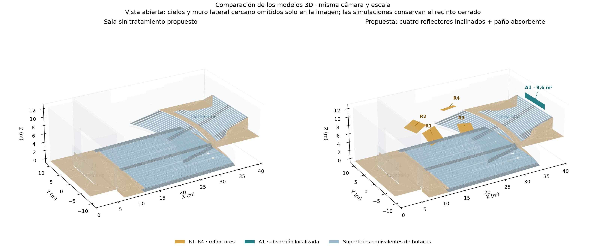
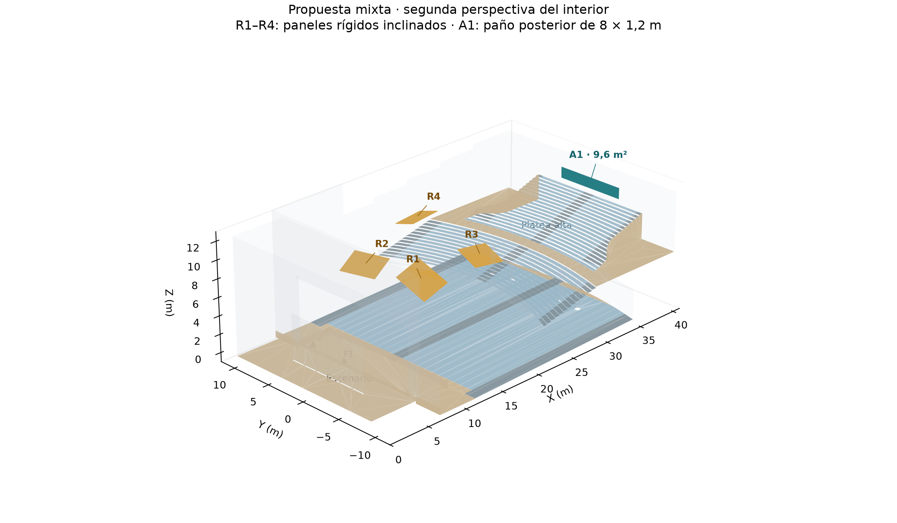
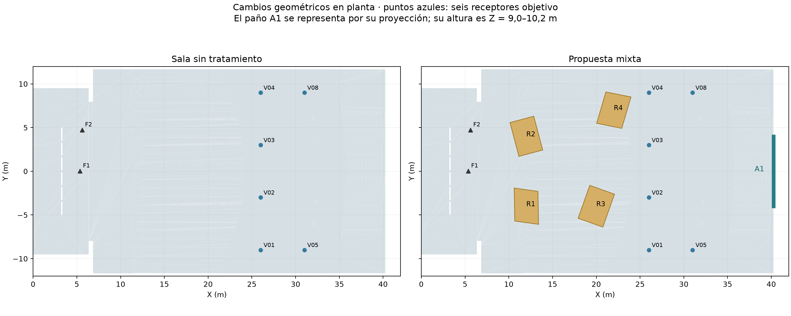
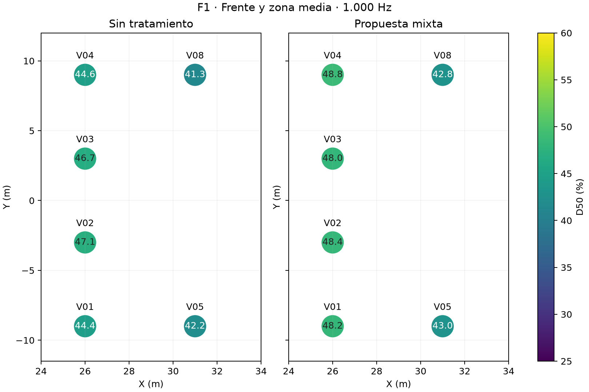
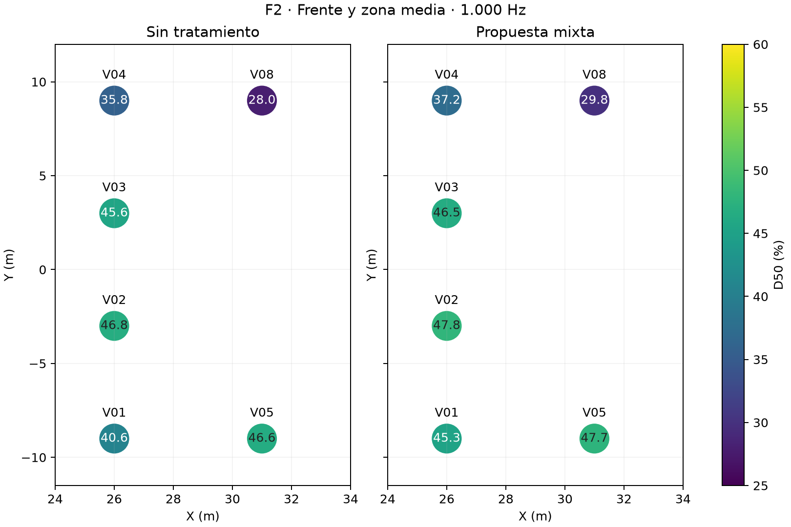
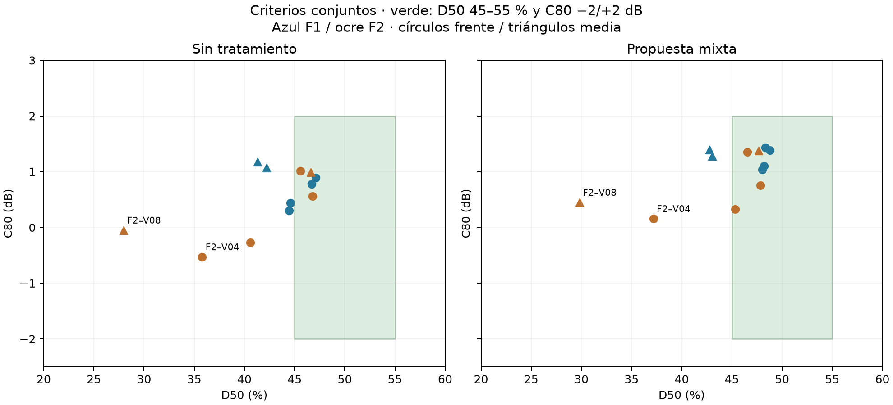
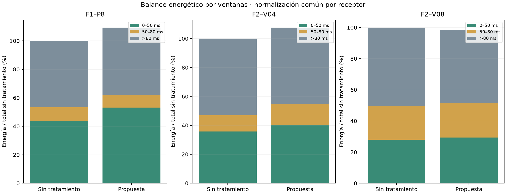
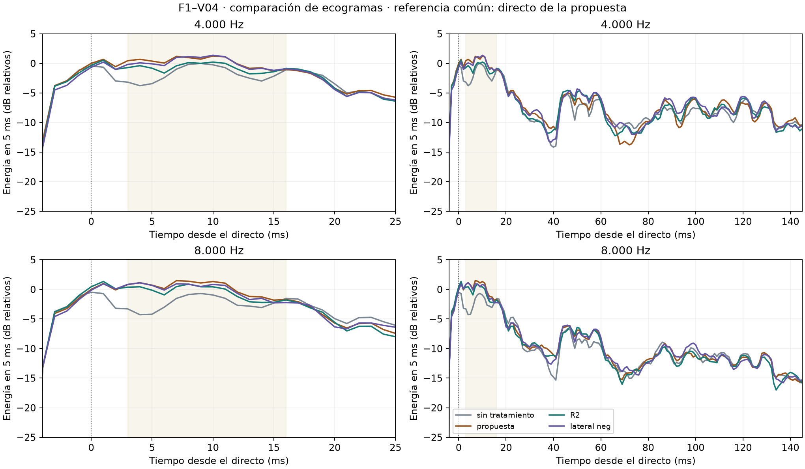
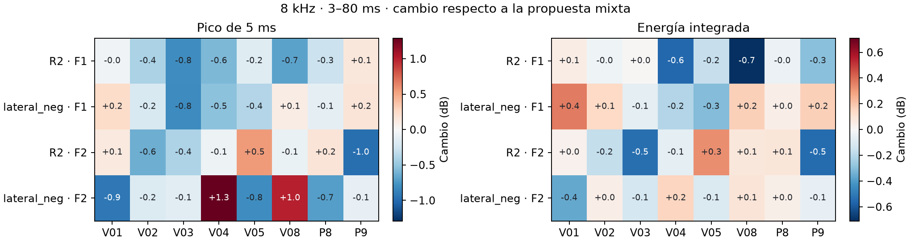

# Informe comparativo: sala sin tratamiento y propuesta mixta de acondicionamiento

**Teatro Aula Magna de la Universidad Técnica Federico Santa María**  
**Fecha:** 10 de noviembre de 2026.  
**Comparación:** modelo predictivo del estado actual frente a cuatro reflectores personalizados con inclinación combinada y absorción posterior localizada.  
**Alcance:** comparación principal a 1.000 Hz y ensayo complementario de dispersión a 4 y 8 kHz, con control a 1 kHz.

La [comparación por bandas de octava de 63 a 8.000 Hz](RESULTADOS-COMPARACION-POR-OCTAVAS.md) documenta las hipótesis espectrales y los resultados por frecuencia. La evaluación de la dispersión parte de la propuesta mixta de esa comparación.

## Resumen

La propuesta mejora la definición prevista en varias posiciones de la platea alta, especialmente en el frente y en los puntos P8/P9. Las combinaciones virtuales dentro de D50 = 45–55 % y C80 = −2 a +2 dB pasan de **5/12 a 8/12**. El D50 medio del frente pasa de **43,95 a 46,28 %**; en la franja media pasa de 39,52 a 40,82 %. El efecto es favorable y parcial; no homogeneiza toda la platea alta.

El T30 medio de las doce combinaciones objetivo pasa de **1,772 a 1,723 s**. La variación es pequeña en esta banda. Se conserva como intención el carácter reverberante musical del recinto, sin afirmar que una única banda demuestre el balance perceptual del espectro completo.

A 8 kHz, el C80 medio del frente y la franja media pasa de **+5,35 a +5,72 dB**. En F1–V04, aumentar la dispersión del reflector R2 reduce el pico temprano **1,04 dB a 4 kHz** y **0,58 dB a 8 kHz**. La reducción es consistente en ese punto y desigual entre butacas y fuentes. R2 queda como candidato para estudiar el reparto de esa reflexión.

## 1. Motivación: por qué se realizó esta propuesta

La investigación comenzó con mediciones de respuestas impulsivas mediante explosión de globo y barridos sinusoidales con un parlante de rango completo. Durante las pruebas se percibió persistencia de agudos y lejanía del escenario en la platea alta. El análisis posterior distinguió la platea general, la zona bajo balcón y la platea alta, donde se ubican P8/P9.

El proyecto no buscaba reducir globalmente la reverberación de una sala destinada principalmente a música orquestal. Se buscaba investigar si era posible mejorar localmente el reparto entre energía temprana y tardía, manteniendo un balance musical. La observación de persistencia de agudos motivó el estudio, pero esta comparación a 1.000 Hz no demuestra la eliminación de ecos flotantes ni resuelve por sí sola lo observado en bandas altas.

Las primeras pruebas de difusión y absorción posterior aislada mostraron beneficios limitados o compromisos entre D50 y C80. Posteriormente se incorporaron superficies reflectoras reales al modelo para modificar las trayectorias, y se ajustó su inclinación. La absorción localizada se añadió como complemento para estudiar retornos posteriores específicos, conservando las mejoras de los reflectores. La propuesta aquí evaluada procede de ese proceso de selección; no se presenta como un óptimo universal.

## 2. Objetivo y pregunta del estudio

**Objetivo general:** obtener una demostración predictiva de que una intervención localizada puede mejorar la definición en varias posiciones de la platea alta, con resultados suficientemente repartidos y consistentes, preservando el balance musical del modelo.

Los objetivos específicos son: aumentar la proporción de energía útil en posiciones deficitarias; observar conjuntamente D50 y C80; conservar los avances en P8/P9; examinar EDT/T30 y el nivel relativo; y comprobar los efectos en platea baja y bajo balcón. No se exige que todas las posiciones alcancen idénticos parámetros ni se elimina un punto desfavorable para mejorar el resultado.

La pregunta comparativa es: **¿qué cambia al pasar de la geometría y materiales del estado actual a la misma sala con cuatro reflectores inclinados y un paño absorbente localizado?** Los dos estados de este informe son predicciones. Las mediciones de campo sustentaron la construcción y aproximación de la base, pero no se confunden con una medición real posterior al tratamiento.

## 3. Estados comparados y modificaciones del modelo 3D

### 3.1. Estado de referencia: sala sin el tratamiento propuesto

Se utiliza la base predictiva del estado actual: geometría del recinto, escenario, plateas, balcón, cielos, pilares, superficies equivalentes de butacas, madera, alfombra y cortinas existentes. «Sin tratamiento» significa sin los cuatro reflectores y sin el nuevo paño absorbente; no significa que la sala carezca de absorción o de sus materiales originales.

La envolvente nativa original tiene 2.340 vértices, 4.692 caras y aproximadamente 9.543,734 m³ de volumen. Sus coeficientes son efectivos y provisionales: la aproximación a mediciones no identifica de forma única los materiales reales ni garantiza una coincidencia exacta de claridad por posición.

### 3.2. Propuesta comparada

Se selecciona como propuesta principal la alternativa de menor intervención que conservó los tres pares prioritarios de P8/P9 dentro de ambos rangos en las tres semillas del estudio mixto: **cuatro reflectores de inclinación combinada y un paño central posterior de 9,6 m² a menor altura**. Esta elección prioriza conservar ese balance; no corresponde a la alternativa con el mayor aumento medio de D50 ni se declara óptima.

| Elemento | Geometría y posición | Propiedades a 1.000 Hz |
|---|---|---|
| R1–R4: reflectores | Cuatro paneles de 4 × 3 m, 20 mm; área frontal total 48 m² | α = 0,05; dispersión = 0,05; caras y cantos opacos |
| A1: absorción localizada | Paño de 8 × 1,2 m = 9,6 m²; X = 40,25 m; Y = −4/+4 m; Z = 9,0/10,2 m | α final = 0,60; dispersión y ley del muro conservadas |

El reflector representa una superficie rígida sellada, idealizada mediante su geometría y coeficientes. El coeficiente del paño sustituye al del muro en esa zona; no se suma a él. Ambos son supuestos de modelado de una banda, no la caracterización de un producto comercial o de una solución constructiva completa.

| Panel | Centro X / Y / Z (m) | Dimensiones | Inclinación del plano respecto de la horizontal |
|---|---|---|---|
| R1 | 12,00 / -4,00 / 9,20 | 4 × 3 m | 31,6° |
| R2 | 12,00 / 4,00 / 8,20 | 4 × 3 m | 20,6° |
| R3 | 20,00 / -4,00 / 9,20 | 4 × 3 m | 4,3° |
| R4 | 22,00 / 7,00 / 9,20 | 4 × 3 m | 24,9° |

Las coordenadas usan el sistema global del modelo. La inclinación tabulada es absoluta respecto de la horizontal; los vectores normales y los ejes completos se conservan en los datos de paneles. No se sustituye la nueva geometría por un aumento de difusión.

### 3.3. Comparación visual de las modificaciones

Las figuras siguientes se generaron desde las mallas usadas en los cálculos. Las vistas 3D mantienen cámara y escala entre estados. Para permitir ver el interior se omiten cielos y el muro lateral cercano únicamente en la representación gráfica: los modelos de cálculo permanecen cerrados.

**Figura 1.** Sala base a la izquierda y propuesta a la derecha. R1–R4 identifican los reflectores; A1 identifica el paño absorbente. Los bloques de butacas son superficies equivalentes, no asientos individuales.

**Figura 2.** Perspectiva adicional para observar inclinaciones y ubicación posterior del paño.

**Figura 3.** Cambios en planta y seis posiciones virtuales objetivo. El paño A1 se muestra mediante su proyección; su cota vertical es Z = 9,0–10,2 m.

## 4. Metodología de comparación

### 4.1. Método y condiciones comunes

Se emplea el motor SPPS de I-Simpa en modalidad energética. El cálculo representa transporte y pérdidas de energía mediante partículas en la geometría tridimensional. No es una simulación ondulatoria completa ni reproduce explícitamente vibraciones de tableros, difracción detallada de bordes o interferencias de fase.

| Parámetro | Valor |
|---|---|
| Banda activa | 1.000 Hz |
| Fuentes | F1 y F2 omnidireccionales, calculadas por separado |
| Potencia sonora | Lw global = 90 dB re 1 pW, con el espectro de la base |
| Partículas | 600.000 por corrida |
| Semillas | 20261019, 20261020 y 20261021 |
| Duración / paso | 4 s / 1 ms |
| Radio receptor | 0,31 m |
| Ambiente | 18 °C; humedad relativa 57 %; velocidad 342 m/s |
| Propagación | Absorción del aire activada; transmisión de superficies desactivada |

Lw global de 90 dB no significa 90 dB por banda ni un nivel de 90 dB SPL en las butacas. Las posiciones de fuente y receptor se conservan entre estados. Las fuentes representan las condiciones omnidireccionales de la base; no representan la directividad del parlante de medición ni del line array del teatro.

### 4.2. Receptores y criterios de evaluación

Se conservan 21 receptores: P1–P9 y doce virtuales. La evaluación espacial principal usa V01–V04 en el frente y V05/V08 en la franja media de la platea alta: seis posiciones con dos fuentes, doce combinaciones. V06/V07 y V09/V12 corresponden a controles sobre madera; V10/V11 son posteriores sobre butacas. Estos controles no se confunden con posiciones objetivo.

Los pares prioritarios son F1–P8, F1–P9 y F2–P8. F2–P9 se mantiene como control secundario. En platea baja abierta se observan P1/P2/P4/P7; bajo balcón, P3/P5/P6. Las alturas del modelo siguen las hipótesis previas: fuentes aproximadamente un metro sobre el escenario y receptores aproximadamente dos metros sobre el piso local.

Se usa D50 de 45–55 % y C80 de −2 a +2 dB como **rango exploratorio de este proyecto para la platea alta**, manteniendo 50 % como referencia. No es un óptimo universal de música orquestal ni un criterio que se imponga a todos los controles de la sala. Se examinan también mejoras que no alcanzan la banda y posibles pérdidas en puntos ya favorables.

### 4.3. Procesamiento de respuestas y ventanas temporales

Para la comparación principal a 1 kHz se reutilizan doce corridas: dos estados × dos fuentes × tres semillas. Se verifican las configuraciones y los archivos de entrada. Para cada posición/fuente se promedian las energías lineales de las tres semillas antes de calcular los indicadores.

El origen temporal se refiere al arribo directo geométrico, distancia/342. La integración incluye el frente directo captado por la esfera receptora antes de su centro geométrico. Las energías nativas ya son lineales y no se vuelven a elevar al cuadrado. La ventana total es la duración calculada de 4 s.

| Indicador | Definición e interpretación |
|---|---|
| D50 | 100 × E0–50 / Etotal. Incluye sonido directo y reflexiones tempranas; no es el porcentaje de sonido directo. |
| C80 | 10 log10(E0–80 / E>80), en dB. Se observa conjuntamente con D50 para el balance musical. |
| E0–50 / E50–80 / E>80 | Separan los mecanismos que pueden producir cambios diferentes en D50 y C80. |
| EDT / T30 | Estimaciones extrapoladas a 60 dB desde ajustes de decaimiento: 0/−10 dB y −5/−35 dB, respectivamente. |
| Nivel relativo | 10 log10(Etotal propuesta / Etotal base). No es un cambio de Lw ni una medición de SPL in situ. |

Los promedios de zona son medias de indicadores por posición/fuente, sin fusionar fuentes o asientos en una sola respuesta. Los cambios de D50 se expresan en puntos porcentuales. Los mínimos/máximos entre semillas describen variación numérica; no son intervalos de confianza.

### 4.4. Control de geometría e incertidumbre

La sala exterior y sus propiedades no tratadas se mantienen. El paño requiere subdividir coplanarmente caras del muro; los reflectores agregan sólidos y obligan a remallar. Por ello, las triangulaciones y los tetraedros de los dos estados no son idénticos. Se verificó la conservación de la envolvente y del área de las caras originales y se documentaron las mallas efectivamente usadas.

El estudio mixto recalculó además una referencia de cuatro reflectores con subdivisión común. Frente a la referencia inclinada anterior, los cambios de D50 en las posiciones objetivo quedaron entre −0,34 y +0,79 puntos. Es un diagnóstico de esa comparación, no una cota universal de error de este informe. Las diferencias pequeñas deben leerse con la variación entre semillas y las hipótesis de materiales y posiciones.

### 4.5. Ensayo de dispersión en agudos

Se toma la propuesta mixta como referencia y se modifica **una superficie por corrida**. Se asigna un coeficiente de dispersión de 0,60 con ley Lambert en la banda activa, conservando la absorción, la geometría, la malla tetraédrica, las fuentes y los 21 receptores. El valor de 0,60 se usa para estudiar la sensibilidad del modelo. R2 mantiene la dispersión original de 0,05 a 1 kHz.

| Etapa | Condiciones | Corridas nuevas |
|---|---|---:|
| Barrido inicial a 8 kHz | F1, 120.000 partículas, una semilla. Referencia, R1–R4, fondo alto sin A1 y ambos laterales altos | 8 |
| Verificación a 4 y 8 kHz | R2 y lateral alto del lado Y negativo, seleccionados por su efecto inicial en F1–V04. F1 y F2 a 8 kHz, F1 a 4 kHz. 600.000 partículas y tres semillas por combinación | 18 |
| Control a 1 kHz | R2 con F1, 600.000 partículas y semilla 20261019 | 1 |

El ecograma se alinea con la llegada directa geométrica. En F1–V04 se mide el pico de energía acumulada en 5 ms dentro de **3–16 ms** y su proporción respecto de toda esa ventana. En la comparación espacial se usa el máximo de 5 ms y la energía integrada entre **3 y 80 ms**. Así se puede identificar una caída del pico, una menor concentración temporal o un aumento en otras butacas. La repetibilidad se evalúa comparando cada variante con la propuesta mixta bajo las mismas semillas. Se conservan D50, C80, EDT y la energía tardía como controles.

Los retardos especulares geométricos candidatos en F1–V04 son 3,6 ms para R4 y 5,8 ms para R2. Ambos caen en la ventana de interés junto con otras llegadas. El ensayo comprueba la sensibilidad a cada superficie. La asignación de un pico individual a una trayectoria sigue siendo una hipótesis.

## 5. Resultados comparativos

### 5.1. Cobertura de los criterios en platea alta

| Zona / grupo | Combinaciones | Cumplen sin tratamiento | Cumplen con propuesta | Cumplen en tres semillas: base / propuesta |
|---|---|---|---|---|
| Frente virtual | 8 | 4/8 | 7/8 | 2 / 5 |
| Zona media virtual | 4 | 1/4 | 1/4 | 0 / 1 |
| Objetivo virtual conjunto | 12 | 5/12 | 8/12 | 2 / 6 |
| Pares prioritarios de P8/P9 | 3 | 1/3 | 3/3 | 1 / 3 |

El incremento de cobertura se concentra en el frente. La franja media mantiene un solo cumplimiento medio entre cuatro combinaciones, por lo que no se declara resuelta. La mejora de repetibilidad dentro de las tres semillas es favorable, pero no constituye validación estadística o perceptual.

### 5.2. Parámetros medios de las zonas objetivo

| Zona | D50 base / propuesta | C80 base / propuesta | EDT base / propuesta | T30 base / propuesta |
|---|---|---|---|---|
| Frente | 43,95 / 46,28 % | 0,40 / 0,94 dB | 1,663 / 1,626 s | 1,773 / 1,718 s |
| Media | 39,52 / 40,82 % | 0,80 / 1,13 dB | 1,687 / 1,601 s | 1,770 / 1,733 s |
| Conjunto objetivo | 42,47 / 44,46 % | 0,53 / 1,00 dB | 1,671 / 1,618 s | 1,772 / 1,723 s |
| P8/P9 prioritarios | 45,70 / 50,34 % | 0,76 / 1,41 dB | 1,648 / 1,572 s | 1,755 / 1,693 s |

### 5.3. Puntos prioritarios y caso secundario

Cada celda de estado muestra D50 (%) / C80 (dB).

| Par | Sin tratamiento | Propuesta | ΔD50 puntos | ΔC80 dB |
|---|---|---|---|---|
| F1–P8 | 43,77 / 0,58 | 48,59 / 1,19 | 4,81 | 0,61 |
| F1–P9 | 44,43 / 0,50 | 49,99 / 1,42 | 5,55 | 0,92 |
| F2–P8 | 48,90 / 1,19 | 52,45 / 1,63 | 3,54 | 0,44 |
| F2–P9 | 37,17 / -0,35 | 39,34 / 0,16 | 2,17 | 0,51 |

Los tres pares prioritarios quedan dentro de ambos rangos en las respuestas medias y en cada una de las tres semillas de la propuesta. Este resultado sustenta una mejora local. F2–P9 permanece fuera del rango de D50 y se conserva visible como control secundario.

### 5.4. Distribución por los seis puntos virtuales

| Combinación | Sin tratamiento: D50 / C80 | Propuesta: D50 / C80 | ΔD50 puntos |
|---|---|---|---|
| F1–V01 | 44,43 / 0,30 | 48,21 / 1,11 | 3,78 |
| F1–V02 | 47,10 / 0,90 | 48,35 / 1,43 | 1,26 |
| F1–V03 | 46,71 / 0,78 | 48,04 / 1,04 | 1,33 |
| F1–V04 | 44,59 / 0,44 | 48,78 / 1,38 | 4,20 |
| F1–V05 | 42,22 / 1,07 | 43,02 / 1,28 | 0,81 |
| F1–V08 | 41,31 / 1,17 | 42,78 / 1,40 | 1,47 |
| F2–V01 | 40,61 / -0,27 | 45,30 / 0,32 | 4,70 |
| F2–V02 | 46,77 / 0,56 | 47,84 / 0,75 | 1,07 |
| F2–V03 | 45,58 / 1,01 | 46,54 / 1,35 | 0,96 |
| F2–V04 | 35,79 / -0,53 | 37,18 / 0,16 | 1,39 |
| F2–V05 | 46,59 / 0,99 | 47,65 / 1,38 | 1,06 |
| F2–V08 | 27,98 / -0,05 | 29,81 / 0,45 | 1,84 |

**Figuras 4 y 5.** Mismo rango de color en ambos estados. Un promedio favorable no sustituye la lectura por posición.

**Figura 6.** La región verde representa el rango exploratorio conjunto. Los símbolos distinguen fuentes y franjas; no son un mapa continuo de cobertura.

### 5.5. Distribución temporal de la energía

| Par | ΔE0–50 dB | ΔE50–80 dB | ΔE>80 dB | ΔE total dB |
|---|---|---|---|---|
| F1–P8 | 0,84 | -0,26 | 0,05 | 0,39 |
| F1–P9 | 1,30 | 0,62 | 0,28 | 0,79 |
| F2–P8 | 0,59 | -0,36 | 0,04 | 0,29 |
| F2–V04 | 0,49 | 1,22 | -0,02 | 0,32 |
| F2–V08 | 0,21 | 0,14 | -0,32 | -0,07 |

**Figura 7.** Las energías se normalizan por el mismo total del estado sin tratamiento para cada receptor. La altura total puede variar; no se renormaliza cada barra a 100 %. Así se distingue una redistribución proporcional de un cambio absoluto.

La combinación puede aportar o retirar energía de distintas ventanas porque los reflectores modifican trayectorias y los paños aumentan pérdidas. El contraste no atribuye todo el cambio a la absorción: incluye ambos componentes. Para aislar el aporte incremental del absorbente debe consultarse el [estudio mixto con referencia de cuatro reflectores](RESULTADOS-ESTUDIO-MIXTO-REFLECTORES-ABSORCION.md).

### 5.6. Efectos sobre otras zonas

| Zona de control | D50 base / propuesta | C80 base / propuesta | T30 base / propuesta | Δenergía total dB |
|---|---|---|---|---|
| Platea baja abierta | 44,73 / 45,65 % | 0,91 / 0,98 dB | 1,754 / 1,700 s | -0,07 |
| Bajo balcón | 57,47 / 56,80 % | 3,47 / 3,25 dB | 1,744 / 1,733 s | 0,04 |
| Posteriores sobre butacas | 43,24 / 43,94 % | 1,00 / 1,24 dB | 1,755 / 1,679 s | 0,12 |

No aparecen cambios grandes en los promedios de las zonas inferiores en esta banda. Eso no garantiza ausencia de efectos locales ni demuestra conservación de todo el espectro. El C80 bajo balcón ya es elevado en la referencia y continúa elevado; esta propuesta no resuelve el diseño de cobertura electroacústica de esa zona.

### 5.7. Reflexiones en la platea alta a 4 y 8 kHz

En **F1–V04**, el C80 a 8 kHz pasa de **+5,29 a +6,77 dB** de la sala base a la propuesta mixta. En ese mismo contraste, la energía de 3–16 ms aumenta 2,95 dB, su pico de 5 ms aumenta 2,16 dB y la energía posterior a 80 ms cambia −0,02 dB. El aumento de C80 en ese receptor se debe principalmente al aporte temprano.

| Banda | Variante | Cambio del pico de 3–16 ms frente a la propuesta (dB) | Concentración en los 5 ms más intensos, propuesta → variante |
|---|---|---:|---:|
| 4 kHz | R2 | −1,04 | 49,6 → 49,8 % |
| 4 kHz | Lateral alto Y negativo | +0,11 | 49,6 → 52,3 % |
| 8 kHz | R2 | −0,58 | 49,8 → 52,6 % |
| 8 kHz | Lateral alto Y negativo | −0,53 | 49,8 → 48,3 % |

R2 reduce el pico de F1–V04 en las tres semillas de ambas bandas. La energía integrada de 3–16 ms baja 1,06 dB a 4 kHz y 0,82 dB a 8 kHz, mientras la concentración permanece similar o aumenta. El lateral reduce el pico de 8 kHz en las tres semillas, aunque el signo del cambio en concentración varía. El C80 a 8 kHz queda en +6,62 dB con R2 y +6,52 dB con el lateral.

**Figura 8.** Energía en ventanas de 5 ms referida al directo de la propuesta mixta. El sombreado marca el intervalo de 3–16 ms.

| Banda y fuente | R2: cambio medio del pico / reducción en las tres semillas | Lateral alto Y negativo: cambio medio del pico / reducción en las tres semillas |
|---|---|---|
| 4 kHz, F1 | −0,02 dB / 1 de 6 | +0,23 dB / 0 de 6 |
| 8 kHz, F1 | −0,45 dB / 4 de 6 | −0,26 dB / 2 de 6 |
| 8 kHz, F2 | −0,08 dB / 1 de 6 | +0,04 dB / 2 de 6 |

Los promedios corresponden al pico de 5 ms dentro de 3–80 ms en las seis butacas virtuales prioritarias de cada fuente. Con F2 a 8 kHz, el máximo sube hasta 0,55 dB en una de esas butacas con R2 y 1,29 dB con el lateral. Los cambios medios de nivel total a 8 kHz en platea baja y bajo balcón quedan entre −0,04 y +0,12 dB. En el control a 1 kHz con F1, R2 reproduce el D50 y el C80 de la propuesta en los 21 receptores para la semilla ensayada.

**Figura 9.** Cambios en el máximo de 5 ms y en la energía integrada de 3–80 ms respecto a la propuesta mixta.

### 5.8. Contraste con las mediciones en P8 y P9

| Par | C80 medido con sweep a 4 kHz (dB) | C80 medido con sweep a 8 kHz (dB) | C80 de la base simulada a 8 kHz (dB) |
|---|---:|---:|---:|
| F1–P8 | +0,90 | +3,76 | +5,32 |
| F1–P9 | +0,68 | +3,53 | +5,27 |
| F2–P8 | +1,16 | +4,18 | +5,45 |
| F2–P9 | +0,74 | +4,43 | +4,42 |

En los cuatro pares medidos, el C80 aumenta de 4 a 8 kHz. La base simulada supera el valor medido en tres pares. Los WAV se analizaron por octavas, con corrección de ruido y truncado según el decaimiento. El examen de periodicidad a 8 kHz muestra retardos variables entre respuestas y ofrece poco respaldo para atribuir la molestia a un único eco repetitivo. V04 es virtual y su resultado se interpreta como diagnóstico de la propuesta simulada. [Energía por ventanas](../analisis/diagnostico_platea_alta/energia_por_ventanas.csv) · [Periodicidad de los WAV](../analisis/diagnostico_platea_alta/periodicidad_flutter.csv).

## 6. Lectura crítica del resultado

### 6.1. Qué queda respaldado

El modelo respalda una mejora parcial de definición en el frente y en P8/P9, acompañada de un C80 medio dentro del rango de trabajo en las doce combinaciones virtuales. El aumento de cobertura de 5/12 a 8/12 y la repetición de los tres pares prioritarios dentro de rango son señales favorables de viabilidad del método. La disminución media de T30 es pequeña a 1.000 Hz frente al carácter reverberante de partida.

### 6.2. Qué no queda resuelto

La franja media mantiene déficits. F2–V08 pasa de D50 de 27,98 a 29,81 %, con C80 de -0,05 a 0,45 dB. Su cambio es limitado y sigue lejos de 45 %. Se conserva como caso crítico, sin afirmar que sea imposible mejorarlo ni exigir que determine por sí solo el valor de la propuesta.

Tampoco se demuestra la eliminación de flutter, una mejora subjetiva de escucha ni una solución uniforme en todos los asientos. Las fuentes omnidireccionales y las hipótesis efectivas de materiales limitan la extrapolación al uso con parlante direccional, line array u orquesta. La comparación es energética y predictiva.

### 6.3. Consistencia y límites de extrapolación

| Par representativo | D50 propuesta: mínimo/máximo entre semillas | C80 propuesta: mínimo/máximo entre semillas | ΔD50 mínimo/máximo entre semillas |
|---|---|---|---|
| F1–P8 | 47,73 / 50,07 % | 0,99 / 1,31 dB | 2,74 / 5,96 puntos |
| F1–P9 | 47,75 / 51,18 % | 1,20 / 1,54 dB | 4,26 / 6,65 puntos |
| F2–P8 | 51,98 / 52,91 % | 1,52 / 1,74 dB | 0,37 / 5,65 puntos |
| F2–V04 | 36,78 / 37,39 % | 0,11 / 0,20 dB | -1,46 / 3,43 puntos |
| F2–V08 | 29,35 / 30,65 % | 0,30 / 0,55 dB | -0,34 / 4,64 puntos |

Los rangos no son intervalos de confianza. Algunas mejoras pequeñas se mezclan con variación de muestreo; usar la misma semilla no asegura las mismas trayectorias entre geometrías distintas. Tampoco es válido sumar directamente a una medición real los puntos porcentuales de mejora de esta predicción. El contraste demuestra comportamiento de estas hipótesis, no una corrección exacta del recinto real.

## 7. Conclusión

**La propuesta de cuatro reflectores personalizados con inclinación combinada y un paño absorbente posterior de 9,6 m² ofrece una demostración predictiva favorable, aunque parcial, de acondicionamiento localizado de la platea alta.** Frente al modelo sin tratamiento, mejora principalmente el frente y los tres pares prioritarios de P8/P9, manteniendo un C80 compatible con el criterio de proyecto y una variación reducida del T30 a 1.000 Hz.

La evidencia permite sostener que la combinación de geometría reflectora y pérdidas localizadas puede utilizarse para ajustar el reparto temporal de energía. No permite afirmar que toda la platea alta quede resuelta: el beneficio es desigual y F2–V08 conserva un déficit importante. Esa limitación se mantiene explícita y no invalida por sí sola la mejora observada en otras posiciones.

El ensayo de agudos identifica R2 como la superficie más prometedora para estudiar el rebote temprano de F1–V04. El beneficio espacial fue modesto y dependiente de la fuente. Los datos todavía son insuficientes para seleccionar un difusor o indicar un tratamiento de los muros. Una continuación puede comparar un giro leve de R2 con una variante facetada, verificando los picos y el reparto por butaca con F1 y F2, la conservación de energía útil y el D50 a 1 kHz.

## 8. Referencias y datos adjuntos

- [Base teórica y metodología de la predicción](BASE-TEORICA-Y-METODOLOGIA-PREDICCION.md).
- [Inclinación y segmentación de reflectores](RESULTADOS-INCLINACION-Y-SEGMENTACION-REFLECTORES.md).
- [Protocolo del estudio mixto](ESTUDIO-MIXTO-REFLECTORES-Y-ABSORCION-LOCALIZADA.md) y [sus resultados](RESULTADOS-ESTUDIO-MIXTO-REFLECTORES-ABSORCION.md).
- [Comparación por octavas](RESULTADOS-COMPARACION-POR-OCTAVAS.md) y [ensayo de dispersión en agudos](RESULTADOS-DISPERSION-AGUDOS-PLATEA-ALTA.md).
- [Resultados de dispersión por receptor](../prediccion/estudio-difusion/dispersion-agudos/resultados/medias.csv), [por semilla](../prediccion/estudio-difusion/dispersion-agudos/resultados/por-semilla.csv), [por zona](../prediccion/estudio-difusion/dispersion-agudos/resultados/por-zona.csv) y [verificación de las 27 corridas](../prediccion/estudio-difusion/dispersion-agudos/resultados/verificacion.json).
- [Mapa y coordenadas de receptores](MAPA-DE-RECEPTORES-VIRTUALES-PLATEA-ALTA.md).
- [Datos medios comparados](../prediccion/estudio-difusion/comparacion-sala-propuesta/medias.csv), [resultados por semilla](../prediccion/estudio-difusion/comparacion-sala-propuesta/semillas.csv), [diferencias por receptor](../prediccion/estudio-difusion/comparacion-sala-propuesta/diferencias.csv), [resumen por zonas](../prediccion/estudio-difusion/comparacion-sala-propuesta/resumen-zonas.csv) y [verificación de entradas](../prediccion/estudio-difusion/comparacion-sala-propuesta/verificacion.json).
- [Geometría sin tratamiento](../prediccion/estudio-difusion/reflectores/base/modelo.obj) y [geometría de la propuesta](../prediccion/estudio-difusion/reflectores-absorcion-localizada/media_centro_a060/modelo.obj), con sus archivos MTL donde corresponda.
- [Paneles: coordenadas, normales y ejes](../prediccion/estudio-difusion/reflectores-absorcion-localizada/paneles-fijos.json).

