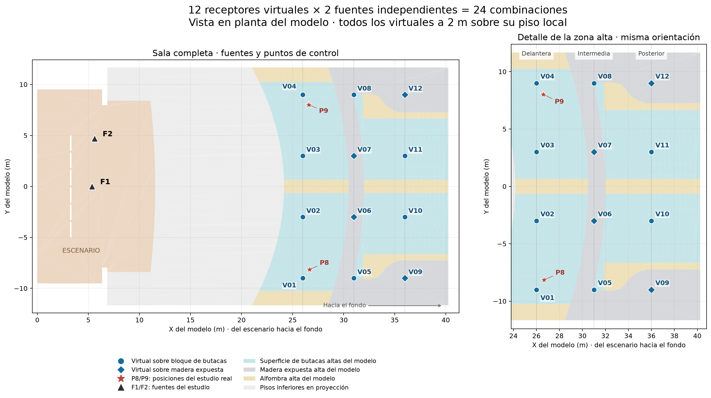

# Mapa de los receptores virtuales de la platea alta

**Fecha:** 9 de noviembre de 2026. Las posiciones corresponden a las utilizadas en los cálculos existentes; no se cambiaron receptores ni se ejecutaron nuevas predicciones.

## Cómo se obtienen las 24 combinaciones

Son **12 posiciones virtuales, V01–V12, calculadas una vez con F1 y otra con F2**. Por ejemplo, F1–V02 y F2–V02 son dos respuestas del mismo punto con distinta fuente. Las fuentes se calculan por separado. No son 24 ubicaciones ni fuentes actuando simultáneamente.

Los doce virtuales complementan P1–P9. Cada corrida contiene **21 receptores**; para el análisis espacial alto se usan P8/P9 y los doce virtuales. P8/P9 son posiciones del estudio real y no forman parte del conteo de doce virtuales.

El fondo del mapa procede de las superficies del modelo nativo. Es una proyección en planta: las superficies superiores pueden ocultar en ella las inferiores. La vista de detalle conserva la orientación de la sala completa. El escenario está a la izquierda y el fondo a la derecha.

## Distribución

La cuadrícula tiene tres franjas longitudinales y cuatro posiciones transversales. X aumenta del escenario hacia el fondo; los valores son coordenadas del modelo, no distancias medidas desde el borde del escenario. Y negativo corresponde al lado de P8 y Y positivo al de P9.

| Franja | Y = −9 m | Y = −3 m | Y = +3 m | Y = +9 m |
|---|---|---|---|---|
| Delantera: X = 26 m | V01 | V02 | V03 | V04 |
| Intermedia: X = 31 m | V05 | V06 | V07 | V08 |
| Posterior: X = 36 m | V09 | V10 | V11 | V12 |

## Coordenadas y altura

Todos los virtuales están a **2,00 m sobre el piso local**. Z es la cota global del receptor; varía porque el piso y las gradas tienen alturas diferentes.

| Punto | X (m) | Y (m) | Z receptor (m) | Z piso (m) | Superficie bajo el punto en el modelo |
|---|---:|---:|---:|---:|---|
| V01 | 26,00 | -9,00 | 6,74 | 4,74 | Butacas |
| V02 | 26,00 | -3,00 | 6,34 | 4,34 | Butacas |
| V03 | 26,00 | 3,00 | 6,34 | 4,34 | Butacas |
| V04 | 26,00 | 9,00 | 6,74 | 4,74 | Butacas |
| V05 | 31,00 | -9,00 | 7,54 | 5,54 | Butacas |
| V06 | 31,00 | -3,00 | 7,54 | 5,54 | Madera expuesta |
| V07 | 31,00 | 3,00 | 7,54 | 5,54 | Madera expuesta |
| V08 | 31,00 | 9,00 | 7,54 | 5,54 | Butacas |
| V09 | 36,00 | -9,00 | 7,54 | 5,54 | Madera expuesta |
| V10 | 36,00 | -3,00 | 8,96 | 6,96 | Butacas |
| V11 | 36,00 | 3,00 | 8,96 | 6,96 | Butacas |
| V12 | 36,00 | 9,00 | 7,54 | 5,54 | Madera expuesta |

## Qué representa cada punto

Son puntos de evaluación añadidos al modelo, no nuevas mediciones ni un recuento de butacas. Al comprobar la superficie de apoyo, **ocho están sobre bloques de butacas** y **cuatro sobre madera expuesta: V06, V07, V09 y V12**. Estos últimos muestrean partes del suelo alto que el modelo no clasifica como butacas. La clasificación procede de los materiales nativos, no de identificar una silla concreta en el plano.

Por ello, el resultado anterior de **5/24 combinaciones dentro de los objetivos** describe esta cuadrícula de control y ambas fuentes. No equivale a que el 5/24 del público cumpla. Para estudiar cobertura de audiencia se puede informar por separado butacas y otras superficies, manteniendo todos estos puntos como referencia y añadiendo muestreo en las áreas de interés.

## Archivos y referencias

- [Coordenadas y clasificación CSV](../prediccion/estudio-difusion/reflectores/resultados/ubicacion-receptores-virtuales.csv).

- [Coordenadas y clasificación JSON](../prediccion/estudio-difusion/reflectores/resultados/ubicacion-receptores-virtuales.json).

- [Mapa vectorial SVG](../prediccion/estudio-difusion/reflectores/resultados/mapa-receptores-virtuales.svg).

- [Posiciones originales de los virtuales](../prediccion/estudio-difusion/absorcion-posterior/receptores-virtuales.json).

- [Auditoría de fuentes y receptores del estudio de reflectores](../prediccion/estudio-difusion/reflectores/auditoria-posiciones.json).

- [Avances y estado del estudio](AVANCES-Y-ESTADO-DEL-ESTUDIO-ACUSTICO.md).

- [Resultados iniciales de reflectores](RESULTADOS-INICIALES-REFLECTORES-PLATEA-ALTA.md).
