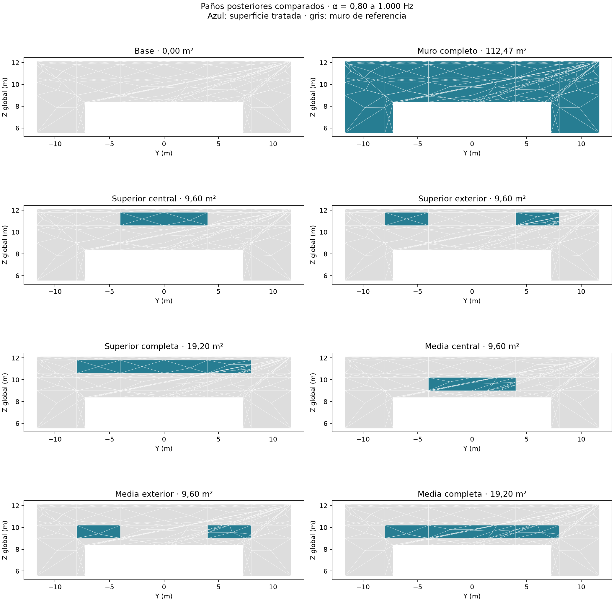
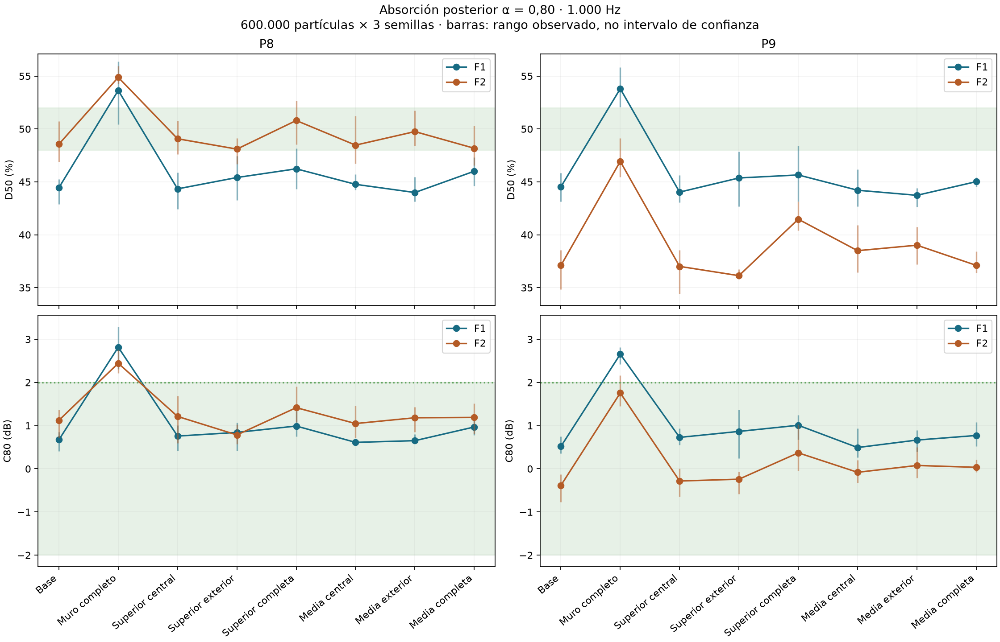

# Absorción posterior α = 0,80: pared completa y paneles localizados

**Teatro Aula Magna UTFSM — 9 de noviembre de 2026.**

## 1. Pregunta y alcance

Se estudió si reducir energía posterior mediante absorción en el fondo de la platea alta permite acercarse a **D50 de 48–52 % a 1.000 Hz**, conservando **C80 entre −2 y +2 dB** como criterio de proyecto. Este rango no se presenta como un requisito normativo universal ni como garantía perceptual.

**Resultado principal:** ninguna configuración ensayada cumple el objetivo conjunto en los cuatro pares F1/F2–P8/P9. La pared completa α = 0,80 deja F2–P9 en D50 = 46,94 % y C80 = 1,76 dB; los otros pares y los paños locales se detallan a continuación. Se cuantifica un beneficio parcial, sin seleccionar un tratamiento suficiente.

La pared completa con α = 0,80 sirve de límite de cobertura para ese coeficiente en el modelo. Los seis paños parciales permiten comparar sensibilidad a posición y superficie. No se supone una relación lineal entre área y D50.

## 2. Método y condiciones

Se ejecutaron **42 nuevas corridas**: siete tratamientos × dos fuentes independientes × tres semillas. Se reutilizaron las seis referencias sin tratamiento sobre la misma geometría. Cada corrida usa **600.000 partículas**, semillas **20261019, 20261020 y 20261021**, una banda activa de **1.000 Hz**, 21 receptores, radio 0,31 m, 4 s de duración y paso 1 ms. Las energías lineales de las tres realizaciones se promedian antes de recalcular los indicadores.

Se conservaron las fuentes omnidireccionales idealizadas, Lw global de 90 dB y su espectro, posiciones, altura, malla común y condiciones ambientales de 18 °C y 57 % HR. La absorción atmosférica permanece activa y la transmisión desactivada. La dispersión del paño permanece aproximadamente en 0,05 y conserva su ley: aquí se aísla absorción, sin introducir simultáneamente una nueva hipótesis de difusión.

El coeficiente **α = 0,80 es el valor final de las superficies seleccionadas a 1.000 Hz**, no un incremento de 0,80 ni un valor impuesto en todas las bandas. El muro efectivo de referencia tiene α ≈ 0,24795 a esa frecuencia. Esta referencia es una calibración efectiva, no un ensayo del concreto real. No se ha seleccionado todavía un material comercial ni un montaje con espectro acreditado.

## 3. Ubicación y superficie

Todos los tratamientos se encuentran en X = 40,25 m. La franja superior ocupa Z = 10,6–11,8 m; la media, Z = 9,0–10,2 m. En cada altura, el sector central ocupa Y = −4 a +4 m; los exteriores son dos paños separados, Y = −8 a −4 y +4 a +8 m. La franja completa reúne central y exteriores. Las coordenadas Z son cotas globales del modelo, no alturas medidas desde cada grada.

| Distribución | Superficie | Aumento de absorción equivalente a 1 kHz |
|---|---:|---:|
| Muro completo | 112,47 m² | 62,09 m² |
| Superior central | 9,60 m² | 5,30 m² |
| Superior exterior | 9,60 m² | 5,30 m² |
| Superior completa | 19,20 m² | 10,60 m² |
| Media central | 9,60 m² | 5,30 m² |
| Media exterior | 9,60 m² | 5,30 m² |
| Media completa | 19,20 m² | 10,60 m² |

La absorción equivalente se presenta solo para dimensionar el cambio; no reemplaza la propagación calculada ni permite deducir la eficacia local mediante Sabine.

## 4. Resultados por fuente y posición

Cada celda presenta **D50 (%) / C80 (dB)**. No se mezclan fuentes ni asientos para evaluar cumplimiento.

| Condición | F1–P8 | F1–P9 | F2–P8 | F2–P9 | Cumplen ambos criterios |
|---|---:|---:|---:|---:|---:|
| Base | 44,45 / 0,67 | 44,54 / 0,52 | 48,56 / 1,12 | 37,10 / -0,38 | 1/4 |
| Muro completo | 53,64 / 2,82 | 53,80 / 2,65 | 54,88 / 2,44 | 46,94 / 1,76 | 0/4 |
| Superior central | 44,34 / 0,76 | 44,03 / 0,73 | 49,07 / 1,21 | 37,01 / -0,28 | 1/4 |
| Superior exterior | 45,41 / 0,84 | 45,37 / 0,87 | 48,10 / 0,78 | 36,13 / -0,24 | 1/4 |
| Superior completa | 46,23 / 0,99 | 45,65 / 1,01 | 50,80 / 1,42 | 41,47 / 0,37 | 1/4 |
| Media central | 44,77 / 0,61 | 44,21 / 0,49 | 48,47 / 1,05 | 38,49 / -0,08 | 1/4 |
| Media exterior | 43,99 / 0,65 | 43,73 / 0,67 | 49,75 / 1,18 | 39,01 / 0,08 | 1/4 |
| Media completa | 46,00 / 0,97 | 45,02 / 0,77 | 48,17 / 1,19 | 37,11 / 0,03 | 1/4 |

El único par que cumple en cada escenario localizado es F2–P8, que ya cumplía en la referencia. Ese 1/4 no significa que se haya incorporado una posición previamente deficitaria al rango objetivo.

Las barras muestran el rango de las tres realizaciones, no intervalos de confianza. Se evita atribuir a un tratamiento diferencias pequeñas del mismo orden que el muestreo.

### Control de la energía temprana en P8/P9

El análisis geométrico anterior establece que las trayectorias que tocan este plano posterior no pueden contribuir antes de 50 ms en P8/P9, considerando el radio receptor y el paso temporal. Por tanto, las diferencias de energía anterior a 50 ms entre cálculos se interpretan como variación de muestreo. Como diagnóstico secundario se fija esa energía al valor de referencia y se conserva la energía posterior de cada tratamiento. No se sustituye el resultado bruto ni se extiende esta propiedad a todos los virtuales.

| Distribución | F2–P9 D50 bruto | F2–P9 control temprano | Rango entre semillas del control |
|---|---:|---:|---:|
| Muro completo | 46,94 % | 46,52 % | 44,16–47,69 % |
| Superior central | 37,01 % | 37,51 % | 36,39–38,51 % |
| Superior exterior | 36,13 % | 37,83 % | 34,72–39,75 % |
| Superior completa | 41,47 % | 40,15 % | 38,16–41,64 % |
| Media central | 38,49 % | 38,18 % | 36,65–39,35 % |
| Media exterior | 39,01 % | 38,01 % | 34,78–40,53 % |
| Media completa | 37,11 % | 38,43 % | 36,07–39,97 % |

El control no hace invariante la energía de 50–80 ms: parte de las llegadas posteriores puede situarse en esa ventana. Los datos individuales incluyen también C80 de control, calculado con E0–50 de referencia y E50–80 y E>80 del tratamiento. No se conserva sin comprobar toda la energía anterior a 80 ms ni se atribuye una certeza estadística a esta corrección.

## 5. Efectos en las tres zonas y receptores virtuales

Los siguientes cambios son medias descriptivas de diferencias individuales frente a la referencia, a 1.000 Hz. Pueden esconder efectos mayores en un asiento: los archivos individuales se conservan.

| Tratamiento | Zona | ΔD50 (puntos) | ΔC80 (dB) | ΔEDT (s) | ΔT30 (s) | Δnivel de banda (dB) | Máximo cambio absoluto D50 (puntos) |
|---|---|---:|---:|---:|---:|---:|---:|
| Muro completo | P8/P9 | 8,65 | 1,93 | -0,29 | -0,11 | -0,91 | 9,84 |
| Muro completo | Virtuales altos | 9,69 | 1,81 | -0,29 | -0,16 | -1,03 | 17,00 |
| Muro completo | Platea baja | 2,23 | 0,51 | -0,14 | -0,08 | -0,11 | 4,78 |
| Muro completo | Bajo balcón | 0,69 | 0,41 | -0,14 | -0,11 | -0,22 | 3,57 |
| Superior central | P8/P9 | -0,05 | 0,12 | -0,07 | 0,03 | -0,05 | 0,51 |
| Superior central | Virtuales altos | 1,77 | 0,29 | -0,04 | -0,01 | -0,08 | 4,30 |
| Superior central | Platea baja | 0,54 | 0,06 | -0,00 | -0,01 | -0,02 | 2,07 |
| Superior central | Bajo balcón | 0,98 | 0,12 | -0,02 | -0,00 | 0,03 | 5,28 |
| Superior exterior | P8/P9 | 0,09 | 0,08 | -0,03 | -0,02 | -0,17 | 0,97 |
| Superior exterior | Virtuales altos | 1,28 | 0,22 | -0,03 | -0,01 | -0,09 | 3,40 |
| Superior exterior | Platea baja | 0,48 | 0,12 | -0,01 | -0,00 | -0,01 | 1,36 |
| Superior exterior | Bajo balcón | 0,09 | 0,00 | -0,04 | 0,03 | -0,02 | 2,37 |
| Superior completa | P8/P9 | 2,38 | 0,46 | -0,09 | -0,01 | -0,21 | 4,37 |
| Superior completa | Virtuales altos | 2,52 | 0,43 | -0,06 | -0,01 | -0,20 | 5,19 |
| Superior completa | Platea baja | 0,55 | 0,14 | -0,03 | -0,02 | -0,07 | 1,93 |
| Superior completa | Bajo balcón | 0,90 | 0,20 | -0,07 | 0,05 | 0,01 | 2,76 |
| Media central | P8/P9 | 0,32 | 0,03 | -0,04 | 0,01 | -0,05 | 1,39 |
| Media central | Virtuales altos | 1,14 | 0,25 | -0,02 | -0,01 | -0,08 | 3,42 |
| Media central | Platea baja | 0,11 | 0,04 | -0,02 | -0,02 | 0,01 | 0,89 |
| Media central | Bajo balcón | 0,64 | 0,11 | -0,03 | 0,00 | -0,04 | 3,54 |
| Media exterior | P8/P9 | 0,46 | 0,16 | -0,03 | -0,02 | -0,08 | 1,91 |
| Media exterior | Virtuales altos | 1,39 | 0,28 | -0,02 | -0,01 | -0,03 | 3,55 |
| Media exterior | Platea baja | 0,72 | 0,11 | -0,03 | 0,03 | 0,01 | 1,46 |
| Media exterior | Bajo balcón | 0,06 | 0,04 | -0,01 | 0,03 | -0,05 | 1,85 |
| Media completa | P8/P9 | 0,41 | 0,26 | -0,05 | -0,04 | -0,20 | 1,55 |
| Media completa | Virtuales altos | 1,88 | 0,39 | -0,04 | -0,03 | -0,17 | 4,38 |
| Media completa | Platea baja | 0,67 | 0,18 | -0,04 | -0,00 | 0,03 | 1,61 |
| Media completa | Bajo balcón | -0,69 | 0,00 | -0,02 | -0,03 | -0,06 | 1,72 |

## 6. Interpretación y decisión

**Resultado del límite a α = 0,80:** F2–P9 alcanza D50 = 46,94 % y C80 = 1,76 dB. El control de energía temprana da 46,52 %. Los seis paños locales producen D50 bruto de 36,13 a 41,47 % en ese caso, con valores de control de 37,51 a 40,15 %.

Como balance energético, manteniendo fija E0–50 de F2–P9, llegar a D50 = 48 % requeriría reducir su energía total de referencia aproximadamente un 22,71 %; llegar a 50 %, un 25,80 %. El tratamiento completo α = 0,80 produce aproximadamente un 20,25 % de reducción en ese control. Es una identidad del reparto energético, no una conversión de esa diferencia a metros cuadrados ni una predicción de otro material.

**Ninguna de las siete configuraciones ensayadas cumple ambos criterios en los cuatro pares F1/F2–P8/P9.** No se selecciona un área ni un material como solución suficiente. Los tratamientos locales pueden aportar una mejora parcial; su utilidad debe valorarse frente a su magnitud, incertidumbre y efectos sobre los demás asientos.

La selección se debe basar en el caso deficitario y la cobertura, no solo en el promedio de P8/P9. Que un paño reduzca energía posterior y aumente D50 no basta para afirmar que alcanza el objetivo, conserva C80 o mejora la percepción de toda la audiencia.

La pared completa ofrece una referencia de máxima eliminación para α = 0,80 en P8/P9 bajo estas hipótesis: la energía previa a 50 ms permanece físicamente invariable y aumentar la superficie absorbente no aumenta la energía posterior esperada. La comparación Monte Carlo puede presentar fluctuaciones; no se usa para declarar una imposibilidad universal en el recinto real.

Los paños ensayados no abarcan todas las distribuciones posibles. Si el límite completo no alcanza la meta en un caso, no se prometerá que un paño menor del mismo coeficiente la alcance. Si una distribución local se aproxima a los criterios, seguirá siendo una candidata predictiva a contrastar, no una solución instalada validada.

Estos cálculos no verifican el comportamiento a 500 Hz, 2, 4 u 8 kHz ni los ecos audibles. Para seleccionar un absorbente hace falta introducir su espectro ensayado con el montaje previsto y estudiar el balance musical en todas las zonas. No se transfieren los incrementos de D50 a las mediciones mediante suma de puntos porcentuales.

## 7. Datos, verificación y conservación

Se verificaron las 48 entradas de cálculo utilizadas, incluidos los seis controles reutilizados: banda activa, Lw global, receptores y fuentes idénticos a la referencia, parámetros de simulación conservados, dispersión sin cambios, absorción modificada solo a 1.000 Hz y huellas de configuración y mallas. Las series son finitas y no negativas. La fracción máxima de partículas perdidas fue 0,0183 %. Esto comprueba la ejecución; no constituye por sí solo una prueba de convergencia estadística o validación física.

- [Comparaciones individuales y controles](../prediccion/estudio-difusion/absorcion-posterior/resultados-a080/comparaciones.csv).

- [Indicadores por realización](../prediccion/estudio-difusion/absorcion-posterior/resultados-a080/indicadores-por-semilla.csv).

- [Respuestas medias y rangos de semillas](../prediccion/estudio-difusion/absorcion-posterior/resultados-a080/respuestas-medias.csv).

- [Resumen por zonas](../prediccion/estudio-difusion/absorcion-posterior/resultados-a080/resumen-zonas.csv).

- [Verificación de entradas y ejecución](../prediccion/estudio-difusion/absorcion-posterior/resultados-a080/verificacion.json).

- [Escenarios y mallas utilizadas](../prediccion/estudio-difusion/absorcion-posterior/escenarios.json).

- [Ensayo ideal anterior](RESULTADOS-LIMITE-ABSORCION-POSTERIOR.md).

No se modificaron el proyecto canónico ni las mediciones originales. Se conservaron configuraciones, registros del motor, metadatos y energías lineales. Las salidas nativas de las 42 corridas nuevas se archivaron sin pérdida en ZIP por corrida, verificando contenido y SHA256 antes de retirar las copias sueltas; el registro queda en [verificación de compactación](../prediccion/estudio-difusion/absorcion-posterior/resultados-a080/verificacion-compactacion.json).
