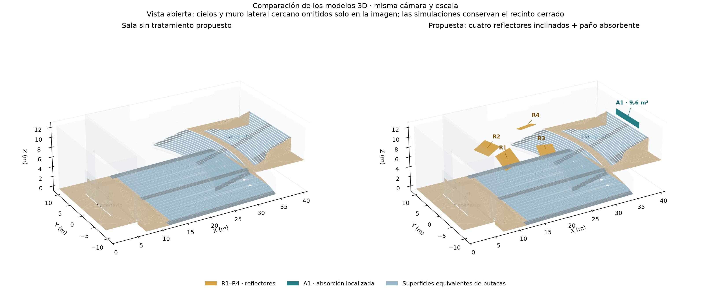
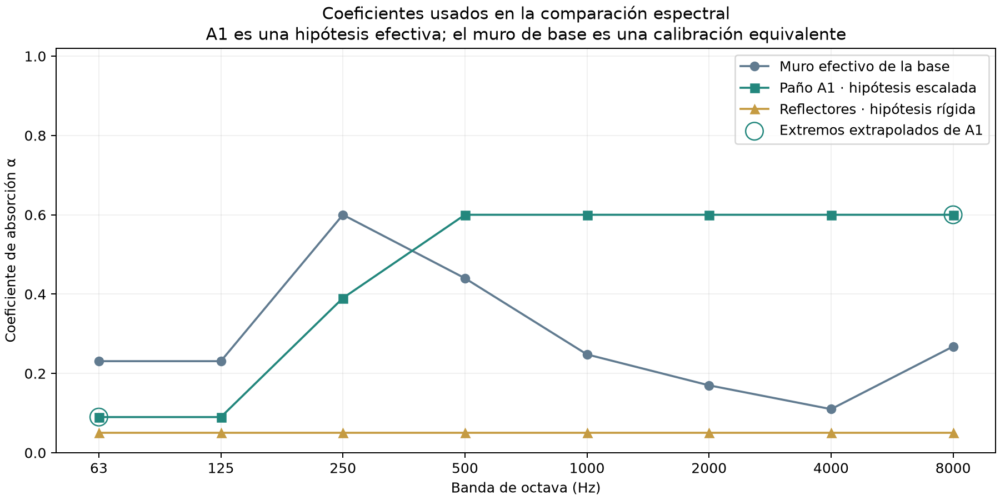
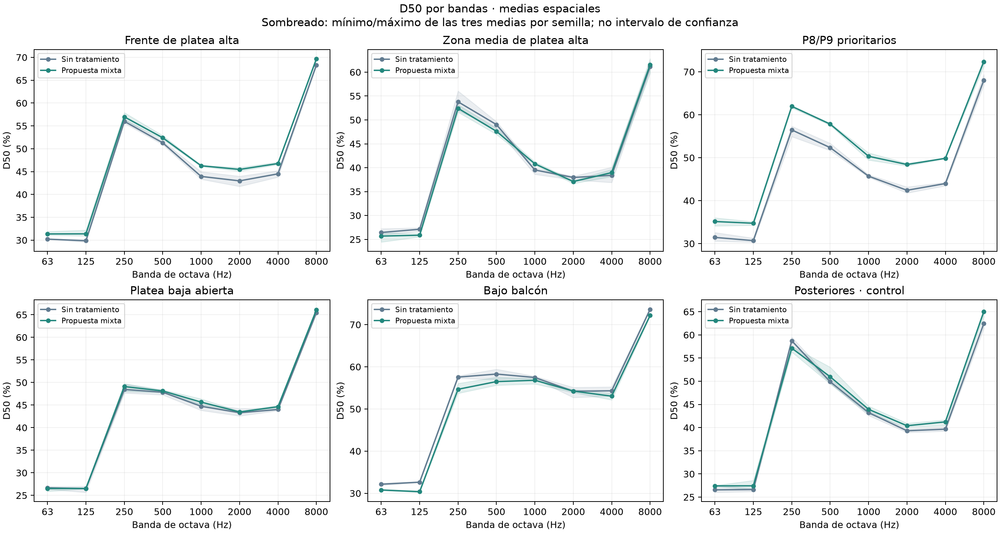
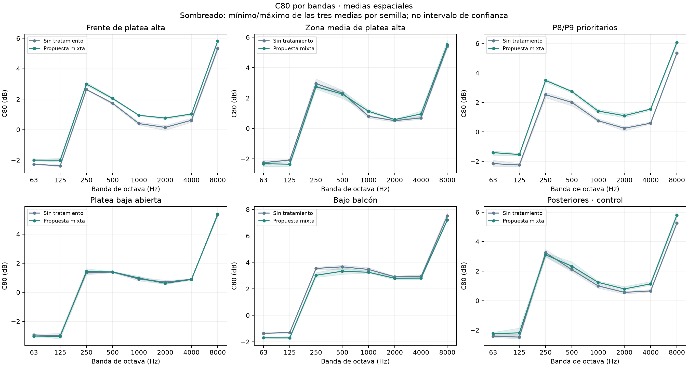
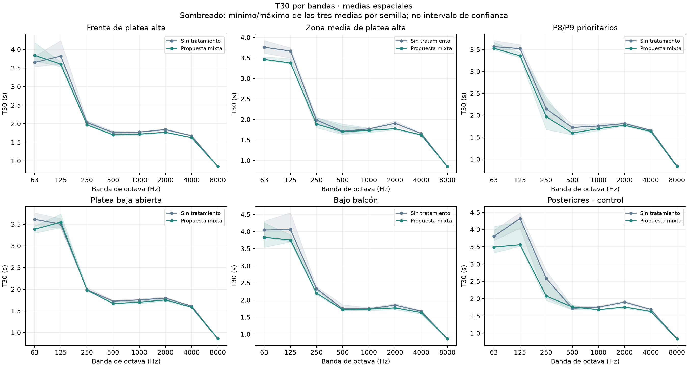
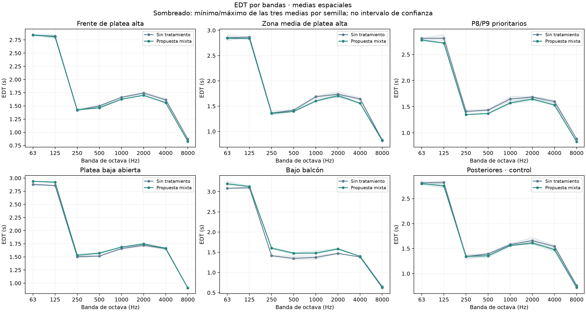
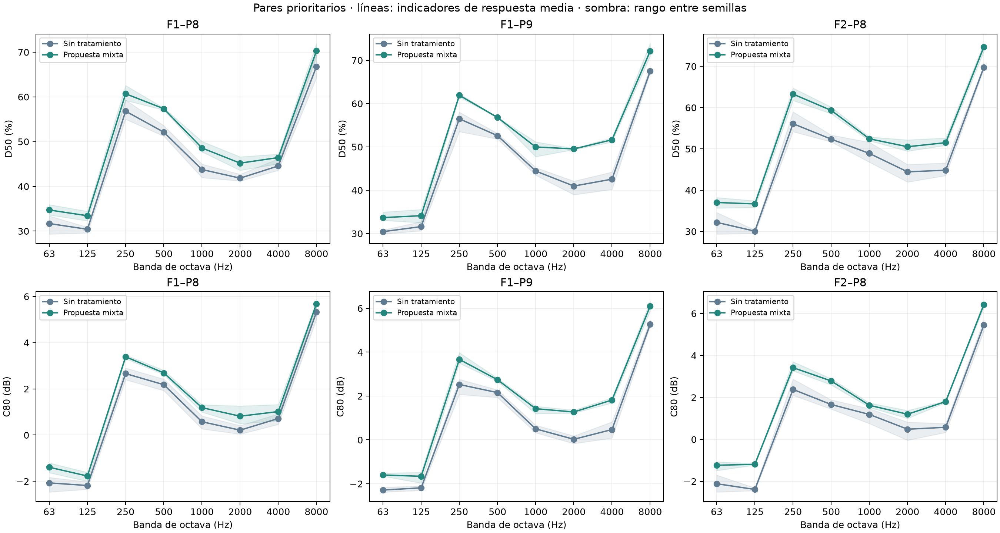
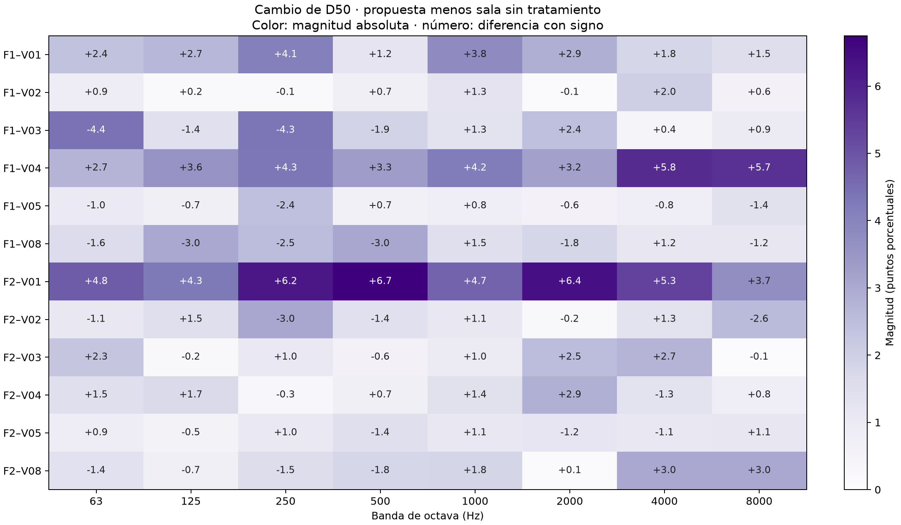
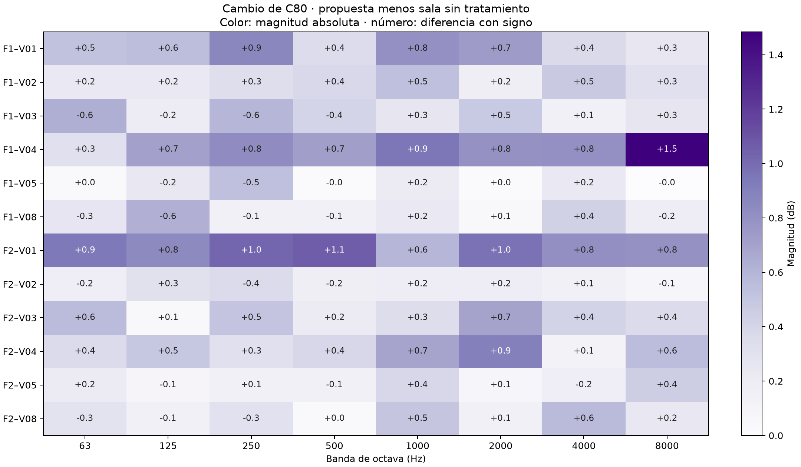
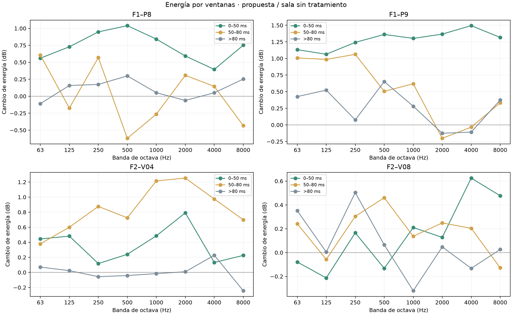

# Comparación por bandas de octava: sala base y propuesta mixta

**Aula Magna UTFSM — estudio iniciado el 10 de noviembre de 2026.**  
**Estados:** sala sin tratamiento propuesto frente a cuatro reflectores con inclinación combinada y paño posterior central de 9,6 m².  
**Bandas:** 63, 125, 250, 500, 1.000, 2.000, 4.000 y 8.000 Hz.

## Resumen

Se amplió la comparación a ocho frecuencias centrales de octava manteniendo las geometrías del informe anterior. Se ejecutaron **84 corridas principales nuevas** y se reutilizaron **doce corridas compatibles de 1.000 Hz**. El conjunto reúne 96 condiciones banda/estado/fuente/semilla, 672 respuestas medias y 2.016 respuestas individuales. Los pilotos se excluyen de los resultados.

El D50 medio de las doce combinaciones objetivo aumenta en las ocho bandas, entre 0,20 y 1,99 puntos porcentuales. Un aumento de D50 no se interpreta automáticamente como mejora musical: se examina junto con C80, EDT/T30, energía recibida y posición.

La banda de 1.000 Hz reproduce exactamente el resultado anterior: D50 medio objetivo de 42,47 → 44,46 %, C80 de +0,53 → +1,00 dB y T30 de 1,772 → 1,723 s. La extensión espectral añade hipótesis de materiales; no constituye una validación física multibanda ni una medición posterior a la intervención.

## 1. Objetivo y propuesta conservada

El objetivo es determinar cómo varía por frecuencia el efecto de la propuesta, identificar beneficios y compromisos que un único resultado a 1.000 Hz no muestra, y comprobar si se conserva el balance entre definición y reverberación en las posiciones de interés.

Se mantienen cuatro reflectores rígidos de 4 × 3 m, 48 m² de área frontal total y 20 mm de espesor, con la inclinación combinada del estudio anterior. El paño A1 ocupa 9,6 m² en el muro posterior: X = 40,25 m, Y = −4 a +4 m, Z = 9,0 a 10,2 m. No se incorpora el paño superior extendido de 19,2 m².

La figura corresponde a las mismas geometrías calculadas. La apertura gráfica de cielos y muro lateral permite visualizar el interior; no se abre el recinto de simulación. Los cambios de este estudio son espectrales, no una nueva disposición de paneles.

## 2. Hipótesis de materiales por frecuencia

La propuesta anterior solo definía el tratamiento a 1.000 Hz. El usuario autorizó usar un espectro de referencia documentado para la ampliación. Se utilizó la forma de la curva publicada en el [ensayo CSTB AC14-26051052/7 de Ecophon](https://www.ecophon.com/globalassets/old-structure/01.ecophon-master/technical-documentation/absorption_iso/akusto-wall/akusto_wall_wall_panel_a_super_g_ods43_octave.pdf/), correspondiente a Akusto Wall A/Super G de 40 mm y profundidad total de montaje de 43 mm. Sus coeficientes prácticos de 125–4.000 Hz se escalan por 0,60 para conservar el valor efectivo anterior a 1.000 Hz.

La curva resultante es una **hipótesis efectiva de la propuesta**, no el espectro ensayado de ese producto ni una especificación de montaje. El escalado no identifica por sí solo una mezcla de áreas o una solución constructiva capaz de reproducirla.

| Banda Hz | α publicado de referencia | α A1 usado | α reflectores | Dato / hipótesis |
|---|---|---|---|---|
| 63 | — | 0,09 | 0,05 | Extrapolación del extremo vecino |
| 125 | 0,15 | 0,09 | 0,05 | Referencia escalada |
| 250 | 0,65 | 0,39 | 0,05 | Referencia escalada |
| 500 | 1,00 | 0,60 | 0,05 | Referencia escalada |
| 1000 | 1,00 | 0,60 | 0,05 | Referencia escalada |
| 2000 | 1,00 | 0,60 | 0,05 | Referencia escalada |
| 4000 | 1,00 | 0,60 | 0,05 | Referencia escalada |
| 8000 | — | 0,60 | 0,05 | Extrapolación del extremo vecino |

A 63 Hz se conserva el valor de 125 Hz y a 8.000 Hz el de 4.000 Hz. No hay un dato de ensayo de esa fuente para esos dos extremos. Los reflectores mantienen absorción y dispersión 0,05 constantes; no se representan resonancias, flexión del tablero ni difracción detallada de sus bordes. La dispersión de A1 se conserva como la del muro original.

El espectro efectivo original de la sala permanece fijo. Su muro tiene α ≈ 0,231 a 63/125 Hz y α = 0,60 a 250 Hz, superiores a la hipótesis de A1 en esas bandas. Por ello la sustitución puede reducir la absorción efectiva de ese sector en graves. La base no se recalibra para hacer favorable el tratamiento.

Estos coeficientes del muro no son la ficha física del concreto: pueden representar pérdidas equivalentes no resueltas por la geometría. Un empeoramiento calculado en graves bajo esta sustitución no prueba por sí solo que un panel poroso real empeoraría la sala. Señala también la incertidumbre de reemplazar una superficie calibrada por una curva física hipotética.

## 3. Metodología de cálculo y comparación

Se sigue el [protocolo previo de octavas](PROTOCOLO-COMPARACION-POR-OCTAVAS.md). Se usa SPPS energético, una fuente y una frecuencia activa por proceso, 600.000 partículas por corrida y tres semillas (20261019/20261020/20261021). Se conservan 4 s, paso 1 ms, radio receptor 0,31 m, 18 °C, humedad 57 %, velocidad 342 m/s, absorción del aire activada y transmisión de superficies desactivada.

Se mantienen las dos fuentes omnidireccionales, las posiciones de los 21 receptores y el espectro completo de fuente normalizado a Lw global de 90 dB. La frecuencia activa utiliza el valor correspondiente de ese espectro; no se asignan 90 dB a cada banda ni se suman como potencia global los ocho resultados aislados. Las comparaciones de energía son cocientes dentro de cada banda y entre estados.

La selección de frecuencias centrales representa las bandas mediante el cálculo geométrico y los coeficientes usados en esas frecuencias; no es una integración ondulatoria de todos los tonos contenidos en cada octava. No se modela la directividad del parlante real ni del line array.

Se promedian energías lineales de las tres semillas y después se calculan D50, C80, EDT y T30. Las ventanas 0–50, 50–80 y >80 ms se refieren al directo geométrico. Se mantiene la integración del estudio anterior y no se eleva otra vez al cuadrado la energía nativa. Los cambios de D50 son puntos porcentuales; los de energía son 10 log10(Epropuesta/Ebase).

Los promedios de zona son medias de los indicadores por combinación. La evaluación principal comprende V01–V04 y V05/V08 con ambas fuentes: doce combinaciones. P8/P9 prioritarios, F2–P9, platea baja, bajo balcón y posiciones posteriores se conservan identificados. Los datos adjuntos incluyen todos los receptores.

El rango D50 de 45–55 % y C80 de −2 a +2 dB se utilizó como criterio exploratorio a 1.000 Hz. No se convierte aquí en un requisito idéntico u óptimo universal para cada banda. Los resultados se interpretan como tendencias espectrales y compromisos locales.

Se verificaron geometrías, condiciones y hashes de las 96 corridas. La máxima fracción de partículas perdidas es 0.000317. Los resultados de 1.000 Hz se reproducen con error máximo 0 en D50/C80/EDT/T30. Los 28 pilotos de 20.000 partículas quedan excluidos de los promedios.

## 4. Resultados del conjunto objetivo de platea alta

Cada celda presenta **sin tratamiento → propuesta**. Se agrupan las doce combinaciones de frente y media; las fuentes no se emiten simultáneamente.

| Banda Hz | D50 % | ΔD50 puntos | C80 dB | T30 s | EDT s |
|---|---|---|---|---|---|
| 63 | 28,96 → 29,47 | 0,51 | -2,26 → -2,11 | 3,683 → 3,714 | 2,844 → 2,845 |
| 125 | 28,95 → 29,55 | 0,60 | -2,28 → -2,12 | 3,769 → 3,524 | 2,835 → 2,818 |
| 250 | 55,27 → 55,47 | 0,20 | 2,74 → 2,92 | 2,017 → 1,942 | 1,400 → 1,403 |
| 500 | 50,54 → 50,81 | 0,27 | 1,93 → 2,12 | 1,746 → 1,700 | 1,474 → 1,441 |
| 1000 | 42,47 → 44,46 | 1,99 | 0,53 → 1,00 | 1,772 → 1,723 | 1,671 → 1,618 |
| 2000 | 41,30 → 42,68 | 1,38 | 0,27 → 0,70 | 1,864 → 1,770 | 1,740 → 1,702 |
| 4000 | 42,48 → 44,17 | 1,69 | 0,64 → 1,00 | 1,668 → 1,622 | 1,624 → 1,559 |
| 8000 | 65,93 → 66,95 | 1,02 | 5,35 → 5,72 | 0,851 → 0,850 | 0,858 → 0,824 |

### 4.1. Distribución por franja

| Banda Hz | D50 frente % | D50 media % | C80 frente dB | C80 media dB |
|---|---|---|---|---|
| 63 | 30,22 → 31,36 | 26,44 → 25,69 | -2,27 → -2,00 | -2,25 → -2,33 |
| 125 | 29,87 → 31,38 | 27,11 → 25,87 | -2,38 → -2,01 | -2,08 → -2,35 |
| 250 | 56,00 → 56,99 | 53,79 → 52,43 | 2,64 → 3,00 | 2,95 → 2,74 |
| 500 | 51,30 → 52,41 | 49,02 → 47,63 | 1,73 → 2,05 | 2,33 → 2,27 |
| 1000 | 43,95 → 46,28 | 39,52 → 40,82 | 0,40 → 0,94 | 0,80 → 1,13 |
| 2000 | 42,97 → 45,48 | 37,96 → 37,09 | 0,15 → 0,76 | 0,51 → 0,58 |
| 4000 | 44,51 → 46,77 | 38,41 → 38,97 | 0,62 → 1,03 | 0,69 → 0,95 |
| 8000 | 68,32 → 69,65 | 61,14 → 61,54 | 5,33 → 5,82 | 5,39 → 5,52 |

Las líneas conectan bandas calculadas y no representan mediciones en frecuencias intermedias. El sombreado es el mínimo/máximo de las tres medias espaciales por semilla, no la dispersión entre asientos ni un intervalo de confianza.

**El resultado espacial es desigual.** Aunque la media conjunta aumenta en las ocho bandas, la media de la franja intermedia disminuye en 5 (63, 125, 250, 500, 2000 Hz). La mejora conjunta se concentra en el frente y en determinados pares prioritarios. Las diferencias pequeñas por franja se interpretan con los rangos entre semillas.

### 4.2. Decaimiento y balance reverberante

EDT y T30 extrapolan a 60 dB los ajustes 0/−10 y −5/−35 dB. No se afirma que la respuesta haya caído 60 dB en cada caso. Se revisó la calidad de ajuste y su proximidad al final de la ventana simulada.

El control interno señala **9/672 respuestas medias** para revisión de T30 por ajuste insuficiente, R² menor que 0,95 o final de ajuste después de 3,8 s. Son umbrales de revisión numérica de este informe; no garantizan validación física cuando no se activan. Los valores, R² y final de ajuste se conservan en los archivos.

Las respuestas señaladas se conservan identificadas en las tablas y los promedios:

| Banda Hz | Estado | Par | T30 s | R² | Final de ajuste s |
|---|---|---|---|---|---|
| 63 | Propuesta mixta | F1–V02 | 4,915 | 0,945 | 2,787 |
| 250 | Sin tratamiento | F2–V06 | 2,756 | 0,935 | 1,551 |
| 250 | Sin tratamiento | F2–V07 | 2,655 | 0,949 | 1,286 |
| 250 | Sin tratamiento | F2–V09 | 2,598 | 0,920 | 1,477 |
| 250 | Sin tratamiento | F2–V10 | 3,678 | 0,835 | 1,762 |
| 250 | Propuesta mixta | F2–P6 | 2,501 | 0,948 | 1,412 |
| 250 | Propuesta mixta | F2–V06 | 3,901 | 0,902 | 1,425 |
| 250 | Propuesta mixta | F2–V12 | 2,475 | 0,939 | 1,454 |
| 500 | Propuesta mixta | F2–V06 | 2,663 | 0,943 | 1,407 |

## 5. P8/P9: comparación detallada de los pares prioritarios

### D50, porcentaje: sin tratamiento → propuesta

| Banda Hz | F1–P8 | F1–P9 | F2–P8 |
|---|---|---|---|
| 63 | 31,69 → 34,73 | 30,44 → 33,68 | 32,20 → 37,01 |
| 125 | 30,42 → 33,44 | 31,60 → 34,13 | 30,07 → 36,67 |
| 250 | 56,81 → 60,70 | 56,49 → 61,92 | 56,11 → 63,28 |
| 500 | 52,12 → 57,37 | 52,59 → 56,80 | 52,36 → 59,33 |
| 1000 | 43,77 → 48,59 | 44,43 → 49,99 | 48,90 → 52,45 |
| 2000 | 41,84 → 45,20 | 40,97 → 49,53 | 44,44 → 50,52 |
| 4000 | 44,57 → 46,44 | 42,55 → 51,64 | 44,83 → 51,51 |
| 8000 | 66,79 → 70,29 | 67,47 → 72,10 | 69,79 → 74,71 |

### C80, dB: sin tratamiento → propuesta

| Banda Hz | F1–P8 | F1–P9 | F2–P8 |
|---|---|---|---|
| 63 | -2,07 → -1,39 | -2,29 → -1,60 | -2,11 → -1,23 |
| 125 | -2,18 → -1,77 | -2,19 → -1,66 | -2,39 → -1,19 |
| 250 | 2,66 → 3,39 | 2,53 → 3,67 | 2,38 → 3,42 |
| 500 | 2,18 → 2,69 | 2,16 → 2,74 | 1,66 → 2,79 |
| 1000 | 0,58 → 1,19 | 0,50 → 1,42 | 1,19 → 1,63 |
| 2000 | 0,21 → 0,82 | 0,03 → 1,27 | 0,49 → 1,20 |
| 4000 | 0,72 → 1,02 | 0,47 → 1,82 | 0,58 → 1,80 |
| 8000 | 5,32 → 5,68 | 5,27 → 6,10 | 5,45 → 6,43 |

El sombreado representa el rango de cada parámetro entre semillas en ese punto. La mejora observada a 1.000 Hz no se traslada automáticamente a todas las bandas; una frecuencia con mayor D50 o C80 puede estar cambiando su balance musical, no necesariamente mejorando en cualquier sentido.

En **500 Hz** aparece un compromiso que el promedio general oculta: F1–P8, F1–P9 y F2–P8 alcanzan D50 de 57,37/56,80/59,33 % y C80 de +2,69/+2,74/+2,79 dB. Parte de la referencia ya tenía C80 alto y la propuesta lo aumenta. Con la guía de balance del proyecto, estos puntos requieren revisión espectral; no se presenta ese aumento como una mejora musical automática ni como prueba de deterioro subjetivo.

En **4.000 Hz**, F1–P9 pasa de D50 de 42,55 a 51,64 % y C80 de +0,47 a +1,82 dB; F2–P8 pasa de 44,83 a 51,51 % y de +0,58 a +1,80 dB. Esto constituye un beneficio local bajo las hipótesis del modelo y muestra que una misma geometría puede tener compromisos distintos según la banda.

## 6. Distribución espacial de los cambios

El color usa la magnitud absoluta del cambio y una sola escala cromática. Las anotaciones conservan el signo para distinguir aumento y disminución. Una celda intensa indica un cambio grande, no una mejora o deterioro automático.

## 7. Energía según el tiempo

Los gráficos separan el aporte temprano (directo más reflexiones de 0–50 ms), el intervalo 50–80 ms y la energía posterior a 80 ms. El intervalo intermedio pertenece al denominador de D50 y al numerador de C80. Por eso un cambio de D50 no permite deducir por sí solo el de C80.

Esta comparación incluye reflectores y absorción, por lo que puede haber redistribución de trayectorias y cambios de pérdidas. No se atribuye todo el cambio a A1 ni se supone que el efecto combinado sea la suma de estudios separados. Los histogramas energéticos no identifican automáticamente una pared causal para cada pico.

## 8. Caso crítico F2–V08 y control secundario F2–P9

| Banda Hz | V08 D50 % | V08 C80 dB | V08 T30 s | F2–P9 D50 % | F2–P9 C80 dB |
|---|---|---|---|---|---|
| 63 | 18,16 → 16,79 | -3,15 → -3,43 | 3,27 → 3,23 | 22,15 → 25,98 | -3,62 → -2,85 |
| 125 | 18,05 → 17,36 | -3,17 → -3,31 | 3,51 → 3,39 | 22,88 → 24,79 | -3,51 → -3,05 |
| 250 | 44,20 → 42,66 | 2,32 → 2,03 | 1,85 → 1,87 | 49,43 → 53,00 | 2,08 → 2,72 |
| 500 | 37,30 → 35,50 | 1,55 → 1,58 | 1,70 → 1,68 | 43,48 → 45,53 | 0,97 → 1,38 |
| 1000 | 27,98 → 29,81 | -0,05 → 0,45 | 1,75 → 1,73 | 37,17 → 39,34 | -0,35 → 0,16 |
| 2000 | 26,32 → 26,41 | -0,39 → -0,25 | 1,90 → 1,84 | 33,96 → 36,43 | -0,89 → -0,39 |
| 4000 | 26,17 → 29,18 | -0,26 → 0,31 | 1,65 → 1,59 | 37,00 → 40,20 | -0,32 → 0,50 |
| 8000 | 46,11 → 49,12 | 4,16 → 4,40 | 0,86 → 0,85 | 59,97 → 63,87 | 4,42 → 5,24 |

Ambos permanecen visibles, sin excluir sus datos. La mejora parcial de otros puntos no requiere que V08 alcance un único valor ideal en todas las frecuencias, pero tampoco permite declarar resuelta la franja media si conserva déficits. Esta matriz no demuestra que un punto sea imposible de mejorar mediante otras geometrías o condiciones de fuente.

## 9. Controles en las otras zonas

| Banda Hz | D50 platea baja % | C80 platea baja dB | D50 bajo balcón % | C80 bajo balcón dB |
|---|---|---|---|---|
| 63 | 26,67 → 26,53 | -2,94 → -3,02 | 32,16 → 30,78 | -1,36 → -1,69 |
| 125 | 26,50 → 26,53 | -2,99 → -3,04 | 32,64 → 30,38 | -1,30 → -1,71 |
| 250 | 48,45 → 49,10 | 1,36 → 1,43 | 57,56 → 54,67 | 3,54 → 3,02 |
| 500 | 47,85 → 48,13 | 1,39 → 1,40 | 58,28 → 56,50 | 3,66 → 3,33 |
| 1000 | 44,73 → 45,65 | 0,91 → 0,98 | 57,47 → 56,80 | 3,47 → 3,25 |
| 2000 | 43,30 → 43,48 | 0,70 → 0,62 | 54,21 → 54,24 | 2,91 → 2,80 |
| 4000 | 44,01 → 44,63 | 0,89 → 0,88 | 54,31 → 53,03 | 2,92 → 2,81 |
| 8000 | 65,48 → 66,08 | 5,34 → 5,38 | 73,64 → 72,19 | 7,51 → 7,20 |

Los promedios de otras zonas permiten observar efectos indirectos. No se les impone el rango de la platea alta ni se interpreta que un C80 alto equivalga a cobertura sonora suficiente. La propuesta no incluye altavoces de apoyo ni rediseño del sistema de refuerzo.

## 10. Alcance de la evidencia

El cálculo permite comparar dos modelos bajo condiciones conservadas y observar efectos espectrales en todas las bandas solicitadas. Se mantiene como evidencia predictiva exploratoria. Las hipótesis de material y calibración no quedan validadas por haber completado el cálculo.

Las limitaciones más relevantes son el espectro efectivo y provisional de la base; su discrepancia previa de claridad a 250 Hz; el escalado no ensayado de A1; las extrapolaciones de 63 y 8.000 Hz; las fuentes omnidireccionales; y la representación geométrica de reflectores finitos, sin resonancias ni difracción detallada. Las longitudes de onda bajas comparables al tamaño de los paneles requieren especial cautela.

Las diferencias pequeñas deben leerse con los rangos entre semillas. Tres repeticiones no constituyen un intervalo de confianza ni demuestran un efecto perceptual. Tampoco es válido sumar a las mediciones reales las diferencias porcentuales de la simulación como si fueran una corrección lineal.

## 11. Conclusión

La extensión por octavas permite evaluar la propuesta más allá de su resultado a 1.000 Hz y detectar qué bandas y posiciones mejoran, cambian poco o se alejan del balance buscado. La lectura conjunta de definición, claridad, decaimiento y ventanas energéticas es necesaria para elegir una continuación; no basta con maximizar D50 o reducir T30.

El resultado de 1.000 Hz conserva su demostración parcial favorable. La interpretación multibanda debe restringirse a la hipótesis espectral declarada. Antes de convertirla en una especificación de material o una afirmación sobre la escucha real, corresponde contrastar las propiedades espectrales del montaje y confirmar las bandas determinantes con datos y sensibilidad de modelo adecuados.

**La comparación completa no respalda describir la propuesta como una mejora musical uniforme en todas las bandas.** Los aumentos medios de D50 más claros del conjunto objetivo se observan en 1.000, 2.000 y 4.000 Hz. En 500 Hz los pares prioritarios quedan con mayor claridad temprana y C80 alrededor de +2,7 dB. Los cambios medios de definición en graves son pequeños. El paso siguiente de diseño sería revisar el reparto espectral y las propiedades del montaje, manteniendo visibles esos compromisos, en lugar de maximizar D50 de forma indiscriminada.

## 12. Datos, fuentes y documentos vinculados

- [Coeficientes usados por material y banda](../prediccion/estudio-difusion/comparacion-octavas/resultados/coeficientes-usados.csv) y [listado de corridas verificadas](../prediccion/estudio-difusion/comparacion-octavas/resultados/corridas-verificadas.csv).

- [Protocolo de octavas](PROTOCOLO-COMPARACION-POR-OCTAVAS.md) y [carpeta del experimento](../prediccion/estudio-difusion/comparacion-octavas/README.md).
- [Espectros declarados](../prediccion/estudio-difusion/comparacion-octavas/espectros.json) y [fuente de referencia](../prediccion/estudio-difusion/comparacion-octavas/fuentes/REFERENCIA-ESPECTRAL.md).
- [Medias por receptor/banda](../prediccion/estudio-difusion/comparacion-octavas/resultados/medias.csv), [resultados por semilla](../prediccion/estudio-difusion/comparacion-octavas/resultados/semillas.csv), [diferencias](../prediccion/estudio-difusion/comparacion-octavas/resultados/diferencias.csv), [resumen por zona](../prediccion/estudio-difusion/comparacion-octavas/resultados/resumen-zonas.csv) y [verificación](../prediccion/estudio-difusion/comparacion-octavas/resultados/verificacion.json).
- [Comparación previa a 1.000 Hz](INFORME-COMPARATIVO-SALA-SIN-TRATAMIENTO-Y-PROPUESTA-MIXTA.md), [estudio mixto](RESULTADOS-ESTUDIO-MIXTO-REFLECTORES-ABSORCION.md) y [base teórica](BASE-TEORICA-Y-METODOLOGIA-PREDICCION.md).

