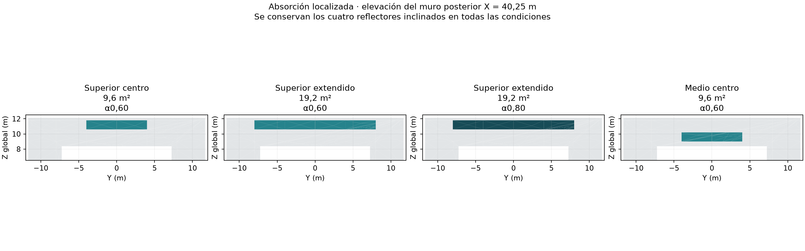
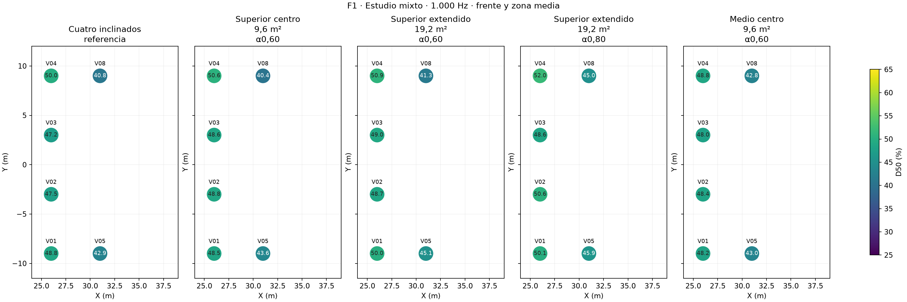
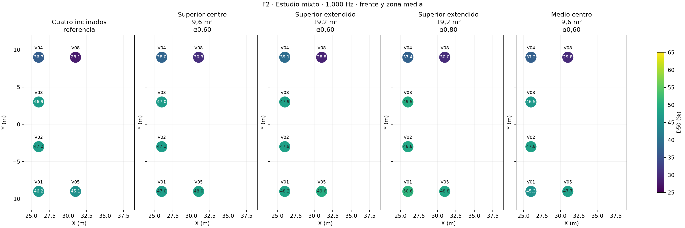
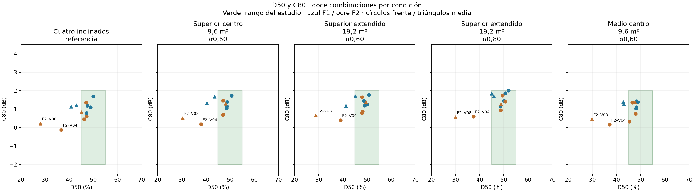
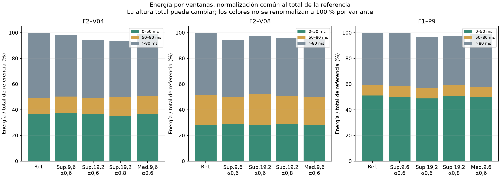
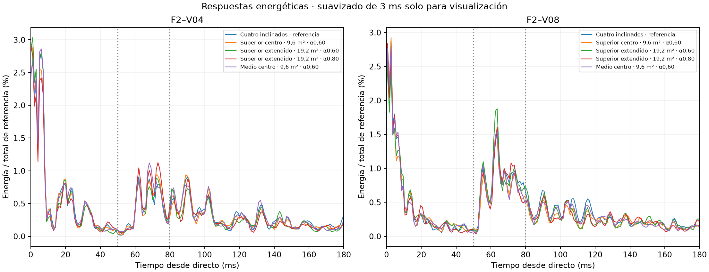

# Resultados del estudio mixto: reflectores inclinados y absorción localizada

**Aula Magna UTFSM — 10 de noviembre de 2026.** Estudio independiente. Referencia: cuatro paneles con inclinación combinada.

## 1. Resultado y alcance

Se calcularon cuatro tratamientos absorbentes localizados en el muro posterior de la platea alta, manteniendo los mismos cuatro reflectores. El objetivo es comprobar una mejora parcial, repartida y consistente, conservando el balance musical. No se exige que todas las posiciones alcancen el mismo valor ni se elimina F2–V08 del análisis.

La referencia de este estudio cumple D50 de 45–55 % y C80 de −2 a +2 dB en **8/12 combinaciones virtuales objetivo**. El menor déficit medio de D50 respecto de esa banda entre los tratamientos corresponde a **Superior extendido · 19,2 m² · α0,80**, con 1,89 puntos frente a 2,62 de referencia. Este orden considera solo el déficit de D50; no selecciona por sí solo un tratamiento ni considera suficiente superar C80.

El conteo de cumplimiento, las variaciones energéticas y las pérdidas en otras posiciones se mantienen separados. Una respuesta que mejora pero sigue fuera de rango es una mejora parcial, no un cumplimiento. Las diferencias pequeñas se contrastan con la variación entre semillas.

**Evidencia preliminar favorable:** el paño superior de 19,2 m² y α = 0,80 aumenta D50 en las cuatro combinaciones de la franja media en las tres semillas. El promedio de esa franja pasa de 39,23 a 42,40 %, una mejora de 3,17 puntos. Ocho de las doce combinaciones objetivo aumentan D50 en las tres semillas. No constituye una prueba estadística ni resuelve toda la franja, pero sí respalda un efecto parcial repartido dentro de este modelo.

**Compromisos:** el paño superior de 19,2 m² y α = 0,60 obtiene 9/12 cumplimientos medios frente a 8/12 de referencia, pero F2–P8 llega a D50 de 56,09 % y C80 de +2,12 dB. El paño central de 9,6 m² a menor altura conserva los tres pares prioritarios dentro de ambos rangos en las tres semillas, con una mejora media de D50 en la franja media de 1,59 puntos. Ninguna variante domina todos los indicadores.

## 2. Protocolo y condiciones estudiadas

El [protocolo previo](ESTUDIO-MIXTO-REFLECTORES-Y-ABSORCION-LOCALIZADA.md) define la hipótesis, variantes y criterios. Se mantiene 1.000 Hz como banda de estudio. La absorción del paño es un coeficiente final efectivo, no un incremento sumado al existente ni un producto físico seleccionado. El material original del muro tiene α ≈ 0,24795 a esta banda; en las zonas elegidas se sustituye por 0,60 o 0,80.

| Condición | Área | Y mínimo/máximo | Z mínimo/máximo | α final |
|---|---|---|---|---|
| Cuatro inclinados · referencia | 0,0 m² | — | — | — |
| Superior centro · 9,6 m² · α0,60 | 9,6 m² | -4,0 / 4,0 | 10,6 / 11,8 | 0,60 |
| Superior extendido · 19,2 m² · α0,60 | 19,2 m² | -8,0 / 8,0 | 10,6 / 11,8 | 0,60 |
| Superior extendido · 19,2 m² · α0,80 | 19,2 m² | -8,0 / 8,0 | 10,6 / 11,8 | 0,80 |
| Medio centro · 9,6 m² · α0,60 | 9,6 m² | -4,0 / 4,0 | 9,0 / 10,2 | 0,60 |

Todos los paños están en X = 40,25 m. La dispersión y la ley de reflexión del muro se mantienen. Los reflectores conservan 48 m² de área frontal, espesor 20 mm, α = 0,05 y dispersión 0,05. La sala y los paneles no cambian entre condiciones; solo se modifican etiquetas y absorción de las caras elegidas.

## 3. Referencia, cálculo y verificaciones

Se subdividió coplanarmente el muro para delimitar paños, conservando la superficie y volumen del recinto y los mismos paneles que la configuración inclinada anterior. Se recalculó la referencia con esa subdivisión; todos los tratamientos usan exactamente la misma malla tetraédrica. Los cambios respecto de las simulaciones anteriores se registran como control de subdivisión/muestreo, no como efecto absorbente.

En las doce combinaciones objetivo, el cambio de D50 de la nueva referencia respecto de la anterior está entre -0,34 y 0,79 puntos. Los efectos descritos a continuación se calculan exclusivamente respecto de la nueva referencia común.

Se ejecutaron **30 corridas principales nuevas y diez pilotos**. Cada principal usa 600.000 partículas, una fuente, tres semillas por condición/fuente (20261019/20261020/20261021), 4 s, paso 1 ms y receptor de radio 0,31 m. Se obtienen **210 respuestas medias y 630 resultados individuales**. La máxima fracción de partículas perdidas es 0.000162.

Se conservan Lw global de 90 dB y el espectro original, fuentes omnidireccionales, posiciones de los 21 receptores, materiales no tratados, 18 °C, humedad 57 %, velocidad 342 m/s, absorción del aire activada y transmisión de superficies desactivada. No se modela la directividad del line array. Las energías lineales se promedian antes de calcular los indicadores, sin volver a elevarlas al cuadrado.

La verificación comprueba conservación coplanar de las caras originales, igualdad de los cuatro paneles, áreas tratadas, volumen de aire, vecindades tetraédricas y ausencia de tetraedros dentro de los paneles. Todos los MBIN son idénticos. Se verifican configuraciones y hashes para demostrar que solo cambia el coeficiente activo del material de paño. El proyecto canónico permanece sin cambios.

## 4. Cobertura del frente y zona media

El objetivo incluye V01–V04 y V05/V08 con dos fuentes: doce combinaciones. «Cumplen» requiere simultáneamente D50 de 45–55 % y C80 de −2 a +2 dB. «Distancia a banda» es la media de max(45−D50, 0, D50−55), en puntos porcentuales. No incluye una penalización de C80: sus excesos se muestran en columna separada.

| Condición | D50 frente | D50 media | Distancia a banda | Cumplen /12 | C80 >+2 /12 | Cumplen en las tres semillas /12 |
|---|---|---|---|---|---|---|
| Cuatro inclinados · referencia | 46,31 % | 39,23 % | 2,62 | 8 | 0 | 6 |
| Superior centro · 9,6 m² · α0,60 | 46,95 % | 40,58 % | 2,31 | 8 | 0 | 8 |
| Superior extendido · 19,2 m² · α0,60 | 47,71 % | 41,20 % | 2,16 | 9 | 0 | 8 |
| Superior extendido · 19,2 m² · α0,80 | 48,45 % | 42,40 % | 1,89 | 8 | 1 | 7 |
| Medio centro · 9,6 m² · α0,60 | 46,28 % | 40,82 % | 2,27 | 8 | 0 | 6 |

El cumplimiento entre semillas es descriptivo y no constituye un intervalo de confianza. Tampoco implica que todos los puntos entre receptores tengan el mismo comportamiento.

## 5. Conservación de los puntos prioritarios

Cada celda muestra D50 (%) / C80 (dB). F2–P9 permanece como control secundario. La comparación usa los cuatro reflectores como referencia; no vuelve a atribuirles a los paños la mejora que ya aportaban.

| Condición | F1–P8 | F1–P9 | F2–P8 | F2–P9, control | Cumplen prioritarios /3 |
|---|---|---|---|---|---|
| Cuatro inclinados · referencia | 47,46 / 1,06 | 51,13 / 1,60 | 51,62 / 1,51 | 40,35 / 0,12 | 3 |
| Superior centro · 9,6 m² · α0,60 | 49,83 / 1,46 | 50,20 / 1,46 | 54,62 / 1,95 | 39,64 / 0,22 | 3 |
| Superior extendido · 19,2 m² · α0,60 | 49,93 / 1,46 | 50,29 / 1,53 | 56,09 / 2,12 | 41,32 / 0,44 | 2 |
| Superior extendido · 19,2 m² · α0,80 | 50,92 / 1,61 | 52,27 / 1,92 | 55,06 / 2,09 | 42,42 / 0,66 | 2 |
| Medio centro · 9,6 m² · α0,60 | 48,59 / 1,19 | 49,99 / 1,42 | 52,45 / 1,63 | 39,34 / 0,16 | 3 |

## 6. Ventanas energéticas: mecanismo y límites

Se calcularon recorridos candidatos mínimos sobre los rectángulos tratados, minimizando la longitud fuente–paño–receptor y comprobando visibilidad con los paneles presentes. Los retardos siguientes son relativos al directo y corresponden a ubicaciones, no a coeficientes. No etiquetan picos de la respuesta simulada.

| Ubicación | F2–V04 | F2–V08 |
|---|---|---|
| Superior centro | 87,51 ms | 59,43 ms |
| Superior extendido | 85,61 ms | 56,47 ms |
| Medio centro | 85,49 ms | 57,36 ms |

Los candidatos de V04 están después de 80 ms; los de V08 están entre 50 y 80 ms. Esto justifica estudiar las ventanas por separado: un mismo paño puede tener efectos distintos sobre C80 según el receptor. La minimización numérica no incorpora por sí sola una contribución energética ni demuestra que ese recorrido domine.

Las energías se integran desde el arribo directo: E0–50 incluye directo y reflexiones tempranas; E50–80 pertenece al denominador de D50 y al numerador de C80; E>80 es tardía para ambos. Quitar energía posterior a 80 ms puede elevar D50 y C80 simultáneamente. Un paño no actúa después de un tiempo programado: intercepta trayectorias que pueden alimentar distintas ventanas.

En este modelo energético, con geometría, fuente y ley de dispersión idénticas, aumentar únicamente la absorción no aporta energía ni redirige trayectorias: incrementa sus pérdidas. Un aumento absoluto estimado en alguna ventana se interpreta como fluctuación del muestreo, no como energía creada o redirigida por el absorbente. Los indicadores son cocientes y sí pueden aumentar al disminuir más su denominador. Esta distinción importa para interpretar diferencias pequeñas entre condiciones.

En las tablas siguientes, ΔE en dB es el cociente de energía de tratamiento/referencia. Las fracciones temporales y los indicadores no se confunden con cambios de nivel absoluto.

| Condición | Par | ΔE0–50 dB | ΔE50–80 dB | ΔE>80 dB | ΔE total dB | D50 / C80 |
|---|---|---|---|---|---|---|
| Cuatro inclinados · referencia | F2–V04 | 0,00 | 0,00 | 0,00 | 0,00 | 36,73 / -0,12 |
| Cuatro inclinados · referencia | F2–V08 | 0,00 | 0,00 | 0,00 | 0,00 | 28,11 / 0,22 |
| Superior centro · 9,6 m² · α0,60 | F2–V04 | 0,07 | 0,10 | -0,22 | -0,07 | 37,95 / 0,18 |
| Superior centro · 9,6 m² · α0,60 | F2–V08 | 0,07 | -0,36 | -0,42 | -0,26 | 30,34 / 0,52 |
| Superior extendido · 19,2 m² · α0,60 | F2–V04 | 0,02 | -0,02 | -0,52 | -0,25 | 39,08 / 0,41 |
| Superior extendido · 19,2 m² · α0,60 | F2–V08 | -0,01 | 0,21 | -0,35 | -0,12 | 28,79 / 0,66 |
| Superior extendido · 19,2 m² · α0,80 | F2–V04 | -0,21 | 0,77 | -0,66 | -0,29 | 37,43 / 0,60 |
| Superior extendido · 19,2 m² · α0,80 | F2–V08 | 0,08 | -0,18 | -0,38 | -0,20 | 29,96 / 0,56 |
| Medio centro · 9,6 m² · α0,60 | F2–V04 | 0,01 | 0,34 | -0,18 | -0,04 | 37,18 / 0,16 |
| Medio centro · 9,6 m² · α0,60 | F2–V08 | 0,04 | -0,29 | -0,33 | -0,22 | 29,81 / 0,45 |

Las barras usan el mismo total de referencia para cada receptor: pueden reducir su altura total. No se renormaliza cada tratamiento a 100 %, lo que permite distinguir pérdida absoluta de energía y cambio de proporciones.

Las curvas tienen un suavizado de 3 ms solo para visualización; los indicadores se integran sin suavizar. No se identifica un pico concreto con una superficie únicamente por coincidencia de tiempos.

## 7. Diagnóstico de muestreo con energía temprana fija

Para cada fuente/receptor se calcula un límite inferior de recorrido que toque el plano posterior infinito mediante la fuente imagen. Es una cota geométrica: incluso si ese recorrido está obstruido o fuera del paño, los recorridos físicamente posibles no pueden ser más cortos. Se agrega una guarda de 0,31/342 s por el radio receptor y 1 ms por la discretización.

Cuando esa cota garantiza que el muro no puede influir en E0–50, se informa un diagnóstico adicional que conserva E0–50 de la referencia y utiliza E50–80/E>80 del tratamiento. D50control = 100·E0–50ref/(E0–50ref + E>50trat); C80control = 10·log10[(E0–50ref + E50–80trat)/E>80trat]. Esto ayuda a examinar fluctuaciones de Monte Carlo en una ventana físicamente invariante. No reemplaza el resultado simulado completo, no elimina el ruido de las ventanas posteriores y no impone una mejoría.

| Condición | Par | D50 simulado | D50 con temprano fijo | C80 simulado | C80 con temprano fijo |
|---|---|---|---|---|---|
| Cuatro inclinados · referencia | F2–V04 | 36,73 % | 36,73 % | -0,12 dB | -0,12 dB |
| Cuatro inclinados · referencia | F2–V08 | 28,11 % | 28,11 % | 0,22 dB | 0,22 dB |
| Cuatro inclinados · referencia | F1–P9 | 51,13 % | 51,13 % | 1,60 dB | 1,60 dB |
| Superior centro · 9,6 m² · α0,60 | F2–V04 | 37,95 % | 37,55 % | 0,18 dB | 0,12 dB |
| Superior centro · 9,6 m² · α0,60 | F2–V08 | 30,34 % | 29,99 % | 0,52 dB | 0,48 dB |
| Superior centro · 9,6 m² · α0,60 | F1–P9 | 50,20 % | 50,66 % | 1,46 dB | 1,53 dB |
| Superior extendido · 19,2 m² · α0,60 | F2–V04 | 39,08 % | 38,99 % | 0,41 dB | 0,39 dB |
| Superior extendido · 19,2 m² · α0,60 | F2–V08 | 28,79 % | 28,84 % | 0,66 dB | 0,66 dB |
| Superior extendido · 19,2 m² · α0,60 | F1–P9 | 50,29 % | 51,47 % | 1,53 dB | 1,71 dB |
| Superior extendido · 19,2 m² · α0,80 | F2–V04 | 37,43 % | 38,55 % | 0,60 dB | 0,75 dB |
| Superior extendido · 19,2 m² · α0,80 | F2–V08 | 29,96 % | 29,58 % | 0,56 dB | 0,52 dB |
| Superior extendido · 19,2 m² · α0,80 | F1–P9 | 52,27 % | 52,39 % | 1,92 dB | 1,94 dB |
| Medio centro · 9,6 m² · α0,60 | F2–V04 | 37,18 % | 37,13 % | 0,16 dB | 0,15 dB |
| Medio centro · 9,6 m² · α0,60 | F2–V08 | 29,81 % | 29,62 % | 0,45 dB | 0,42 dB |
| Medio centro · 9,6 m² · α0,60 | F1–P9 | 49,99 % | 50,76 % | 1,42 dB | 1,54 dB |

## 8. Consistencia en los casos deficitarios

Los cambios por semilla comparan condiciones con la misma semilla nominal. Cambiar la absorción puede alterar la secuencia de trayectorias y de números aleatorios; no se supone un emparejamiento perfecto ni se interpreta el rango como significación estadística.

| Condición | Par | ΔD50 medio (puntos) | ΔD50 mínimo/máximo entre semillas | D50 medio | Rango D50 entre semillas |
|---|---|---|---|---|---|
| Cuatro inclinados · referencia | F2–V04 | 0,00 | 0,00 / 0,00 | 36,73 % | 36,24 / 37,66 % |
| Cuatro inclinados · referencia | F2–V08 | 0,00 | 0,00 / 0,00 | 28,11 % | 26,53 / 30,50 % |
| Superior centro · 9,6 m² · α0,60 | F2–V04 | 1,22 | 0,70 / 2,23 | 37,95 % | 37,04 / 38,47 % |
| Superior centro · 9,6 m² · α0,60 | F2–V08 | 2,23 | -0,16 / 3,86 | 30,34 % | 26,38 / 33,26 % |
| Superior extendido · 19,2 m² · α0,60 | F2–V04 | 2,35 | 1,53 / 3,73 | 39,08 % | 37,99 / 40,00 % |
| Superior extendido · 19,2 m² · α0,60 | F2–V08 | 0,68 | -1,26 / 2,30 | 28,79 % | 27,50 / 29,52 % |
| Superior extendido · 19,2 m² · α0,80 | F2–V04 | 0,70 | -1,86 / 2,44 | 37,43 % | 35,79 / 38,71 % |
| Superior extendido · 19,2 m² · α0,80 | F2–V08 | 1,85 | 1,69 / 2,24 | 29,96 % | 28,22 / 32,74 % |
| Medio centro · 9,6 m² · α0,60 | F2–V04 | 0,45 | -0,27 / 1,14 | 37,18 % | 36,78 / 37,39 % |
| Medio centro · 9,6 m² · α0,60 | F2–V08 | 1,70 | -1,04 / 3,43 | 29,81 % | 29,35 / 30,65 % |

## 9. Efectos sobre otras zonas

Cambios medios respecto de la referencia con cuatro reflectores. Los controles posteriores y sobre madera se conservan en los datos completos y no se incorporan al objetivo de doce combinaciones.

| Condición | Zona | ΔD50 puntos | ΔC80 dB | ΔT30 s | ΔEDT s | Δenergía total dB |
|---|---|---|---|---|---|---|
| Superior centro · 9,6 m² · α0,60 | Platea baja | -0,32 | -0,03 | -0,01 | -0,02 | 0,00 |
| Superior centro · 9,6 m² · α0,60 | Bajo balcón | -0,20 | -0,07 | 0,01 | 0,02 | -0,08 |
| Superior centro · 9,6 m² · α0,60 | Posteriores en butacas | 1,03 | 0,18 | -0,03 | -0,05 | -0,15 |
| Superior extendido · 19,2 m² · α0,60 | Platea baja | -0,96 | -0,12 | -0,01 | -0,03 | 0,00 |
| Superior extendido · 19,2 m² · α0,60 | Bajo balcón | -0,07 | -0,11 | -0,05 | 0,05 | -0,02 |
| Superior extendido · 19,2 m² · α0,60 | Posteriores en butacas | 0,92 | 0,07 | -0,01 | -0,08 | -0,30 |
| Superior extendido · 19,2 m² · α0,80 | Platea baja | -0,91 | -0,17 | -0,04 | -0,04 | -0,06 |
| Superior extendido · 19,2 m² · α0,80 | Bajo balcón | -0,60 | -0,10 | -0,04 | -0,03 | -0,15 |
| Superior extendido · 19,2 m² · α0,80 | Posteriores en butacas | 1,69 | 0,15 | -0,05 | -0,11 | -0,31 |
| Medio centro · 9,6 m² · α0,60 | Platea baja | -0,93 | -0,17 | -0,01 | -0,01 | -0,01 |
| Medio centro · 9,6 m² · α0,60 | Bajo balcón | 0,73 | -0,00 | 0,00 | -0,00 | -0,06 |
| Medio centro · 9,6 m² · α0,60 | Posteriores en butacas | 0,69 | 0,11 | -0,03 | -0,03 | -0,19 |

Una media pequeña no excluye cambios locales. Las diferencias de EDT/T30 se contrastan con los ajustes y respuestas individuales conservados; estos ensayos de una banda no certifican el balance reverberante del espectro completo.

## 10. F2–V08 y decisión de continuación

F2–V08 permanece como caso crítico en mapas, tablas y conteos. Que no alcance la banda no invalida automáticamente una mejora útil en las demás posiciones, pero tampoco permite afirmar que la franja media esté resuelta. Los resultados de estas superficies concretas no prueban que sea imposible mejorarlo mediante otras posiciones, orientación de reflectores o condiciones de fuente.

La decisión debe considerar simultáneamente magnitud de mejora, reparto espacial, persistencia entre semillas, margen de C80 en puntos ya favorables y efectos en otras zonas. No se selecciona el mayor coeficiente por defecto ni se extrapolan los puntos porcentuales de predicción como correcciones lineales de las mediciones reales. El tratamiento combinado no se considera la suma algebraica de los estudios por separado.

**Conclusión del estudio:** hay una demostración preliminar de que añadir absorción posterior localizada a los cuatro reflectores puede mejorar la definición en varias posiciones y reducir energía tardía con cambios pequeños en los promedios de las zonas inferiores. La magnitud es moderada y se conserva un compromiso con C80. Esto respalda investigar la combinación, no declarar una solución uniforme o un material físico ya validado.

Para continuar se conservan dos referencias de compromiso: el paño central medio de 9,6 m² y α = 0,60 para proteger P8/P9, y el superior extendido para estudiar mayor beneficio sobre la zona media. No se selecciona α = 0,80 como óptimo: sus beneficios y los pequeños excesos de C80 deben revisarse conjuntamente. Diferencias de centésimas alrededor de +2 dB no son una frontera perceptual abrupta; se mantienen los conteos estrictos sin convertirlos en una sentencia de audibilidad.

F2–V08 pasa de D50 = 28,11 % a 29,96 % con el superior de 19,2 m² y α = 0,80: +1,85 puntos, positivos en las tres semillas, con C80 medio de +0,56 dB. No está inmóvil ni demuestra imposibilidad de mejora. Sigue lejos de 45 %: la corrección de ese punto por estos paños es limitada y no se fuerza el diseño completo para resolverlo. La confirmación futura debe comprobar otras bandas y estabilidad de las alternativas elegidas, sin exigir perfección para reconocer este beneficio parcial.

## 11. Archivos y referencias

- [Protocolo independiente](ESTUDIO-MIXTO-REFLECTORES-Y-ABSORCION-LOCALIZADA.md) y [carpeta del estudio](../prediccion/estudio-difusion/reflectores-absorcion-localizada/README.md).
- [Medias](../prediccion/estudio-difusion/reflectores-absorcion-localizada/resultados/medias.csv), [semillas](../prediccion/estudio-difusion/reflectores-absorcion-localizada/resultados/semillas.csv), [comparaciones](../prediccion/estudio-difusion/reflectores-absorcion-localizada/resultados/comparaciones.csv) y [resumen por zona](../prediccion/estudio-difusion/reflectores-absorcion-localizada/resultados/resumen-zonas.csv).
- [Control de subdivisión](../prediccion/estudio-difusion/reflectores-absorcion-localizada/resultados/control-subdivision.csv), [verificación geométrica](../prediccion/estudio-difusion/reflectores-absorcion-localizada/resultados/verificacion-geometria.json) y [verificación de cálculos](../prediccion/estudio-difusion/reflectores-absorcion-localizada/resultados/verificacion-calculos.json).
- [Inclinación y segmentación, antecedente](RESULTADOS-INCLINACION-Y-SEGMENTACION-REFLECTORES.md), [absorción posterior sin estos reflectores, antecedente](RESULTADOS-ABSORCION-POSTERIOR-080.md) y [documento central](AVANCES-Y-ESTADO-DEL-ESTUDIO-ACUSTICO.md).

