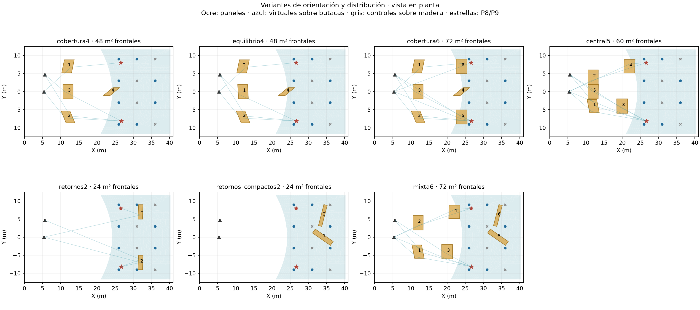
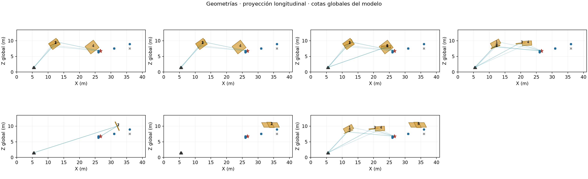
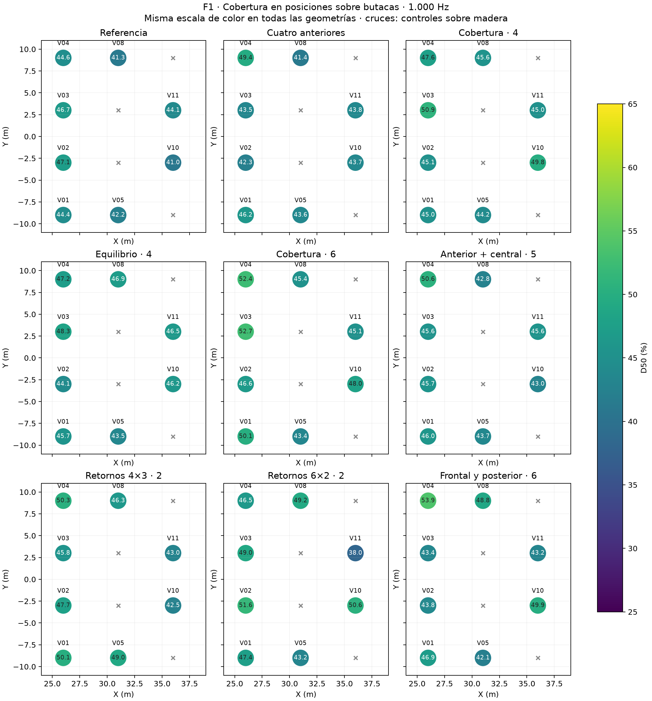
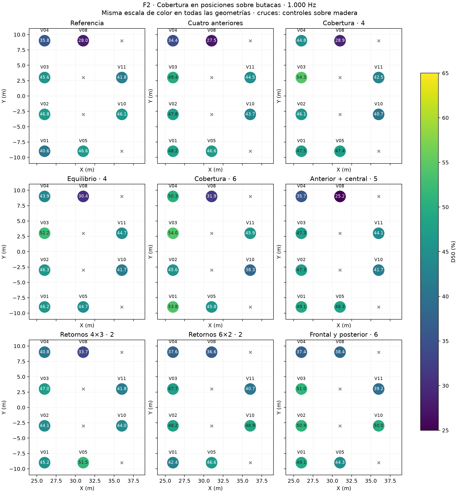
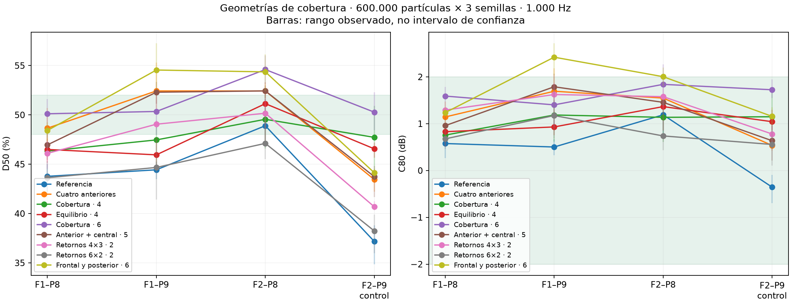

# Comparación de geometrías para la cobertura acústica de platea alta

**Teatro Aula Magna UTFSM — 9 de noviembre de 2026.**

## 1. Resultado principal

Se compararon **siete geometrías nuevas** a 1.000 Hz. La menor distancia media de D50 respecto de 50 % en las dieciséis combinaciones virtuales sobre butacas corresponde a **Cobertura · 6**, con 4,83 puntos de error absoluto medio y 2/16 respuestas dentro de ambos rangos. La mayor cantidad de cumplimientos entre las nuevas corresponde a **Retornos 6×2 · 2**, con 5/16. Ambos criterios se muestran porque una media más cercana y un mayor número dentro de un intervalo estrecho pueden favorecer geometrías diferentes.

El objetivo se mantiene en **D50 de 48–52 % y C80 entre −2 y +2 dB** como criterios de proyecto. Los pares prioritarios son F1–P8, F1–P9 y F2–P8; F2–P9 permanece como control secundario. No se modificaron las metas para seleccionar una variante.

Ninguna de las siete variantes reúne ambos rangos en los tres pares prioritarios y las dieciséis combinaciones virtuales sobre butacas a la vez. Los resultados se interpretan como avances y diferencias de cobertura.

## 2. Muestreo y comparación

Se mantienen los 21 receptores y las dos fuentes calculadas por separado. Los virtuales se separan según la superficie del modelo: **ocho posiciones sobre butacas × dos fuentes = 16 combinaciones**; **cuatro posiciones sobre madera expuesta × dos fuentes = 8 controles**. El antiguo conteo de 24 mezclaba ambos grupos; no se interpreta como porcentaje de público.

Se ejecutaron **42 corridas principales nuevas de 600.000 partículas y tres semillas por fuente y geometría**, más **14 pilotos de 20.000 partículas**. Se reutilizaron doce corridas del estudio anterior: seis de referencia sin paneles y seis de su combinación de cuatro paneles. En total se analizan 54 corridas principales, de las cuales doce son reutilizadas, con 21 receptores por corrida.

Las semillas son 20261019, 20261020 y 20261021. Se promedian energías lineales antes de recalcular D50/C80 y decaimientos. Se conservan Lw global 90 dB y espectro de referencia, fuente omnidireccional idealizada, radio receptor 0,31 m, duración 4 s, paso 1 ms, 18 °C, 57 % HR y absorción atmosférica activa. El material de los reflectores permanece en α = 0,05 y s = 0,05 a 1.000 Hz, con transmisión desactivada. La comparación aísla cambios geométricos sin reajustar los materiales de la sala.

La envolvente original y sus materiales se conservan en todas las variantes. Cada panel es un sólido cerrado de 20 mm, con su volumen excluido del aire tetraédrico. La referencia utiliza la misma representación original y cadena de exportación que el estudio anterior; se conserva su identidad por huellas de archivos y no se vuelve a calibrar para cada geometría.

## 3. Geometrías comparadas

| Identificador | Distribución | Paneles | Dimensiones por panel | Área frontal total |
|---|---|---:|---|---:|
| cobertura4 | Selección de rutas tempranas sobre los sectores de butacas, dando mayor peso a déficits de referencia | 4 | 4 × 3 m | 48 m² |
| equilibrio4 | Selección con recompensa de equilibrio entre franjas delantera, intermedia y posterior | 4 | 4 × 3 m | 48 m² |
| cobertura6 | Misma geometría cobertura4, con dos módulos adicionales | 6 | 4 × 3 m | 72 m² |
| central5 | Cuatro paneles del estudio anterior más un módulo elegido para aportar a V02/V03 | 5 | 4 × 3 m | 60 m² |
| retornos2 | Dos reflectores elevados en el sector posterior, adelantados respecto del muro | 2 | 4 × 3 m | 24 m² |
| retornos_compactos2 | Dos paneles posteriores más anchos y menos altos, con el eje largo horizontal | 2 | 6 × 2 m | 24 m² |
| mixta6 | Cuatro paneles anteriores más los dos posteriores compactos | 6 | Cuatro de 4 × 3 m y dos de 6 × 2 m | 72 m² |

Las cuatro primeras variantes proceden de una búsqueda de posiciones X = 12–28 m, Y = −7/0/+7 m y Z = 8/9/10 m. Se conservaron 468 propuestas de posición y orientación con rutas útiles y compatibilidad geométrica. El puntaje pondera las posiciones deficitarias y equilibra profundidad según el caso; es una herramienta de selección geométrica, no una predicción de D50/C80.

Se puntuaron rutas especulares con retardo relativo menor que 45 ms y corte conservador de reflector finito no mayor que 1.000 Hz. Se incluyó la ocultación de rutas entre paneles al seleccionar conjuntos. Las posiciones, normales y puntos de reflexión quedan en los archivos de geometría. La ley geométrica de cada panel cambia realmente: no se representa la nueva forma aumentando un coeficiente de difusión.

Las dos variantes posteriores se añadieron para estudiar otra familia de recorridos. En retornos2 se exploraron 516 propuestas y quedaron 69 al aplicar la reserva vertical descrita más abajo. En retornos_compactos2 se conservaron 75 propuestas y se forzó que el primer módulo tuviera una ruta útil hacia V10/V11. Se mantuvo el área de 12 m² por módulo al pasar de 4 × 3 a 6 × 2 m, aunque también cambian posición y orientación; no se atribuye el resultado exclusivamente a la relación de aspecto.

La variante mixta se añadió al observar efectos diferentes entre grupos: la cobertura6 acercó más el promedio virtual a 50 %, mientras los posteriores compactos consiguieron más respuestas dentro de ambos rangos. La mixta prueba esa distribución con los cuatro paneles anteriores, usando los mismos 72 m² de cobertura6. Es una elección adaptativa, no una validación independiente de una geometría preseleccionada.

## 4. Restricciones espaciales verificadas

Se comprobaron paneles dentro de la envolvente, cajas sin intersección mutua, continuidad de la envolvente original, esferas receptoras fuera de los paneles y conservación de los segmentos directos de F1/F2 hacia los 21 receptores. Los reflejos entre paneles pueden ocultarse: esa comprobación es distinta de la de sonido directo y se conserva en el registro de rutas.

La holgura vertical se muestreó en 50 puntos de ambas caras de cada panel, buscando el piso modelado más alto bajo cada muestra. Los valores siguientes son **mínimos muestreados sobre el modelo**, no alturas globales Z ni una medición del recinto. Para las variantes posteriores se utilizó una reserva geométrica de 2,31 m = 2 m de altura de receptor + 0,31 m de radio. Es una condición de este estudio, no una exigencia normativa.

| Variante | Holgura vertical mínima muestreada | Tetraedros | Volumen de aire |
|---|---:|---:|---:|
| Cobertura · 4 | 2,50 m | 8281 | 9542,774 m³ |
| Equilibrio · 4 | 2,50 m | 8141 | 9542,774 m³ |
| Cobertura · 6 | 2,50 m | 9335 | 9542,294 m³ |
| Anterior + central · 5 | 4,50 m | 8509 | 9542,534 m³ |
| Retornos 4×3 · 2 | 2,59 m | 8333 | 9543,254 m³ |
| Retornos 6×2 · 2 | 2,38 m | 8085 | 9543,254 m³ |
| Frontal y posterior · 6 | 2,38 m | 9122 | 9542,294 m³ |

Los elementos de iluminación, escenografía y line array que no estén representados por geometría identificada no forman parte de esta prueba de colisiones. Las comprobaciones anteriores corresponden al volumen modelado y a las fuentes del estudio. Los [datos de holgura](../prediccion/estudio-difusion/reflectores-cobertura/resultados/holguras-verticales.json) identifican cada punto de control y su piso.

## 5. Cobertura en los puntos virtuales sobre butacas

Todos los conteos siguientes usan el mismo denominador: **16 respuestas, ocho posiciones y dos fuentes**. La media no sustituye el cumplimiento por posición; el error medio es la distancia absoluta de D50 respecto de 50 %, en puntos porcentuales.

| Geometría | D50 medio | Error medio respecto de 50 % | D50 mínimo–máximo | Cumplen D50 y C80 | D50 <48 % | D50 >52 % | C80 >+2 dB |
|---|---:|---:|---:|---:|---:|---:|---:|
| Referencia | 42,66 % | 7,34 puntos | 27,98–47,10 % | 0/16 | 16/16 | 0/16 | 0/16 |
| Cuatro anteriores | 43,50 % | 6,50 puntos | 27,50–49,43 % | 3/16 | 13/16 | 0/16 | 0/16 |
| Cobertura · 4 | 45,33 % | 5,31 puntos | 28,88–54,26 % | 1/16 | 13/16 | 1/16 | 2/16 |
| Equilibrio · 4 | 44,91 % | 5,37 puntos | 30,45–52,25 % | 1/16 | 14/16 | 1/16 | 1/16 |
| Cobertura · 6 | 46,84 % | 4,83 puntos | 31,94–53,98 % | 2/16 | 10/16 | 4/16 | 1/16 |
| Anterior + central · 5 | 43,86 % | 6,22 puntos | 25,20–50,59 % | 3/16 | 13/16 | 0/16 | 0/16 |
| Retornos 4×3 · 2 | 45,18 % | 5,06 puntos | 33,69–51,49 % | 3/16 | 12/16 | 0/16 | 1/16 |
| Retornos 6×2 · 2 | 45,26 % | 5,01 puntos | 36,57–51,64 % | 5/16 | 10/16 | 0/16 | 1/16 |
| Frontal y posterior · 6 | 45,77 % | 4,95 puntos | 37,44–53,88 % | 3/16 | 9/16 | 1/16 | 4/16 |

## 6. Puntos prioritarios y F2–P9

Cada celda muestra **D50 (%) / C80 (dB)**. F2–P9 se conserva visible, aunque no es un requisito excluyente para estos conjuntos.

| Geometría | F1–P8 | F1–P9 | F2–P8 | F2–P9, control | Cumplen prioritarios |
|---|---:|---:|---:|---:|---:|
| Referencia | 43,77 / 0,58 | 44,43 / 0,50 | 48,90 / 1,19 | 37,17 / -0,35 | 1/3 |
| Cuatro anteriores | 48,65 / 1,14 | 52,43 / 1,69 | 52,42 / 1,55 | 43,45 / 0,54 | 1/3 |
| Cobertura · 4 | 46,33 / 0,76 | 47,46 / 1,19 | 49,55 / 1,14 | 47,72 / 1,15 | 1/3 |
| Equilibrio · 4 | 46,50 / 0,83 | 45,95 / 0,93 | 51,14 / 1,37 | 46,56 / 1,04 | 1/3 |
| Cobertura · 6 | 50,12 / 1,59 | 50,35 / 1,40 | 54,60 / 1,84 | 50,28 / 1,73 | 2/3 |
| Anterior + central · 5 | 46,96 / 0,96 | 52,30 / 1,79 | 52,43 / 1,46 | 43,74 / 0,64 | 0/3 |
| Retornos 4×3 · 2 | 46,10 / 1,29 | 49,06 / 1,62 | 50,17 / 1,58 | 40,69 / 0,78 | 2/3 |
| Retornos 6×2 · 2 | 43,63 / 0,68 | 44,67 / 1,17 | 47,11 / 0,74 | 38,24 / 0,56 | 0/3 |
| Frontal y posterior · 6 | 48,42 / 1,24 | 54,55 / 2,42 | 54,36 / 2,00 | 44,14 / 1,16 | 1/3 |

Las barras y los archivos individuales muestran el rango entre tres semillas, no un intervalo de confianza. Un exceso de unas décimas sobre 52 % se distingue de un déficit espacial de diez o veinte puntos; el conteo estricto conserva los umbrales sin convertirlos en fronteras perceptuales.

## 7. Diagnóstico temporal: el caso F2–V08

En la referencia, F2–V08 tiene D50 ≈ 27,98 %, C80 ≈ −0,05 dB y **21,73 % de energía entre 50 y 80 ms**. Parte importante de la energía que no contribuye a D50 sí pertenece al numerador de C80. Esto ayuda a explicar por qué mejorar ambos parámetros requiere mirar tres ventanas y no simplemente añadir más reflexiones.

Como balance algebraico, si solo se añadiera energía anterior a 50 ms y todo lo demás permaneciera fijo, llevar ese D50 a 50 % daría C80 cercano a **+2,7 dB**. Ese balance no es una nueva simulación ni una imposibilidad para cualquier tratamiento: señala la necesidad de cambiar también la distribución de 50–80 ms y/o la energía posterior. Las variantes posteriores buscan investigar cambios de recorrido; no se presume que hayan eliminado una reflexión concreta de la referencia.

| Geometría | D50 F2–V08 | C80 F2–V08 | Δenergía 0–50 ms | Δenergía 50–80 ms | Δenergía 80–300 ms |
|---|---:|---:|---:|---:|---:|
| Referencia | 27,98 % | -0,05 dB | 0,00 dB | 0,00 dB | 0,00 dB |
| Cuatro anteriores | 27,50 % | 0,06 dB | -0,05 dB | 0,24 dB | -0,07 dB |
| Cobertura · 4 | 28,88 % | 0,07 dB | 0,48 dB | 0,30 dB | 0,23 dB |
| Equilibrio · 4 | 30,45 % | 0,01 dB | 0,82 dB | 0,01 dB | 0,44 dB |
| Cobertura · 6 | 31,94 % | 0,07 dB | 0,80 dB | -0,48 dB | 0,15 dB |
| Anterior + central · 5 | 25,20 % | -0,02 dB | -0,38 dB | 0,62 dB | 0,08 dB |
| Retornos 4×3 · 2 | 33,69 % | 0,73 dB | 1,12 dB | 0,07 dB | -0,05 dB |
| Retornos 6×2 · 2 | 36,57 % | 1,01 dB | 1,53 dB | -0,18 dB | -0,19 dB |
| Frontal y posterior · 6 | 38,43 % | 1,02 dB | 2,01 dB | -0,34 dB | 0,07 dB |

## 8. Controles y efectos en otras zonas

Los controles sobre madera se conservan separados de la audiencia. Los cambios se expresan como medias de diferencias individuales frente a la referencia, a 1.000 Hz; los CSV mantienen los extremos y cada receptor.

| Variante | Grupo | ΔD50 (puntos) | ΔC80 (dB) | ΔT30 (s) | ΔEDT (s) | Δnivel de banda (dB) |
|---|---|---:|---:|---:|---:|---:|
| Cobertura · 4 | Madera alta, control | 1,59 | 0,39 | -0,10 | -0,03 | 0,56 |
| Cobertura · 4 | Platea baja | 0,70 | 0,09 | -0,06 | 0,02 | 0,01 |
| Cobertura · 4 | Bajo balcón | -1,02 | -0,30 | 0,01 | 0,15 | 0,09 |
| Equilibrio · 4 | Madera alta, control | 0,94 | 0,31 | -0,08 | -0,03 | 0,54 |
| Equilibrio · 4 | Platea baja | 0,75 | 0,09 | -0,07 | 0,01 | 0,06 |
| Equilibrio · 4 | Bajo balcón | -2,48 | -0,43 | -0,04 | 0,13 | 0,06 |
| Cobertura · 6 | Madera alta, control | 0,89 | 0,30 | -0,07 | -0,05 | 0,47 |
| Cobertura · 6 | Platea baja | 0,85 | 0,09 | -0,05 | 0,02 | -0,01 |
| Cobertura · 6 | Bajo balcón | -0,93 | -0,24 | -0,03 | 0,16 | 0,12 |
| Anterior + central · 5 | Madera alta, control | 2,92 | 0,51 | -0,05 | -0,03 | 0,63 |
| Anterior + central · 5 | Platea baja | 1,24 | 0,10 | -0,07 | 0,05 | -0,19 |
| Anterior + central · 5 | Bajo balcón | -1,30 | -0,37 | -0,00 | 0,18 | 0,01 |
| Retornos 4×3 · 2 | Madera alta, control | -3,50 | -0,38 | -0,04 | -0,06 | -0,21 |
| Retornos 4×3 · 2 | Platea baja | 0,33 | 0,00 | -0,01 | -0,02 | 0,05 |
| Retornos 4×3 · 2 | Bajo balcón | -0,61 | -0,10 | 0,00 | 0,01 | -0,16 |
| Retornos 6×2 · 2 | Madera alta, control | -0,76 | -0,12 | -0,04 | -0,06 | 0,04 |
| Retornos 6×2 · 2 | Platea baja | 1,05 | 0,14 | -0,03 | -0,02 | 0,01 |
| Retornos 6×2 · 2 | Bajo balcón | 0,69 | 0,13 | 0,05 | -0,03 | 0,04 |
| Frontal y posterior · 6 | Madera alta, control | 3,44 | 0,47 | -0,01 | -0,09 | 0,49 |
| Frontal y posterior · 6 | Platea baja | 2,17 | 0,28 | -0,07 | 0,01 | -0,13 |
| Frontal y posterior · 6 | Bajo balcón | -0,33 | -0,04 | -0,07 | 0,09 | -0,07 |

## 9. Lectura del resultado y continuación

La geometría de seis paneles redistribuidos logra **50,12 % / +1,59 dB en F1–P8**, **50,35 % / +1,40 dB en F1–P9** y **54,60 % / +1,84 dB en F2–P8**. F2–P9, mantenido como control, llega a **50,28 % / +1,73 dB**. El efecto sobre ese control confirma que su déficit no debe considerarse una consecuencia inevitable de la distancia.

Los dos paneles posteriores de 6 × 2 m consiguen cinco cumplimientos virtuales y elevan el mínimo virtual a 36,57 %, frente a 27,98 % de referencia, pero sus tres pares prioritarios permanecen por debajo de 48 %. La mezcla con los cuatro anteriores no suma simplemente sus ventajas: F1–P9 pasa a 54,55 % y +2,42 dB, y cuatro combinaciones virtuales exceden +2 dB. Ese ensayo conserva la misma área de 72 m² de cobertura6 y permite distinguir el efecto de distribución del mero aumento de superficie.

La comparación debe conservar conjuntamente tres lecturas: acercamiento de D50 a 50 %, C80 por posición y distribución espacial. Una geometría que ayuda a P8/P9 puede seguir dejando sectores virtuales por debajo de 48 % o sobrepasar 52 % en otros. Los mapas permiten identificar ese patrón sin reducirlo a una media global.

La selección geométrica basada en rutas no garantizó el resultado energético: los paneles también interceptan trayectorias existentes y cambian las reflexiones de orden superior. Por eso se calcularon las variantes completas con SPPS, en lugar de sumar respuestas de paneles individuales.

El diagnóstico de F2–V08 indica una línea de continuación concreta: examinar qué superficies alimentan 50–80 ms y contrastar una redistribución de esas llegadas, además del aporte 0–50 ms. Cualquier complemento posterior de absorción debe compararse por separado y combinado, conservando la claridad y la energía de las demás posiciones. No se atribuye causalidad a una pared solo por el valor de D50.

Estos resultados corresponden a 1.000 Hz, material nominal y las fuentes idealizadas actuales. No se han calculado aquí otras bandas, variantes de material ni una nueva confirmación de 4,8 millones de partículas. La variación entre semillas y las hipótesis físicas permanecen en el registro, y los cambios predictivos no se suman automáticamente a las mediciones.

## 10. Datos y modelos

Se verificaron las 42 corridas principales nuevas y las doce reutilizadas: fuentes, receptores, parámetros comunes, materiales y huellas de entrada. Las series son finitas y no negativas. La pérdida máxima en las nuevas fue 0,0190 %. También se verificaron cierre y volumen de las mallas.

- [Variantes: posición, orientación, dimensiones y rutas](../prediccion/estudio-difusion/reflectores-cobertura/variantes.json).

- [Criterios de selección geométrica](../prediccion/estudio-difusion/reflectores-cobertura/criterios-geometricos.json).

- [Indicadores medios y rangos por semilla](../prediccion/estudio-difusion/reflectores-cobertura/resultados/medias.csv).

- [Comparación individual](../prediccion/estudio-difusion/reflectores-cobertura/resultados/comparaciones.csv).

- [Resumen por grupo](../prediccion/estudio-difusion/reflectores-cobertura/resultados/resumen-grupos.csv).

- [Verificación de las corridas](../prediccion/estudio-difusion/reflectores-cobertura/resultados/verificacion-calculos.json).

- [Verificación geométrica](../prediccion/estudio-difusion/reflectores-cobertura/resultados/verificacion-geometrias.json).

- [Archivo nativo verificado](../prediccion/estudio-difusion/reflectores-cobertura/resultados/verificacion-compactacion.json).

- [Primer estudio de reflectores](RESULTADOS-INICIALES-REFLECTORES-PLATEA-ALTA.md).

- [Documento central de avances](AVANCES-Y-ESTADO-DEL-ESTUDIO-ACUSTICO.md).

- [Modelo OBJ: Cobertura · 4](../prediccion/estudio-difusion/reflectores-cobertura/cobertura4/modelo.obj).

- [Modelo OBJ: Equilibrio · 4](../prediccion/estudio-difusion/reflectores-cobertura/equilibrio4/modelo.obj).

- [Modelo OBJ: Cobertura · 6](../prediccion/estudio-difusion/reflectores-cobertura/cobertura6/modelo.obj).

- [Modelo OBJ: Anterior + central · 5](../prediccion/estudio-difusion/reflectores-cobertura/central5/modelo.obj).

- [Modelo OBJ: Retornos 4×3 · 2](../prediccion/estudio-difusion/reflectores-cobertura/retornos2/modelo.obj).

- [Modelo OBJ: Retornos 6×2 · 2](../prediccion/estudio-difusion/reflectores-cobertura/retornos_compactos2/modelo.obj).

- [Modelo OBJ: Frontal y posterior · 6](../prediccion/estudio-difusion/reflectores-cobertura/mixta6/modelo.obj).

Los OBJ tienen MTL contiguo con los paneles diferenciados. Se conservan CBIN, MBIN, geometría JSON, configuraciones, registros y energías lineales, junto con las salidas nativas archivadas sin pérdida. El proyecto de referencia y las mediciones se conservan sin cambios.
