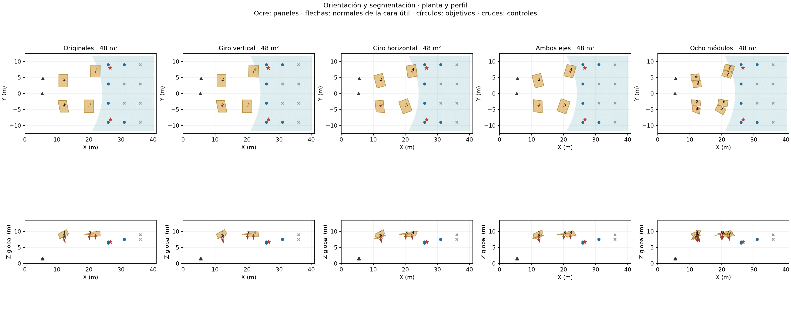
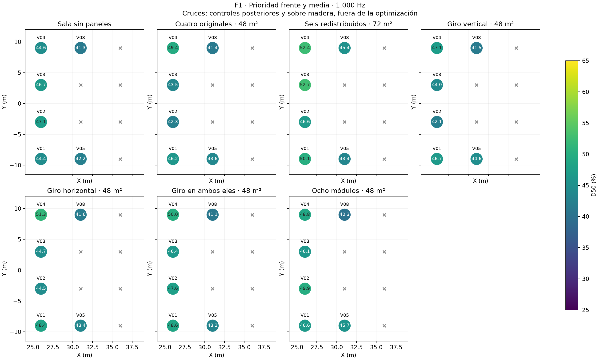
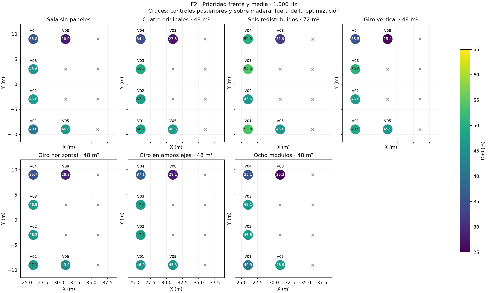
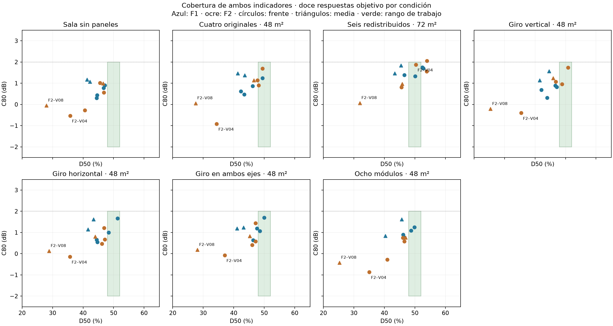
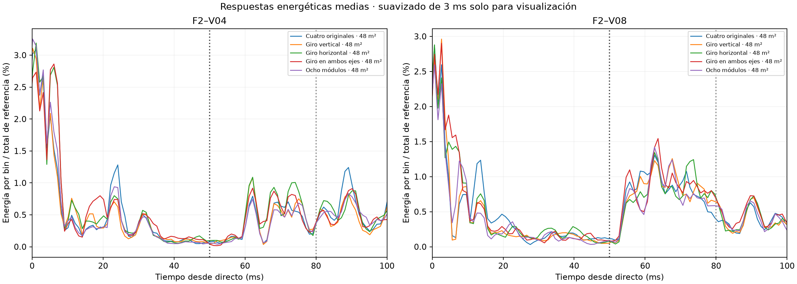

# Inclinación y segmentación de reflectores para platea alta

**Teatro Aula Magna UTFSM — 9 de noviembre de 2026.**

## 1. Resultado principal

Se compararon tres cambios de orientación de los mismos cuatro paneles y una distribución segmentada. Todas las variantes conservan **48 m² de área frontal, 20 mm de espesor, α = 0,05 y dispersión = 0,05 a 1.000 Hz**. La evaluación principal contempla doce combinaciones del frente y la zona media, con las posiciones posteriores como controles.

El menor error medio de D50 respecto de 50 % entre las cuatro variantes nuevas es el de **Giro en ambos ejes · 48 m²**: 6,04 puntos, frente a 6,65 de los cuatro paneles originales. Su D50 medio es 43,97 %, con 2/12 respuestas dentro de los dos rangos. La clasificación por error medio es descriptiva; diferencias pequeñas no se interpretan como una superioridad estadística.

**Ninguna de las cuatro variantes cumple simultáneamente todos los pares virtuales objetivo y los tres pares de campo prioritarios.** Las mejoras parciales y las pérdidas locales se informan por separado.

**Avance local:** la orientación combinada coloca las respuestas medias de F1–P8, F1–P9 y F2–P8 dentro de los rangos: D50 de 48,03/51,36/51,55 % y C80 de +1,12/+1,63/+1,50 dB. Es una referencia útil para conservar el resultado en esos puntos. No implica estabilidad de todos los umbrales: F1–P8 está apenas 0,03 puntos sobre el límite inferior y los rangos entre semillas atraviesan algunos límites. La cobertura virtual sigue siendo insuficiente, especialmente la franja media.

## 2. Qué se mantuvo constante y qué cambió

La referencia de orientación es la combinación de cuatro reflectores del primer ciclo: dos adelantados y dos intermedios, cada uno de 4 × 3 m. Sus centros son (12; −4; 9,2), (12; 4; 8,2), (20; −4; 9,2) y (22; 7; 9,2) m. En las tres variantes de orientación se conservaron exactamente centros, dimensiones, espesor y material. La comparación con esos cuatro originales permite estudiar el cambio de orientación a igual área.

El giro horizontal se aplica alrededor de Z global. Después se aplica el giro vertical alrededor del eje u del panel ya girado. Se rotan conjuntamente normal y ejes del plano, conservando su ortogonalidad. Los números siguientes son incrementos respecto de la orientación original, no ángulos absolutos de montaje ni la pendiente global del panel.

| Variante | Panel | Centro X/Y/Z (m) | Giro vertical | Giro horizontal |
|---|---|---|---|---|
| Giro vertical · 48 m² | 1 | 12,0 / -4,0 / 9,2 | 0° | 0° |
| Giro vertical · 48 m² | 2 | 12,0 / 4,0 / 8,2 | 0° | 0° |
| Giro vertical · 48 m² | 3 | 20,0 / -4,0 / 9,2 | 0° | 0° |
| Giro vertical · 48 m² | 4 | 22,0 / 7,0 / 9,2 | 5° | 0° |
| Giro horizontal · 48 m² | 1 | 12,0 / -4,0 / 9,2 | 0° | -5° |
| Giro horizontal · 48 m² | 2 | 12,0 / 4,0 / 8,2 | 0° | 15° |
| Giro horizontal · 48 m² | 3 | 20,0 / -4,0 / 9,2 | 0° | 20° |
| Giro horizontal · 48 m² | 4 | 22,0 / 7,0 / 9,2 | 0° | 10° |
| Giro en ambos ejes · 48 m² | 1 | 12,0 / -4,0 / 9,2 | 5° | -10° |
| Giro en ambos ejes · 48 m² | 2 | 12,0 / 4,0 / 8,2 | 0° | 15° |
| Giro en ambos ejes · 48 m² | 3 | 20,0 / -4,0 / 9,2 | 5° | -20° |
| Giro en ambos ejes · 48 m² | 4 | 22,0 / 7,0 / 9,2 | -10° | -15° |

Para la segmentación se partió de la orientación combinada seleccionada geométricamente, sin esperar sus resultados acústicos. Cada panel se dividió en dos módulos de 2 × 3 m; los centros se desplazaron ±1,10 m en su eje u, dejando una separación coplanar inicial de 0,20 m. Después se permitió orientar cada módulo ±10° en ambos ejes. El área frontal total permanece en 48 m². **Esta etapa también cambia el tamaño finito, los bordes, las separaciones y los centros de los módulos:** no permite atribuir el resultado exclusivamente al giro.

La separación se describe antes de los giros independientes; las distancias finales se comprueban con las cajas orientadas. La superficie de cantos aumenta al segmentar, por lo que mantener área frontal y coeficientes no conserva exactamente toda la absorción equivalente.

## 3. Selección geométrica antes de simular

Se exploraron giros entre −20° y +20° en pasos de 5° para los cuatro paneles: solo vertical, solo horizontal y ambos ejes. Cada familia se eligió mediante ascenso por coordenadas de hasta tres ciclos. Es una búsqueda local en una malla de ángulos; no garantiza un óptimo global ni selecciona por D50/C80.

El puntaje considera primeras reflexiones visibles con retardo relativo menor que 45 ms y corte conservador de tamaño finito no mayor que 1.000 Hz. Se ponderan los déficits de D50 de los cuatro paneles originales y se favorece el equilibrio entre frente y media. Las ganancias geométricas usan distancia recorrida y reflectancia nominal; se vuelven a comprobar las ocultaciones con los demás paneles presentes. El puntaje no representa nivel recibido ni un parámetro acústico normalizado.

Al dividir en módulos de 2 × 3 m, muchas trayectorias dejan de pasar el filtro conservador de tamaño finito a 1.000 Hz. SPPS geométrico no resuelve por sí solo la difracción y la interferencia entre bordes y módulos. Por ello, el ensayo segmentado se considera exploratorio y su predicción no equivale a una caracterización ondulatoria de esa superficie.

## 4. Simulación y verificación

Se ejecutaron **24 corridas principales nuevas y ocho pilotos**. El análisis reutiliza 18 corridas principales compatibles de sala base, cuatro originales y seis redistribuidos: **42 corridas principales, 294 respuestas medias y 882 resultados por semilla**. Las tres semillas son 20261019/20261020/20261021, con 600.000 partículas por corrida, 4 s, paso 1 ms y radio receptor 0,31 m. La fracción máxima de pérdidas de las corridas nuevas es 0.000177.

Se mantuvieron las posiciones de las dos fuentes, calculadas por separado, los 21 receptores, los materiales de la sala y Lw global de 90 dB con el espectro original. Las fuentes son omnidireccionales; no se modela el line array. Se conservaron 18 °C, humedad 57 %, velocidad 342 m/s, absorción del aire activada y transmisión de superficies desactivada. Solo se calculó 1.000 Hz.

Se promedian energías lineales de tres semillas y después se calculan D50 y C80. El tiempo cero es el directo geométrico distancia/342 y se incluye el frente captado por la esfera antes del centro del arribo. No se vuelve a elevar al cuadrado la energía nativa. D50 = 100·E0–50/Etotal; C80 = 10·log10(E0–80/E>80). Los promedios espaciales son medias de indicadores por posición/fuente.

Las cuatro mallas conservan íntegramente las 2.340 posiciones de vértices y 4.692 caras originales. Se comprobaron envolvente cerrada, ausencia de intersecciones entre paneles, 42 segmentos directos preservados, receptores fuera de los sólidos, volumen de aire coherente y ningún centro tetraédrico dentro de los paneles. En las tres variantes de orientación se verificó además la igualdad de centros y dimensiones con la referencia.

| Variante | Paneles | Holgura vertical mínima muestreada | Volumen de aire |
|---|---|---|---|
| Giro vertical · 48 m² | 4 | 4,38 m | 9542,774 m³ |
| Giro horizontal · 48 m² | 4 | 4,64 m | 9542,774 m³ |
| Giro en ambos ejes · 48 m² | 4 | 4,68 m | 9542,774 m³ |
| Ocho módulos · 48 m² | 8 | 4,46 m | 9542,774 m³ |

Las holguras son muestreos sobre el piso del modelo. Los equipos, iluminación y escenografía sin geometría identificada no se incluyen en las colisiones. Se conservan mallas nativas y OBJ coloreados; no se creó un proyecto `.proj` de interfaz.

## 5. Cobertura del frente y zona media

Objetivo: V01–V04 y V05/V08 con F1/F2, doce combinaciones. Los pares posteriores no intervienen en el conteo. «Cumplen» exige D50 de 48–52 % y C80 entre −2 y +2 dB. El error es la media de |D50 − 50|, en puntos porcentuales.

| Condición | D50 frente | D50 media | Error a 50 % | Cumplen /12 | C80 >+2 dB /12 |
|---|---|---|---|---|---|
| Sala sin paneles | 43,95 % | 39,52 % | 7,53 | 0 | 0 |
| Cuatro originales · 48 m² | 45,15 % | 39,76 % | 6,65 | 3 | 0 |
| Seis redistribuidos · 72 m² | 50,70 % | 41,65 % | 4,55 | 2 | 1 |
| Giro vertical · 48 m² | 45,23 % | 39,35 % | 6,87 | 2 | 0 |
| Giro horizontal · 48 m² | 45,59 % | 39,45 % | 6,67 | 2 | 0 |
| Giro en ambos ejes · 48 m² | 46,25 % | 39,41 % | 6,04 | 2 | 0 |
| Ocho módulos · 48 m² | 44,99 % | 39,53 % | 6,83 | 2 | 0 |

Los seis redistribuidos tienen 72 m² y posiciones diferentes; son una referencia de desempeño anterior, no un control de orientación a igual área. El control de esta etapa es «Cuatro originales · 48 m²».

## 6. Puntos deficitarios y pares de campo

Cada celda muestra D50 (%) / C80 (dB).

| Condición | F2–V04 | F2–V08 | F1–V02 | F1–V03 |
|---|---|---|---|---|
| Sala sin paneles | 35,79 / -0,53 | 27,98 / -0,05 | 47,10 / 0,90 | 46,71 / 0,78 |
| Cuatro originales · 48 m² | 34,42 / -0,92 | 27,50 / 0,06 | 42,34 / 0,62 | 43,47 / 0,47 |
| Seis redistribuidos · 72 m² | 50,32 / 1,88 | 31,94 / 0,07 | 46,58 / 1,38 | 52,74 / 1,71 |
| Giro vertical · 48 m² | 35,48 / -0,40 | 25,40 / -0,21 | 42,06 / 0,68 | 43,96 / 0,31 |
| Giro horizontal · 48 m² | 35,70 / -0,14 | 28,83 / 0,13 | 44,45 / 0,66 | 44,67 / 0,55 |
| Giro en ambos ejes · 48 m² | 37,07 / -0,07 | 28,10 / 0,18 | 47,59 / 1,19 | 46,36 / 0,64 |
| Ocho módulos · 48 m² | 35,05 / -0,87 | 25,26 / -0,42 | 49,87 / 1,25 | 46,11 / 0,89 |

| Condición | F1–P8 | F1–P9 | F2–P8 | F2–P9, control | Cumplen prioritarios /3 |
|---|---|---|---|---|---|
| Sala sin paneles | 43,77 / 0,58 | 44,43 / 0,50 | 48,90 / 1,19 | 37,17 / -0,35 | 1 |
| Cuatro originales · 48 m² | 48,65 / 1,14 | 52,43 / 1,69 | 52,42 / 1,55 | 43,45 / 0,54 | 1 |
| Seis redistribuidos · 72 m² | 50,12 / 1,59 | 50,35 / 1,40 | 54,60 / 1,84 | 50,28 / 1,73 | 2 |
| Giro vertical · 48 m² | 47,08 / 1,00 | 49,82 / 1,30 | 50,67 / 1,29 | 42,73 / 0,48 | 2 |
| Giro horizontal · 48 m² | 44,71 / 0,54 | 51,87 / 1,80 | 53,98 / 1,80 | 42,10 / 0,30 | 1 |
| Giro en ambos ejes · 48 m² | 48,03 / 1,12 | 51,36 / 1,63 | 51,55 / 1,50 | 40,06 / 0,05 | 3 |
| Ocho módulos · 48 m² | 41,98 / 0,35 | 48,95 / 1,34 | 44,32 / 0,34 | 39,20 / 0,11 | 1 |

Para la orientación combinada, los rangos D50 entre semillas son 46,81–50,09 % en F1–P8, 49,80–52,52 % en F1–P9 y 50,67–52,72 % en F2–P8. C80 de F1–P9 abarca +1,23 a +2,05 dB. Se conserva la mejora local como candidata, sin declarar cumplimiento estable de cada límite.

## 7. Energía temporal respecto de los cuatro paneles originales

La comparación siguiente usa F2–V08. Los cambios son de energía absoluta integrada en cada ventana, expresados como cocientes en dB. No son diferencias de D50 ni porcentajes trasladables directamente a mediciones reales.

| Condición | ΔE0–50 | ΔE50–80 | ΔE>50 | ΔE total | ΔD50 (puntos) | ΔC80 |
|---|---|---|---|---|---|---|
| Cuatro originales · 48 m² | 0,00 | 0,00 | 0,00 | 0,00 | 0,00 | 0,00 |
| Giro vertical · 48 m² | -0,48 | -0,03 | -0,01 | -0,14 | -2,09 | -0,27 |
| Giro horizontal · 48 m² | 0,27 | -0,11 | -0,02 | 0,06 | 1,34 | 0,07 |
| Giro en ambos ejes · 48 m² | 0,24 | 0,16 | 0,10 | 0,14 | 0,61 | 0,12 |
| Ocho módulos · 48 m² | -0,57 | -0,30 | -0,07 | -0,20 | -2,24 | -0,48 |

Las curvas se normalizan por la energía total de los cuatro paneles originales. Se suavizan 3 ms solo para visualización; los indicadores se calculan sin suavizar. Una nueva reflexión temprana puede coexistir con la pérdida de otra y con cambios de cola. Los histogramas no etiquetan todas las trayectorias: no se atribuye un pico a una cara únicamente por su retardo.

## 8. Controles de otras zonas

Cambios medios **respecto de los cuatro originales**, para aislar mejor lo que añade esta etapa. Las diferencias individuales completas se conservan en los archivos. Se mantienen posteriores y madera fuera de la función objetivo.

| Variante | Zona | ΔD50 (puntos) | ΔC80 (dB) | ΔT30 (s) | ΔEDT (s) |
|---|---|---|---|---|---|
| Giro vertical · 48 m² | Platea baja | 0,42 | 0,07 | 0,01 | -0,01 |
| Giro vertical · 48 m² | Bajo balcón | -1,15 | -0,10 | 0,01 | 0,07 |
| Giro vertical · 48 m² | Posteriores en butacas | 0,81 | 0,13 | 0,03 | -0,02 |
| Giro horizontal · 48 m² | Platea baja | 1,19 | 0,25 | 0,00 | -0,01 |
| Giro horizontal · 48 m² | Bajo balcón | -0,77 | 0,03 | -0,02 | 0,07 |
| Giro horizontal · 48 m² | Posteriores en butacas | -0,24 | -0,07 | -0,02 | -0,04 |
| Giro en ambos ejes · 48 m² | Platea baja | 0,60 | 0,08 | -0,01 | 0,00 |
| Giro en ambos ejes · 48 m² | Bajo balcón | -1,75 | -0,15 | -0,04 | 0,07 |
| Giro en ambos ejes · 48 m² | Posteriores en butacas | -0,72 | -0,03 | -0,03 | 0,00 |
| Ocho módulos · 48 m² | Platea baja | 0,15 | 0,07 | -0,01 | -0,03 |
| Ocho módulos · 48 m² | Bajo balcón | -0,88 | -0,04 | -0,05 | 0,05 |
| Ocho módulos · 48 m² | Posteriores en butacas | -0,32 | 0,00 | 0,01 | -0,05 |

## 9. Dispersión entre semillas y decisión

Los rangos siguientes son mínimos–máximos entre tres semillas, no intervalos de confianza. No se interpreta una diferencia pequeña entre promedios como efecto estable por sí sola.

| Condición | D50 F2–V08 medio | Rango entre semillas | C80 medio | Rango entre semillas |
|---|---|---|---|---|
| Sala sin paneles | 27,98 % | 24,72 a 29,80 % | -0,05 dB | -0,57 a 0,22 dB |
| Cuatro originales · 48 m² | 27,50 % | 27,26 a 27,87 % | 0,06 dB | -0,15 a 0,21 dB |
| Seis redistribuidos · 72 m² | 31,94 % | 28,28 a 34,02 % | 0,07 dB | -0,40 a 0,49 dB |
| Giro vertical · 48 m² | 25,40 % | 22,26 a 28,33 % | -0,21 dB | -0,76 a 0,13 dB |
| Giro horizontal · 48 m² | 28,83 % | 27,65 a 29,78 % | 0,13 dB | 0,00 a 0,32 dB |
| Giro en ambos ejes · 48 m² | 28,10 % | 26,93 a 30,19 % | 0,18 dB | -0,01 a 0,53 dB |
| Ocho módulos · 48 m² | 25,26 % | 23,91 a 26,43 % | -0,42 dB | -0,62 a -0,29 dB |

La selección de ángulos procede de un puntaje geométrico y la comparación acústica posterior es exploratoria. Algunas orientaciones elegidas llegan al borde de ±20°; no se demuestra que ese rango contenga el óptimo. Los resultados no prueban que se haya encontrado la mejor orientación posible ni descartan ángulos fuera de la malla estudiada. Tampoco permiten afirmar que una mejora de diez puntos en la predicción se trasladaría de forma lineal a la sala real.

Se conserva la orientación combinada como referencia de mejora local en P8/P9. La segmentación concreta de ocho módulos no añade una ventaja suficiente y no se selecciona como continuación principal. El siguiente ciclo debe revisar posiciones y reparto de área hacia V04/V08, utilizando la orientación combinada y los seis redistribuidos como comparadores, y sin asumir que sumar ambos conjuntos sumará sus beneficios. Si se modifica el área, se separará ese efecto del de la orientación. La búsqueda angular tampoco queda agotada, pues algunas selecciones alcanzaron el borde del rango.

Se elegirá una geometría solo si mejora los puntos deficitarios sin crear pérdidas importantes en los demás objetivos ni exceder C80. Si aparecen ventajas consistentes, corresponde sensibilidad a pequeños cambios de orientación/material y confirmación con más partículas; después se evaluarán 500 Hz y 1/2/4/8 kHz. No se justifica una confirmación costosa únicamente para demostrar un cumplimiento global que este ciclo todavía no alcanza.

## 10. Archivos y referencias

- [Medias por punto](../prediccion/estudio-difusion/reflectores-inclinacion/resultados/medias.csv), [semillas](../prediccion/estudio-difusion/reflectores-inclinacion/resultados/semillas.csv), [resumen por zona](../prediccion/estudio-difusion/reflectores-inclinacion/resultados/resumen-grupos.csv) y [cambios respecto de los cuatro originales](../prediccion/estudio-difusion/reflectores-inclinacion/resultados/cambios-respecto-cuatro-originales.csv).
- [Carpeta del experimento](../prediccion/estudio-difusion/reflectores-inclinacion/README.md), [verificación de cálculos](../prediccion/estudio-difusion/reflectores-inclinacion/resultados/verificacion-calculos.json) y [verificación de mallas](../prediccion/estudio-difusion/reflectores-inclinacion/resultados/verificacion-mallas.json).
- [Ensayo lateral anterior](RESULTADOS-REFLECTORES-LATERALES-FRENTE-MEDIA.md), [plan de reflectores](PLAN-DE-ESTUDIO-DE-REFLECTORES-PLATEA-ALTA.md), [mapa de receptores](MAPA-DE-RECEPTORES-VIRTUALES-PLATEA-ALTA.md) y [documento central](AVANCES-Y-ESTADO-DEL-ESTUDIO-ACUSTICO.md).

