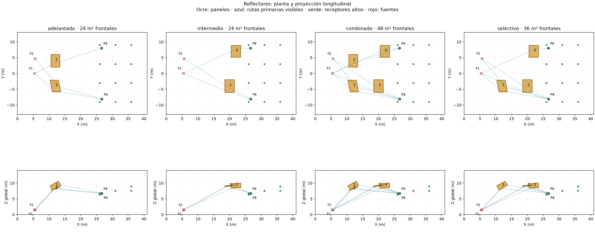
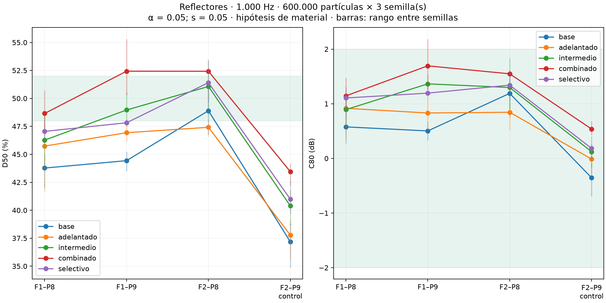

# Primer estudio de reflectores orientados en platea alta

**Teatro Aula Magna UTFSM — 9 de noviembre de 2026.**

## 1. Resultado y alcance

**Ninguna de las cuatro configuraciones ensayadas cumple simultáneamente D50 de 48–52 % y C80 entre −2 y +2 dB en los tres pares prioritarios.** Se ha completado un primer ciclo de localización y predicción; no se ha seleccionado un tratamiento constructivo suficiente.

Se estudia la posibilidad de redistribuir energía hacia llegadas anteriores a 50 ms, en vez de aumentar únicamente la absorción posterior. Se modificó la geometría en variantes independientes del modelo. Las cifras corresponden a **1.000 Hz**, fuentes omnidireccionales idealizadas y un material reflectante hipotético. No constituyen una simulación validada de un producto de madera, de una orquesta distribuida ni del line array real.

Por decisión del usuario, los pares prioritarios son **F1–P8, F1–P9 y F2–P8**. **F2–P9 es control secundario**, se publica sin excluirlo de los gráficos y no determina por sí solo el diseño. Los doce virtuales superiores y P1–P7 controlan distribución espacial y efectos inferiores.

## 2. Posiciones y referencia

Se cotejaron las coordenadas XY de los cálculos con `analisis/sala.py`, `modelo-3d/mediciones-originales.csv` y la imagen existente del plano marcado. F2 y P9 aparecen al mismo lado lateral. No se encontró evidencia documental para intercambiar sus etiquetas. Se conservaron las alturas predictivas actuales, que incorporan el registro con el suelo del modelo; este cotejo no certifica las posiciones físicas de campo.

La distancia recta F2–P9 es aproximadamente 21,88 m; F2–P8 mide 25,23 m. Por ello no se atribuye el déficit de F2–P9 a ser el par más distante. La [auditoría de coordenadas y visibilidad directa](../prediccion/estudio-difusion/reflectores/auditoria-posiciones.json) conserva todos los pares.

Se recalculó una referencia sin paneles con la misma cadena de exportación y mallado que las variantes. La envolvente original conserva unos 9.543,734 m³. La siguiente comparación con la referencia anterior de absorción comprueba la continuidad de los cuatro pares altos; las diferencias numéricas no se atribuyen a un cambio del recinto:

| Par | D50 anterior | D50 nueva referencia | ΔD50 (puntos) | ΔC80 (dB) |
|---|---:|---:|---:|---:|
| F1–P8 | 44,45 % | 43,77 % | -0,68 | -0,09 |
| F1–P9 | 44,54 % | 44,43 % | -0,10 | -0,02 |
| F2–P8 | 48,56 % | 48,90 % | 0,34 | 0,07 |
| F2–P9 | 37,10 % | 37,17 % | 0,07 | 0,03 |

## 3. Búsqueda geométrica y dimensiones

Se exploraron dos familias de ubicación, adelantada e intermedia, variando posición y orientación especular. La orientación se calculó hacia un conjunto de receptores de la zona alta y una fuente central representativa de F1/F2; después se comprobaron las dos fuentes reales del modelo por separado. Se exigieron paneles dentro de la sala, segmentos visibles, punto de reflexión dentro del panel finito y retardos relativos cortos.

La primera exploración de módulos de 3 × 2 m no reunió la cobertura prioritaria exigida en las familias estudiadas al aplicar un filtro conservador de tamaño finito a 1.000 Hz. No se concluye que ese tamaño sea siempre ineficaz: la conclusión se refiere a la cuadrícula de ubicaciones, incidencia y orientación examinada. Esos paneles pequeños no se simularon con SPPS.

Se amplió la hipótesis geométrica a **4 × 3 m por panel, 20 mm de espesor**. De las 32 combinaciones de centros y lado propuestas se conservaron 24 con el panel dentro de la envolvente y sin intersección con ella. Se eligió un panel por lado y familia por cobertura de pares prioritarios y virtuales con ruta temprana y corte conservador de reflector finito no mayor que 1.000 Hz.

| Variante | Panel | Centro X, Y, Z (m) | Normal de la cara frontal | Inclinación respecto de horizontal |
|---|---:|---|---|---:|
| Par adelantado | 1 | 12,00; -4,00; 9,20 | 0,443; 0,379; -0,813 | 35,6° |
| Par adelantado | 2 | 12,00; 4,00; 8,20 | 0,351; -0,008; -0,936 | 20,6° |
| Par intermedio | 1 | 20,00; -4,00; 9,20 | 0,122; 0,067; -0,990 | 8,0° |
| Par intermedio | 2 | 22,00; 7,00; 9,20 | 0,059; -0,357; -0,932 | 21,2° |

Z es una cota global del modelo, no la altura desde el piso situado bajo cada panel. La variante adelantada y la intermedia tienen **24 m² de superficie frontal cada una**; la combinada reúne los cuatro paneles, **48 m² frontales**. La selectiva reúne el adelantado del lado de P8 y ambos intermedios: **tres paneles, 36 m² frontales**. Las dos caras, los bordes y el espesor se representan: el área frontal no equivale al área total expuesta ni a absorción equivalente.

La variante selectiva se definió después de observar que el par intermedio cumplía nominalmente en F1–P9 y F2–P8, pero quedaba corto en F1–P8. Se añadió solo el adelantado del lado de P8 para estudiar ese déficit sin duplicar la reflexión dirigida hacia P9. Es una selección adaptativa dentro del mismo estudio, no una validación independiente.

Las vistas son planta y proyección longitudinal, no cortes constructivos. El plano completo de la sala sigue disponible como [referencia marcada](../modelo-3d/revision/plano-referencia.png).

## 4. Rutas, difracción y geometría nativa

Se calculó retardo = (recorrido reflejado − recorrido directo)/342. Las rutas especulares prioritarias de estas ubicaciones tienen retardos aproximados de **4–10 ms**. Se comprobó la visibilidad con todos los paneles de cada variante presentes: tanto en la combinación de cuatro como en la selectiva, una ruta F1–V10 queda interceptada por otro panel; ninguna ruta prioritaria elegida queda oculta. Los efectos se simularon conjuntamente, sin sumar indicadores de variantes separadas.

La estimación de tamaño finito utiliza la distancia característica d* y una cota conservadora del coseno de incidencia en las dos dimensiones. Para las rutas prioritarias seleccionadas, los cortes estimados están aproximadamente entre 399 y 881 Hz. Es un filtro preliminar, no una comprobación ondulatoria completa ni una corrección incorporada a los resultados de SPPS. Véanse el [método de Arup/Strutt](https://strutt.arup.com/help/Auditorium_Acoustics/Reflector.htm) y la discusión de [Rathsam et al., DAGA 2007](https://digitalcommons.unl.edu/archengfacpub/24/) sobre límites de trazado geométrico en paneles finitos.

Los paneles son cajas cerradas de 20 mm, con normales hacia el aire y huecos tetraédricos que excluyen su interior del dominio acústico. El aire puede propagarse alrededor de sus bordes. Cada panel desplaza aproximadamente 0,24 m³. Se verificaron cierre, aristas con dos caras, volumen de aire, marcadores de frontera y vecinos tetraédricos. El piloto funcional no mostró fallo del motor.

| Variante | Paneles | Tetraedros de aire | Volumen de aire (m³) |
|---|---:|---:|---:|
| Referencia | 0 | 7260 | 9543,734 |
| Par adelantado | 2 | 7411 | 9543,254 |
| Par intermedio | 2 | 8179 | 9543,254 |
| Cuatro paneles | 4 | 8387 | 9542,774 |
| Tres paneles selectivos | 3 | 8251 | 9543,014 |

## 5. Material supuesto y condiciones

La familia constructiva investigada sigue siendo contrachapado continuo y sellado sobre bastidor rigidizado. Sin embargo, **el cálculo no certifica ese producto**: se aplicó al panel un material nominal con **α = 0,05 y s = 0,05 a 1.000 Hz**, ley Lambert para la fracción dispersa y transmisión desactivada. Se modelan ambas caras con la misma hipótesis. No se usaron los coeficientes efectivos del muro para representar madera.

El espesor geométrico de 20 mm no demuestra rigidez suficiente de una placa libre de 4 × 3 m, ni valida anclajes, masa o montaje. Un bastidor y las propiedades del conjunto deben definirse antes de especificar construcción. No se simularon vibración de placa, transmisión real, fase ni interferencia coherente; los resultados no descartan coloración por llegadas muy próximas al directo.

Se conservaron 21 receptores, F1/F2 por separado, Lw global 90 dB y espectro de referencia, radio receptor 0,31 m, paso 1 ms, 4 s, 18 °C, 57 % HR y absorción atmosférica activa. El estudio comprendió **3 pilotos de 20.000 partículas, 8 corridas exploratorias de 150.000 partículas y 30 corridas de comparación de 600.000 partículas**. Estas últimas usan las semillas 20261019, 20261020 y 20261021: referencia y las cuatro alternativas, dos fuentes y tres semillas.

Se promediaron las series energéticas lineales de las tres semillas antes de calcular D50, C80 y decaimiento. Los rangos entre semillas son descriptivos, no intervalos de confianza. No se fijó la energía temprana al valor de referencia: los nuevos paneles buscan modificarla físicamente.

## 6. Resultados a 1.000 Hz

Cada celda presenta **D50 (%) / C80 (dB)**. El cumplimiento se evalúa solo en los tres pares prioritarios; F2–P9 permanece visible como control.

| Condición | F1–P8 | F1–P9 | F2–P8 | F2–P9, control | Cumplen prioritarios |
|---|---:|---:|---:|---:|---:|
| Referencia | 43,77 / 0,58 | 44,43 / 0,50 | 48,90 / 1,19 | 37,17 / -0,35 | 1/3 |
| Par adelantado | 45,74 / 0,92 | 46,94 / 0,83 | 47,41 / 0,84 | 37,77 / -0,01 | 0/3 |
| Par intermedio | 46,27 / 0,89 | 48,96 / 1,36 | 51,06 / 1,30 | 40,39 / 0,12 | 2/3 |
| Cuatro paneles | 48,65 / 1,14 | 52,43 / 1,69 | 52,42 / 1,55 | 43,45 / 0,54 | 1/3 |
| Tres paneles selectivos | 47,05 / 1,11 | 47,82 / 1,19 | 51,41 / 1,34 | 40,98 / 0,18 | 1/3 |

La repetición a 600.000 partículas reduce la dependencia de la exploración de una sola semilla, pero no demuestra por sí sola convergencia suficiente para certificar un intervalo de ±2 puntos de D50. Las diferencias pequeñas y los cruces cercanos a un límite requieren revisar sus rangos individuales.

### Rangos de los pares prioritarios

| Variante | Par | D50 medio | Rango D50 entre semillas | C80 medio | Rango C80 entre semillas |
|---|---|---:|---:|---:|---:|
| Referencia | F1–P8 | 43,77 % | 41,97–44,99 % | 0,58 dB | 0,27–0,83 dB |
| Referencia | F1–P9 | 44,43 % | 43,49–45,25 % | 0,50 dB | 0,33–0,67 dB |
| Referencia | F2–P8 | 48,90 % | 46,79–51,61 % | 1,19 dB | 0,76–1,47 dB |
| Par adelantado | F1–P8 | 45,74 % | 41,67–48,51 % | 0,92 dB | 0,38–1,26 dB |
| Par adelantado | F1–P9 | 46,94 % | 46,12–47,93 % | 0,83 dB | 0,53–1,06 dB |
| Par adelantado | F2–P8 | 47,41 % | 46,58–48,10 % | 0,84 dB | 0,52–1,01 dB |
| Par intermedio | F1–P8 | 46,27 % | 43,81–48,66 % | 0,89 dB | 0,55–1,11 dB |
| Par intermedio | F1–P9 | 48,96 % | 47,75–50,56 % | 1,36 dB | 1,26–1,54 dB |
| Par intermedio | F2–P8 | 51,06 % | 48,50–53,35 % | 1,30 dB | 0,91–1,84 dB |
| Cuatro paneles | F1–P8 | 48,65 % | 47,26–50,72 % | 1,14 dB | 0,94–1,48 dB |
| Cuatro paneles | F1–P9 | 52,43 % | 50,29–55,31 % | 1,69 dB | 1,26–2,18 dB |
| Cuatro paneles | F2–P8 | 52,42 % | 52,27–52,71 % | 1,55 dB | 1,49–1,62 dB |
| Tres paneles selectivos | F1–P8 | 47,05 % | 46,17–47,89 % | 1,11 dB | 0,77–1,31 dB |
| Tres paneles selectivos | F1–P9 | 47,82 % | 47,51–48,14 % | 1,19 dB | 1,07–1,34 dB |
| Tres paneles selectivos | F2–P8 | 51,41 % | 49,66–53,50 % | 1,34 dB | 1,04–1,58 dB |

## 7. Energía temporal y efectos por zona

Los cambios se expresan frente a la referencia nueva, como medias de diferencias individuales. Un cambio medio puede ocultar asientos perjudicados. Para revisar el mecanismo se conservan por separado 0–20, 20–50, 50–80, 80–300 y 300–1.000 ms.

| Variante | Zona | ΔD50 (puntos) | ΔC80 (dB) | Δenergía 0–50 (dB) | ΔT30 (s) | ΔEDT (s) | Δnivel integrado (dB) |
|---|---|---:|---:|---:|---:|---:|---:|
| Par adelantado | P8/P9, cuatro pares | 0,89 | 0,17 | 0,36 | 0,03 | -0,01 | 0,27 |
| Par adelantado | Virtuales altos | 1,41 | 0,26 | 0,53 | 0,00 | -0,02 | 0,39 |
| Par adelantado | Platea baja | -0,09 | -0,10 | -0,09 | -0,04 | 0,06 | -0,08 |
| Par adelantado | Bajo balcón | -1,17 | -0,31 | -0,11 | 0,01 | 0,13 | -0,03 |
| Par intermedio | P8/P9, cuatro pares | 3,10 | 0,44 | 0,55 | 0,03 | -0,05 | 0,25 |
| Par intermedio | Virtuales altos | 0,43 | 0,07 | 0,04 | -0,01 | -0,02 | 0,01 |
| Par intermedio | Platea baja | 1,46 | 0,31 | 0,14 | -0,03 | -0,04 | -0,00 |
| Par intermedio | Bajo balcón | -1,12 | -0,08 | -0,13 | 0,05 | 0,01 | -0,05 |
| Cuatro paneles | P8/P9, cuatro pares | 5,67 | 0,75 | 1,11 | -0,02 | -0,01 | 0,57 |
| Cuatro paneles | Virtuales altos | 1,28 | 0,30 | 0,49 | -0,01 | -0,02 | 0,37 |
| Cuatro paneles | Platea baja | 1,09 | 0,13 | -0,07 | -0,04 | 0,04 | -0,17 |
| Cuatro paneles | Bajo balcón | 0,13 | -0,10 | -0,01 | 0,02 | 0,04 | -0,02 |
| Tres paneles selectivos | P8/P9, cuatro pares | 3,25 | 0,48 | 0,67 | -0,04 | -0,03 | 0,35 |
| Tres paneles selectivos | Virtuales altos | 0,51 | 0,14 | 0,23 | 0,00 | -0,02 | 0,20 |
| Tres paneles selectivos | Platea baja | 1,07 | 0,21 | 0,01 | -0,00 | -0,00 | -0,09 |
| Tres paneles selectivos | Bajo balcón | -0,02 | -0,17 | 0,02 | -0,00 | 0,06 | 0,02 |

### Alcance en los virtuales altos

Se comprueba la cobertura fuera de los puntos usados para orientar los paneles. Cumplir los tres pares prioritarios no equivale a mantener D50 de 50 % en toda la platea alta. Los conteos siguientes usan 24 combinaciones fuente–receptor virtual y respuestas medias; los cambios pequeños siguen sujetos a muestreo.

| Variante | D50 mínimo–máximo | Cumplen D50 48–52 % y C80 −2 a +2 dB | ΔD50 ≥ +2 puntos | ΔD50 ≤ −2 puntos |
|---|---:|---:|---:|---:|
| Par adelantado | 29,24–51,71 % | 4/24 | 7/24 | 1/24 |
| Par intermedio | 26,40–50,07 % | 4/24 | 5/24 | 5/24 |
| Cuatro paneles | 27,50–49,89 % | 5/24 | 8/24 | 3/24 |
| Tres paneles selectivos | 23,58–50,86 % | 5/24 | 8/24 | 7/24 |

## 8. Decisión y trabajo pendiente

**La combinación de cuatro paneles es cercana a la meta en los pares prioritarios:** da D50 de 48,65 %, 52,43 % y 52,42 %, con C80 medio de +1,14, +1,69 y +1,55 dB respectivamente. Los excesos sobre 52 % son pequeños; el incumplimiento nominal no se interpreta como una diferencia perceptual demostrada. Los rangos entre semillas, incluidos valores de C80 mayores que +2 dB en F1–P9, impiden prometer que todos esos límites se mantengan.

**La limitación principal es espacial:** con cuatro paneles solo 5/24 combinaciones virtuales cumplen ambos criterios. En F1–V02, D50 pasa aproximadamente de 47,10 a 42,34 %; en F1–V03, de 46,71 a 43,47 %. Son receptores centrales de la primera fila virtual, no únicamente puntos posteriores. Las disminuciones requieren estudiar el muestreo y las reflexiones interceptadas antes de atribuir causalidad. La nueva geometría podría estar redistribuyendo aportes que antes eran útiles para esos sectores.

No se especifica una instalación para mantener D50 de 50 % y C80 ≤ +2 dB. Las variantes permiten medir el efecto de la geometría, pero no acreditan por sí solas el cumplimiento conjunto y uniforme. La elección debe considerar la tabla por posición y los virtuales, sin sustituirla por una media favorable.

Los resultados favorables en los pares prioritarios deben contrastarse con el alcance espacial de la tabla de virtuales. La siguiente tarea es ampliar o redistribuir cobertura hacia sectores centrales, laterales intermedios y posteriores, antes de recomendar la solución para toda la gradería. Se deberán comparar inclinaciones repartidas o facetas adicionales de menor concentración; una curvatura convexa exigiría un nuevo modelo y no se considera ya validada por estos paneles planos.

El aumento predictivo de D50 no se transfiere a las mediciones sumando automáticamente los mismos puntos porcentuales. La comparación es condicional a estas fuentes, geometría y materiales.

No se ha ejecutado una optimización continua de inclinación/área ni una prueba de todas las superficies de la sala. Tampoco se calcularon sensibilidades de material, 4,8 millones de partículas, otras bandas o combinación con absorción posterior. Este informe cierra el primer ciclo a 1.000 Hz y distingue resultados de esos pasos pendientes; no concluye que cualquier reflector sea inútil o que el diseño esté resuelto.

Si una geometría ofrece una mejora suficientemente amplia y distribuida, la continuación será afinar cobertura y orientación, contrastar el resultado a mayor resolución y con material menos idealizado, y después estudiar 500 Hz y 1, 2, 4, 8 kHz. Si su beneficio se concentra en pocos asientos o excede C80, se revisará la geometría antes de aumentar el número de paneles. La absorción posterior complementaria no se añadirá sin comparar reflector solo, absorbente solo y combinación.

## 9. Archivos y verificación

Se verificaron las 30 corridas de comparación: fuentes y receptores iguales a la referencia, materiales originales conservados, banda activa, huellas de configuración/mallas y series finitas no negativas. La pérdida máxima de partículas fue 0,0180 %. Estos controles no sustituyen la validación física ni la convergencia estadística.

- [Plan del estudio](PLAN-DE-ESTUDIO-DE-REFLECTORES-PLATEA-ALTA.md).

- [Paneles elegidos y rutas geométricas](../prediccion/estudio-difusion/reflectores/paneles-elegidos.json).

- [Rutas con todos los obstáculos presentes](../prediccion/estudio-difusion/reflectores/resultados/rutas-con-obstaculos.json).

- [Indicadores medios y rangos](../prediccion/estudio-difusion/reflectores/resultados/medias-N600000-a0.05-s0.05.csv).

- [Comparaciones individuales](../prediccion/estudio-difusion/reflectores/resultados/comparaciones-N600000-a0.05-s0.05.csv).

- [Resumen por zonas](../prediccion/estudio-difusion/reflectores/resultados/zonas-N600000-a0.05-s0.05.csv).

- [Verificación de cálculo](../prediccion/estudio-difusion/reflectores/resultados/verificacion-N600000-a0.05-s0.05.json).

- [Verificación geométrica y de entrega](../prediccion/estudio-difusion/reflectores/resultados/verificacion-entrega.json).

- [Archivo íntegro de salidas nativas](../prediccion/estudio-difusion/reflectores/resultados/verificacion-compactacion.json).

- [Modelo OBJ: par adelantado](../prediccion/estudio-difusion/reflectores/adelantado/modelo.obj).

- [Modelo OBJ: par intermedio](../prediccion/estudio-difusion/reflectores/intermedio/modelo.obj).

- [Modelo OBJ: cuatro paneles](../prediccion/estudio-difusion/reflectores/combinado/modelo.obj).

- [Modelo OBJ: tres paneles selectivos](../prediccion/estudio-difusion/reflectores/selectivo/modelo.obj).

Los OBJ incluyen un MTL contiguo que distingue paneles en color ocre y sala en gris. También se conservan CBIN, MBIN, geometría JSON, configuraciones, registros y respuestas del motor. No se ha generado un nuevo proyecto de interfaz `.proj`; los OBJ son geometrías para inspección y los archivos nativos permiten las corridas realizadas. El proyecto canónico y las mediciones no se modificaron.
