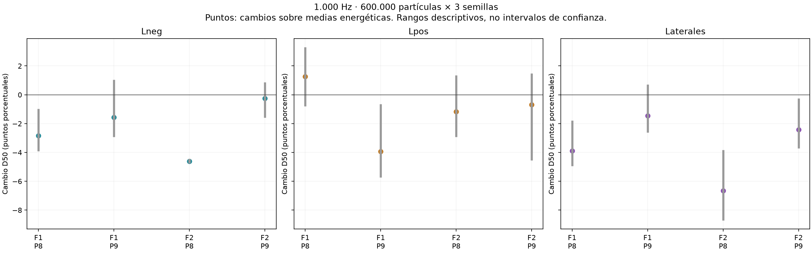
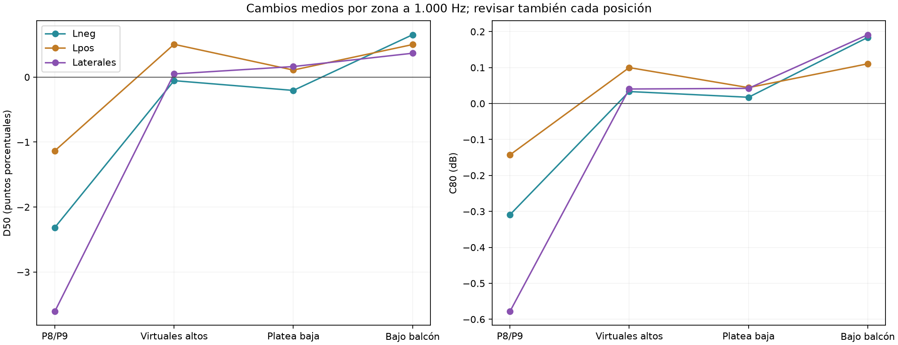

# Ensayo de laterales más bajos y adelantados

**Proyecto:** Teatro Aula Magna UTFSM.  
**Fecha:** 9 de noviembre de 2026.  
**Alcance:** comparación de dispersión equivalente en sectores laterales adelantados, evaluando D50 y C80 en platea alta, platea baja abierta y bajo balcón. No es validación de un QRD físico.

**Conclusión principal:** con estas áreas y s = 0,60, la dispersión reduce D50 medio en P8/P9 a 1.000 Hz y no alcanza la meta del proyecto. Los cambios medios en platea baja son mucho menores; se mantienen diferencias individuales. No se recomienda revestir estos paños con un difusor para elevar D50 bajo las condiciones estudiadas.

## Objetivo y referencia

Este ensayo continúa el [plan vigente](PLAN-DE-ESTUDIO-D50-C80-Y-TRATAMIENTOS-POR-ZONA.md) después de los [resultados de fondo y laterales altos](../descartados/informes/RESULTADOS-D50-FONDO-Y-LATERALES-PLATEA-ALTA.md). Se busca identificar si bajar y adelantar la intervención cambia favorablemente D50 a 1.000 Hz en P8/P9, conservando C80 y evitando perjuicios relevantes en otras zonas.

Se mantiene D50 = 55–60 % como meta del proyecto a 1.000 Hz y C80 = −2 a +2 dB como referencia conjunta a 500/1.000 Hz. No son límites normativos universales. Se observan también energía temprana y posterior, nivel integrado, variabilidad entre semillas y decaimiento.

La referencia se recalcula con la misma malla, fuentes, materiales y receptores que las variantes. Los valores de una referencia anterior no se restan de una variante nueva como si solo cambiara el tratamiento. Las fuentes siguen siendo omnidireccionales idealizadas; no se representa todavía la directividad del parlante real ni del line array.

## Paños y comparación espacial

Se delimitan, en ambos muros Y ≈ ±11,665 m, las partes disponibles de material efectivo de muro dentro de **X = 19–27 m y Z = 4,2–6,6 m**. La envolvente rectangular nominal es de 19,2 m², pero el área efectiva disponible es **17,229 m² por lado**. Se recortan triángulos sobre sus límites; no se asignan caras completas por su centro.

| Condición | Intervención | Área efectiva |
|---|---|---:|
| Base | Sin cambio de material | 0 m² |
| Lneg | Solo lateral Y negativo | 17,229 m² |
| Lpos | Solo lateral Y positivo | 17,229 m² |
| Laterales | Ambos paños a la vez | 34,458 m² |

La condición conjunta utiliza el doble de área y no se interpreta como superioridad a igual superficie. La intervención se restringe al material de muro disponible en esa región; no incluye automáticamente antepechos, elementos de balcón u otras superficies que atraviesen la envolvente nominal.

Los sectores interceptan los cuatro puntos de reflexión lateral simple del lado cercano identificados para F1/F2–P8/P9, con retardos de aproximadamente 6,5–12,4 ms. Los puntos correspondientes al lado opuesto quedan fuera de estos paños. Interceptar una reflexión temprana no garantiza mejorar D50: la dispersión puede reducir la energía que esa reflexión enviaba a un asiento y redistribuirla a otros.

## Materiales y ajustes

Se conserva la absorción efectiva de los muros: α = 0,44 a 500 Hz y α ≈ 0,24795 a 1.000 Hz. Se cambia únicamente la dispersión de s ≈ 0,05 a s = 0,60, ley Lambert, en los paños seleccionados y la banda activa. Estos coeficientes son hipótesis equivalentes de la base y del ensayo, no propiedades medidas de un revestimiento ni del concreto real.

Se conservan F1/F2 por separado, Lw global de 90 dB con su espectro, 4 s, paso de 1 ms, radio receptor de 0,31 m, 18 °C, 57 % de humedad, absorción atmosférica activada y transmisión desactivada. Se conservan P1–P9 y V01–V12, a la altura local previamente documentada.

La platea alta se revisa con P8/P9 y los doce virtuales; la platea baja abierta con P1, P2, P4 y P7; bajo balcón con P3, P5 y P6. Los resultados individuales se conservan para no ocultar perjuicios bajo un promedio de zona.

## Matriz predefinida

| Bloque | Condiciones | Procesos |
|---|---|---:|
| Exploración | Base, Lneg, Lpos y Laterales; F1/F2; 500/1.000 Hz; 150.000 partículas; semilla 20261019 | 16 |
| Repetición principal | Las cuatro condiciones; F1/F2; 1.000 Hz; 600.000 partículas; semillas 20261019, 20261020 y 20261021 | 24 |
| Referencia de control | Base; F1/F2; 500 Hz; 600.000 partículas; mismas tres semillas | 6 |

Se ejecutaron **46 corridas de estudio**, más un piloto independiente de 20.000 partículas. Las tres alternativas se repiten a 1.000 Hz para evitar seleccionar solamente una realización favorable. A 500 Hz los tratamientos quedan exploratorios con una sola semilla; la referencia repetida no convierte esos tratamientos en resultados convergentes.

Se promedian energías lineales por fuente y receptor antes de recalcular D50/C80. Los rangos entre semillas son descriptivos, no intervalos de confianza. Se mantiene el método temporal del estudio anterior y las series originales. No se ejecuta todavía la confirmación de 4,8 millones ni se afirma cumplimiento en 2/4/8 kHz con estos cálculos.

## Control temporal adicional

La mínima longitud de un recorrido que toca cualquiera de los dos planos laterales se acota geométricamente mediante fuente imagen. Para las 42 combinaciones de fuente y receptor, el retardo mínimo respecto del directo supera 3,39 ms. Incluyendo el radio receptor y el paso de integración, ninguna intervención de estos paños puede cambiar físicamente la energía captada hasta el corte de 1 ms posterior al directo.

Se conserva el cálculo bruto como resultado principal. Como diagnóstico secundario se calcula también D50/C80 usando la energía de la base hasta ese corte de 1 ms y las energías posteriores de la variante. Esto permite revisar cuánto depende el cambio aparente de fluctuaciones en una parte que debería ser invariante. No se modifican las respuestas originales ni se presenta este control como validación física del tratamiento o como eliminación completa de incertidumbre.

## Resultados: referencia común

La referencia de 600.000 partículas y tres semillas da los siguientes promedios descriptivos de F1/F2–P8/P9. Se promedia primero la energía por par y después se resume entre pares; no se suman las fuentes como una actuación simultánea.

| Banda | D50 de referencia | C80 de referencia |
|---|---:|---:|
| 500 Hz | 50.09 % | +1.74 dB |
| 1000 Hz | 43.58 % | +0.50 dB |

La ligera diferencia con referencias anteriores de otras discretizaciones no representa un cambio físico del teatro. Todas las comparaciones de esta tanda usan su propia referencia común.

## Resultados principales a 1.000 Hz

| Tratamiento | D50 base P8/P9 | D50 tratado P8/P9 | Cambio D50 | C80 tratado P8/P9 |
|---|---:|---:|---:|---:|
| Lneg | 43.58 % | 41.27 % | -2.32 puntos | +0.19 dB |
| Lpos | 43.58 % | 42.45 % | -1.13 puntos | +0.36 dB |
| Laterales | 43.58 % | 39.98 % | -3.61 puntos | -0.08 dB |

**Ninguna alternativa alcanza D50 = 55–60 % en los cuatro pares altos.** Aunque C80 medio permanece dentro del intervalo de proyecto, eso no implica que D50 mejore. La condición conjunta reduce D50 en las respuestas medias de los cuatro pares:

| Par | Cambio D50 con ambos laterales | Rango entre semillas |
|---|---:|---|
| F1–P8 | -3.89 puntos | -4.95 a -1.78 |
| F1–P9 | -1.46 puntos | -2.62 a +0.71 |
| F2–P8 | -6.66 puntos | -8.72 a -3.82 |
| F2–P9 | -2.43 puntos | -3.72 a -0.24 |

En tres pares la disminución aparece en las tres semillas; F1–P9 cambia de signo entre realizaciones. Se presenta el patrón por posición en vez de declarar una respuesta uniforme de toda la gradería.

### Qué cambia en la energía

Con ambos laterales, el cambio medio de energía anterior a 50 ms en P8/P9 es aproximadamente −0,71 dB, frente a −0,06 dB en la posterior a 50 ms. El descenso de D50 es coherente con una pérdida proporcionalmente mayor de aportes tempranos. La geometría indica que los paños interceptan reflexiones cercanas y tempranas; la comparación no atribuye un porcentaje causal exclusivo a cada recorrido.

El control secundario que conserva la energía de la base hasta 1 ms da cambios medios de D50 de aproximadamente −1,96 puntos en Lneg, −1,02 en Lpos y −3,33 con ambos. La dirección del resultado se mantiene: el descenso medio no se explica solo por la fluctuación de las primeras llegadas. El control no elimina toda la incertidumbre ni valida un panel físico.

## Efectos en platea baja y bajo balcón

Cambios medios a 1.000 Hz calculados sobre las respuestas energéticas medias de cada fuente y receptor:

| Tratamiento | ΔD50 platea baja | ΔC80 platea baja | ΔD50 bajo balcón | ΔC80 bajo balcón |
|---|---:|---:|---:|---:|
| Lneg | -0.21 puntos | +0.02 dB | +0.65 puntos | +0.18 dB |
| Lpos | +0.11 puntos | +0.04 dB | +0.50 puntos | +0.11 dB |
| Laterales | +0.16 puntos | +0.04 dB | +0.37 puntos | +0.19 dB |

Los cambios medios inferiores son pequeños respecto de la pérdida media de D50 en P8/P9. No equivalen a ausencia de efecto: el máximo cambio absoluto individual de D50 llega aproximadamente a 3,34 puntos en platea baja y 3,19 bajo balcón, según la variante. Se requiere revisar los casos individuales y su variación antes de garantizar que una intervención no perjudica ninguna posición.

Los doce receptores virtuales altos tienen cambios medios cercanos a −0,05, +0,50 y +0,05 puntos para Lneg, Lpos y ambos, respectivamente, pero cambios individuales de hasta unos 4,36 puntos. El promedio virtual no sustituye el resultado de P8/P9 ni demuestra uniformidad.

Las variaciones medias de T30 se mantienen moderadas: aproximadamente +0,01 a +0,04 s en P8/P9 y del mismo orden en las zonas inferiores. No se certifica conservación exacta del decaimiento por asiento ni se ha realizado aquí un análisis completo de EDT.

## Exploración de 500 Hz

Estos tratamientos a 500 Hz solo cuentan con 150.000 partículas y una semilla. Su referencia repetida no reemplaza la repetición de las variantes. Los cambios descriptivos iniciales fueron:

| Tratamiento | Cambio D50 P8/P9 | Cambio C80 P8/P9 |
|---|---:|---:|
| Lneg | -0.50 puntos | -0.34 dB |
| Lpos | -1.59 puntos | -0.21 dB |
| Laterales | -3.32 puntos | -0.39 dB |

Se informa esta banda como control exploratorio, sin declarar convergencia ni eficacia en todo el espectro. No se han ensayado los nuevos paños a 2/4/8 kHz, porque primero corresponde obtener una alternativa pertinente para el objetivo principal.

## Qué implica para la siguiente propuesta

La difusión de estos sectores no crea automáticamente energía temprana útil. Puede retirar energía de una reflexión especular que ya contribuía favorablemente a un asiento y redistribuirla por otros caminos. Los resultados no respaldan instalar un QRD en estas áreas, con las propiedades supuestas, para elevar D50 de P8/P9 hasta la meta. Esto no demuestra que toda difusión sea inútil ni describe completamente la percepción musical.

La siguiente línea de estudio debería conservar las reflexiones laterales tempranas beneficiosas y evaluar **reflexión orientada hacia las posiciones deficitarias**, otra ubicación o una solución mixta localizada. Cualquier modificación se contrastará con la misma referencia y con controles en las zonas inferiores. Se mantendrá mínima absorción adicional como preferencia, sin asumir que la absorción es innecesaria ni que garantice el resultado.

### Compatibilidad de las metas y mecanismo requerido

D50 = 55–60 % y C80 ≤ +2 dB son matemáticamente compatibles. Sin embargo, en esta referencia no basta con mantener invariable toda la energía anterior a 80 ms y reducir solo la posterior. Bajo esa hipótesis, el límite C80 = +2 dB fija D80 ≈ 61,31 %, y el máximo D50 sería (E0–50/E0–80) × 61,31 %.

Para las cuatro respuestas base actuales ese máximo condicionado queda aproximadamente entre **47,4 % y 52,7 %**, por debajo del 55 %. Esto no declara imposibles las metas: indica que también debe cambiar el reparto de los primeros 80 ms, por ejemplo aportando energía útil antes de 50 ms o modificando selectivamente otras llegadas. La condición no se aplica a tratamientos que sí alteren ese reparto.

## Archivos y verificación

- [Paños y áreas reales](../prediccion/estudio-difusion/laterales-adelantados/panos.json).
- [Vista de los paños](../prediccion/estudio-difusion/laterales-adelantados/panos-d50.png), [geometría OBJ](../prediccion/estudio-difusion/laterales-adelantados/modelo-panos-d50.obj) y [colores](../prediccion/estudio-difusion/laterales-adelantados/modelo-panos-d50.mtl).
- [Verificación geométrica](../prediccion/estudio-difusion/laterales-adelantados/verificacion-geometrica.json) y [tetraédrica](../prediccion/estudio-difusion/laterales-adelantados/verificacion-tetra.json).
- [Recorridos interceptados](../prediccion/estudio-difusion/laterales-adelantados/recorridos-laterales-interceptados.json), [cotas temporales](../prediccion/estudio-difusion/laterales-adelantados/cotas-temporales-laterales.json) y [compatibilidad condicionada de objetivos](../prediccion/estudio-difusion/laterales-adelantados/compatibilidad-condicionada-objetivos.json).
- [Indicadores de las 46 corridas](../prediccion/estudio-difusion/laterales-adelantados/resultados/indicadores.csv) y [diferencias por corrida](../prediccion/estudio-difusion/laterales-adelantados/resultados/diferencias.csv).
- [Referencia repetida](../prediccion/estudio-difusion/laterales-adelantados/resultados/referencia-tres-semillas.csv).
- [Comparación de las tres alternativas con tres semillas](../prediccion/estudio-difusion/laterales-adelantados/resultados/comparacion-tres-semillas.csv) y [resumen por zonas](../prediccion/estudio-difusion/laterales-adelantados/resultados/resumen-repeticiones.json).
- [Verificación final de ejecución](../prediccion/estudio-difusion/laterales-adelantados/resultados/verificacion-final.json).

Se verificaron las 46 corridas y el piloto: bandas activas, Lw global de 90 dB, 21 receptores, absorción conservada, geometría idéntica entre variantes, huellas de archivos y series finitas no negativas. La pérdida máxima de partículas registrada fue de aproximadamente 0,022 %. Este control no sustituye la convergencia ni la caracterización del tratamiento físico.

Las salidas nativas se conservan sin pérdida en archivos ZIP por corrida, con verificación de integridad. Configuración, log, metadatos y series energéticas quedan disponibles por separado. No se modificaron el proyecto principal ni las mediciones. El OBJ es una entrega geométrica de revisión, no un proyecto completo de interfaz de I-Simpa.
