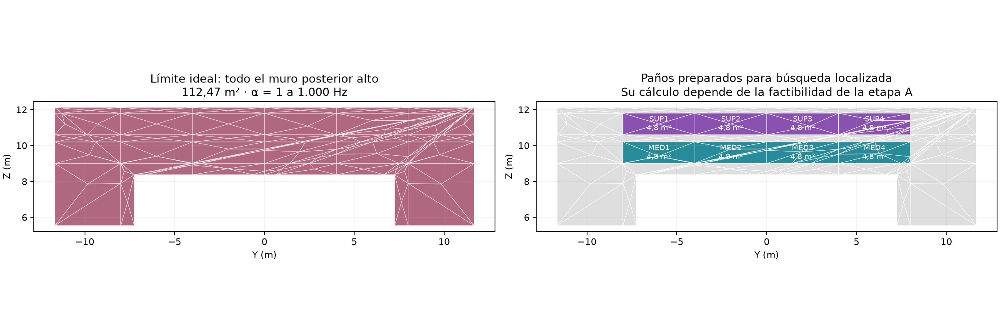
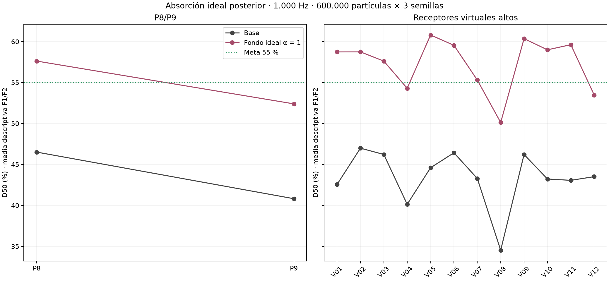
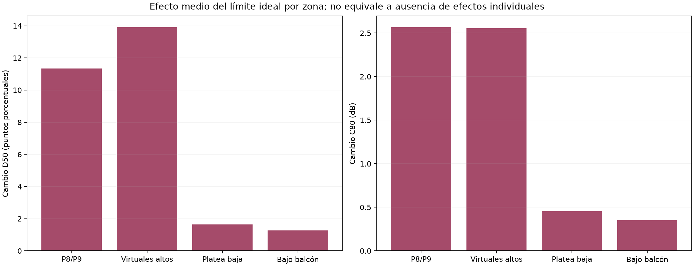

# Límite de la absorción posterior en platea alta

**Teatro Aula Magna UTFSM — 9 de noviembre de 2026.**  
**Etapa:** A del [plan aprobado de absorción posterior](PLAN-PROPUESTO-ABSORCION-POSTERIOR-PLATEA-ALTA.md).  
**Alcance:** diagnóstico energético a 1.000 Hz; no es una especificación de material ni una validación instalada.

**Nota de continuidad:** este informe conserva la etapa ideal y su meta histórica de 55 %. Posteriormente se revisó la meta a 48–52 % y se ejecutaron pared completa y paños locales con α = 0,80; véase el [estudio actualizado](RESULTADOS-ABSORCION-POSTERIOR-080.md). Las menciones a paños todavía no calculados corresponden a la situación al cerrar esta etapa ideal.

## 1. Resultado principal

**La absorción posterior sí produce una mejora importante de D50 en esta base:** el promedio descriptivo F1/F2–P8/P9 pasa aproximadamente de **43,66 % a 55,01 %** al convertir en absorbente ideal todo el muro posterior alto disponible.

Sin embargo, **no se cumple el objetivo conjunto por posición**: F2–P9 permanece en 49,36 %, y el C80 de los cuatro pares altos supera +2 dB. En los virtuales superiores aumenta D50, pero también cambia el balance de claridad, nivel y decaimiento. La platea baja y bajo balcón presentan efectos menores, aunque no nulos.

Este resultado respalda que la absorción puede contribuir al objetivo; no respalda que un paño pequeño, un material comercial determinado o esta estrategia por sí sola garanticen D50 ≥ 55 % en toda la platea alta conservando los demás criterios.

## 2. Qué se calculó

Se ejecutaron **12 corridas de estudio**, más dos pilotos independientes de funcionamiento:

| Condición | Fuentes | Banda | Partículas por corrida | Semillas | Procesos |
|---|---|---:|---:|---|---:|
| Base sin tratamiento | F1 y F2 por separado | 1.000 Hz | 600.000 | 20261019, 20261020 y 20261021 | 6 |
| Todo el fondo alto con absorción ideal | F1 y F2 por separado | 1.000 Hz | 600.000 | Mismas tres | 6 |

Se conservaron los 21 receptores: P1–P9 y doce virtuales altos V01–V12. Las alturas, fuentes, Lw global de 90 dB y espectro, radio receptor de 0,31 m, 4 s de duración, paso 1 ms, ambiente supuesto de 18 °C y 57 % de humedad, absorción atmosférica y transmisión desactivada permanecieron iguales entre condiciones.

Las fuentes continúan siendo omnidireccionales idealizadas. No se ha incorporado la directividad real del parlante de medición, del globo, de una orquesta o del line array. Las cifras son resultados de estas condiciones predictivas; no se transfieren a las mediciones sumando automáticamente los mismos puntos porcentuales.

## 3. Superficie y cambio de material

Se seleccionaron **112,4666 m²** de material efectivo de muro en el plano posterior X = 40,25 m, pertenecientes al sector alto. No se incluyeron cortinas del fondo bajo balcón, suelo, butacas, cielo ni paredes laterales.

Se cambió únicamente la absorción de ese paño a 1.000 Hz:

| Propiedad | Base | Escenario ideal |
|---|---:|---:|
| Absorción α | ≈ 0,24795 | 1,00 |
| Dispersión s | ≈ 0,05 | ≈ 0,05 |
| Ley de reflexión difusa | Lambert | Misma |
| Geometría y área | Iguales | Iguales |

El aumento de absorción equivalente es de unos **84,58 m² a 1.000 Hz**, calculado como S(αideal−αbase). No es una predicción de reverberación por Sabine ni la cantidad de un producto seleccionado. La absorción de base es efectiva de calibración, no un ensayo del concreto real.

α = 1 es un límite ideal: toda energía que alcanza esa superficie queda absorbida en el modelo. No significa que se haya encontrado un panel que produzca exactamente esas prestaciones en todo el espectro.

Se preparó una partición común de ocho módulos de 4,8 m², para que una eventual búsqueda localizada compartiera geometría con su referencia. La envolvente conserva aproximadamente 9.543,734 m³ y su cierre. La malla tiene **2.537 vértices, 5.086 caras y 8.184 tetraedros**, con 2.652 nodos tetraédricos.

Los módulos mostrados a la derecha están preparados, **no calculados como tratamientos locales**. Su existencia geométrica no constituye un resultado de eficacia.

## 4. Método de análisis y control de muestreo

Para cada fuente y receptor se promediaron las energías lineales de las tres semillas y se recalcularon D50, C80 y los indicadores de decaimiento. Los promedios por zona resumen parámetros individuales; no equivalen a sumar las fuentes ni mezclar asientos en una respuesta única.

Se mantuvieron el origen temporal basado en distancia/342 m/s, integración fraccional de intervalos y captura del frente directo de radio finito del procedimiento existente. Se integraron directamente las series energéticas SPPS, sin volver a elevarlas al cuadrado. El total corresponde a los 4 s disponibles.

Las trayectorias que alcanzan el plano posterior no pueden llegar antes de 50 ms relativos al directo en P8/P9. Por tanto, la absorción de ese muro no debería modificar físicamente su energía anterior a 50 ms. Las pequeñas diferencias numéricas observadas en esa ventana se usan como diagnóstico de muestreo.

Además del resultado bruto, se calculó un control secundario que mantiene la energía temprana de la base y la combina con la energía posterior del escenario ideal. Este control no modifica los archivos originales ni se aplica a receptores cuya invariancia temporal no está demostrada. Algunos virtuales cercanos al fondo pueden recibir de él aportes tempranos, por lo que no se supone allí la misma propiedad.

Los mínimos y máximos entre semillas son descriptivos, no intervalos de confianza. La coincidencia de identificador de semilla tampoco asegura trayectorias idénticas después de cambiar una reflexión.

## 5. Resultados en P8/P9

| Par | D50 base | D50 ideal | Cambio D50 | C80 base | C80 ideal |
|---|---:|---:|---:|---:|---:|
| F1–P8 | 44,45 % | 55,11 % | +10,66 puntos | +0,67 dB | +3,15 dB |
| F1–P9 | 44,54 % | 55,44 % | +10,90 puntos | +0,52 dB | +3,19 dB |
| F2–P8 | 48,56 % | 60,14 % | +11,57 puntos | +1,12 dB | +3,53 dB |
| F2–P9 | 37,10 % | 49,36 % | +12,26 puntos | −0,38 dB | +2,33 dB |
| **Media descriptiva** | **43,66 %** | **55,01 %** | **+11,35 puntos** | **+0,48 dB** | **+3,05 dB** |

La absorción mejora D50 en los cuatro pares, pero el promedio de 55 % oculta que F2–P9 sigue claramente por debajo. Tres de cuatro pares alcanzan al menos 55 % de D50; ninguno cumple simultáneamente ese mínimo y el intervalo de proyecto de C80 de −2 a +2 dB en el escenario ideal.

El aumento de C80 no demuestra por sí solo que la escucha empeore: ese intervalo es una meta del proyecto, no una frontera normativa universal. Sí indica que el tratamiento altera de forma importante el balance que se acordó conservar.

### 5.1 El punto limitante: F2–P9

Al conservar la energía temprana de la base como control físico, el D50 ideal de F2–P9 es aproximadamente **50,17 %**, con valores por semilla entre **47,95 % y 52,09 %**.

Incluso combinando el máximo temprano de las tres referencias con el mínimo posterior de las tres realizaciones ideales se obtiene aproximadamente 52,09 %. Es una combinación optimista de extremos observados, **no un intervalo de confianza ni una cota estadística que cubra incertidumbres de materiales o fuente**. Aun así, no aporta evidencia de que este caso alcance 55 % con absorción posterior sola.

### 5.2 Qué energía disminuye

En P8/P9, los cambios medios descriptivos son:

- Energía posterior a 50 ms: aproximadamente **−2,19 dB**.
- Energía de 80–300 ms: **−2,59 dB**.
- Energía de 300–1.000 ms: **−3,71 dB**.
- Energía total de banda: **−1,21 dB**.

La mejora se produce principalmente por reducción de energía posterior, no por aumento físico del aporte anterior a 50 ms. La variación bruta media de esta última, aproximadamente −0,19 dB, no se atribuye a un efecto temprano del paño porque contradice su cota temporal; se considera variación de muestreo.

## 6. Efectos en el resto de la sala

| Grupo | D50 base → ideal | C80 base → ideal | Cambio de nivel integrado de banda |
|---|---:|---:|---:|
| Virtuales altos | 43,39 → 57,30 % | +0,84 → +3,40 dB | −1,39 dB |
| Platea baja abierta | 44,72 → 46,36 % | +0,90 → +1,36 dB | −0,17 dB |
| Bajo balcón | 57,38 → 58,66 % | +3,44 → +3,80 dB | −0,24 dB |

En los virtuales altos, **20 de 24 combinaciones** fuente–receptor alcanzan D50 ≥ 55 %, pero ninguna cumple simultáneamente el criterio C80 adoptado para la zona superior. La variación de D50 es positiva en las 24 respuestas medias, con incrementos entre aproximadamente 7,63 y 19,09 puntos; la pérdida de nivel llega a unos 2,45 dB en una combinación.

En platea baja y bajo balcón los efectos medios son menores. No son zonas desacopladas: el máximo cambio absoluto individual de D50 es de aproximadamente **4,57 puntos en platea baja** y **3,86 bajo balcón**. La platea baja incluye un caso con disminución de unos 0,47 puntos de D50. No se declara que la intervención no afecte a las zonas inferiores.

Los valores absolutos inferiores se presentan como resultados del modelo, no como una nueva evaluación perceptual de esas zonas. El intervalo C80 de −2 a +2 dB no se utiliza para exigir una corrección general de toda la sala.

### 6.1 Decaimiento

| Grupo | Cambio medio T30 | Cambio relativo medio T30 | Cambio medio EDT |
|---|---:|---:|---:|
| P8/P9 | −0,096 s | −5,5 % | −0,319 s |
| Virtuales altos | −0,165 s | −9,2 % | −0,371 s |
| Platea baja | −0,073 s | −4,1 % | −0,182 s |
| Bajo balcón | −0,083 s | −4,8 % | −0,193 s |

Son cambios a **1.000 Hz**, no una reducción global de reverberación en todas las bandas. Los porcentajes son medias de variaciones individuales, no cocientes entre respuestas mezcladas.

La reducción de EDT es mayor que la de T30: cambia notablemente el decaimiento inicial además de la cola. Algunas regresiones de EDT son menos lineales, con r² mínimo cercano a 0,94; las cifras se deben leer con sus ajustes individuales. Los ajustes T30 tienen r² mínimo de aproximadamente 0,990 en el escenario ideal. Los valores son indicadores predictivos, no certificaciones de calidad musical.

## 7. Decisión conforme al plan aprobado

**Se da por completada la etapa A y no se inicia la búsqueda de dosis localizada para prometer el objetivo completo mediante absorción posterior sola.** La razón es específica: F2–P9 no alcanza 55 % ni con absorción ideal de toda la superficie posterior alta disponible, bajo las condiciones estudiadas.

En el modelo energético, con fuente y dispersión constantes y sin contribución de esa pared antes de 50 ms en P8/P9, una absorción parcial o menor no puede eliminar más energía posterior que el escenario ideal sobre todo el muro. Este argumento es una cota del modelo bajo sus supuestos; no una imposibilidad universal de la sala real, cuya fuente y materiales no están identificados exactamente.

Por ello:

- **Sí existe respaldo para que la absorción posterior mejore D50.** El efecto es mucho mayor que el de las configuraciones dispersoras anteriores.
- **No se ha encontrado una cantidad instalable suficiente para el objetivo conjunto y uniforme.** Solo se ha delimitado su factibilidad y sus costes con un extremo ideal.
- No se calcula una dosis por interpolación lineal entre 0 y 112,47 m²: D50, área y absorción no mantienen una relación lineal general.
- El tratamiento de toda la pared tampoco se recomienda como solución: exige una condición ideal, sobrepasa el C80 de proyecto y cambia nivel y decaimiento en varias zonas.
- No se han evaluado materiales reales ni los nuevos escenarios a 500 Hz, 2, 4 u 8 kHz. No se atribuyen prestaciones en esas bandas a partir de este resultado.

La absorción parcial podría seguir siendo útil como componente de una propuesta con una meta parcial explícita o combinada con otra intervención. Ese sería un objetivo de continuación, no un resultado demostrado por esta etapa. Los módulos ya preparados permitirían estudiarlo sin confundirlo con una solución que garantice 55 % por sí sola.

## 8. Siguiente estudio recomendado

Antes de añadir más absorción se recomienda revisar conjuntamente:

1. La representación de fuente y la relación entre los resultados medidos y predictivos de cada posición, particularmente F2–P9.
2. La posibilidad de redistribuir energía hacia llegadas útiles anteriores a 50 ms, mediante una reflexión orientada cuya posición y cobertura se calculen.
3. Una combinación de absorción posterior limitada y modificación de reflexiones, comparada siempre con ambos componentes por separado y con las tres zonas de audiencia.

No basta con aumentar C80 indiscriminadamente ni con conservar solo T30. La futura alternativa deberá revisar el reparto 0–50/50–80/posterior a 80 ms y los efectos por asiento. La reflexión orientada y la combinación **no se han activado ni simulado en esta etapa**, conforme al alcance aprobado.

## 9. Archivos y verificación

- [Geometría y módulos posteriores](../prediccion/estudio-difusion/absorcion-posterior/panos-absorcion.json).
- [Escenarios definidos](../prediccion/estudio-difusion/absorcion-posterior/escenarios.json): solo base y límite ideal se ejecutaron; los coeficientes locales preparados no son resultados.
- [Verificación geométrica](../prediccion/estudio-difusion/absorcion-posterior/verificacion-geometrica.json) y [tetraédrica](../prediccion/estudio-difusion/absorcion-posterior/verificacion-tetra.json).
- [Indicadores por semilla](../prediccion/estudio-difusion/absorcion-posterior/resultados/indicadores-por-semilla.csv).
- [Indicadores sobre respuestas medias](../prediccion/estudio-difusion/absorcion-posterior/resultados/respuestas-medias.csv).
- [Comparación individual y controles temporales](../prediccion/estudio-difusion/absorcion-posterior/resultados/comparacion-ideal.csv).
- [Resumen por zonas](../prediccion/estudio-difusion/absorcion-posterior/resultados/resumen-ideal.json).
- [Verificación de ejecución](../prediccion/estudio-difusion/absorcion-posterior/resultados/verificacion-final.json).

Se verificaron 12 corridas y dos pilotos: 21 receptores, fuente a Lw global de 90 dB, frecuencia activa, dispersión conservada, absorción modificada solo a 1.000 Hz en el paño, huellas de entradas y series finitas no negativas. La pérdida máxima de partículas registrada fue aproximadamente 0,025 %. Esto no sustituye la convergencia estadística ni la validación física.

Las salidas nativas se conservaron sin pérdida en ZIP por corrida tras verificar integridad. Configuraciones, logs, metadatos y energías lineales permanecen disponibles por separado. El proyecto principal, las mediciones y los resultados anteriores no se modificaron.
