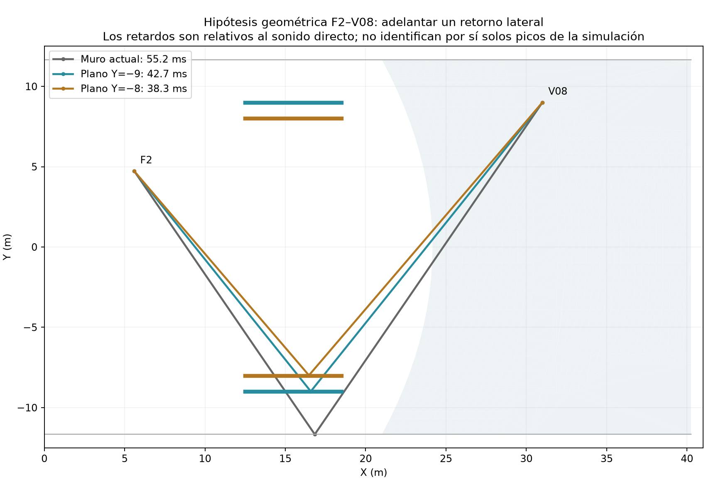
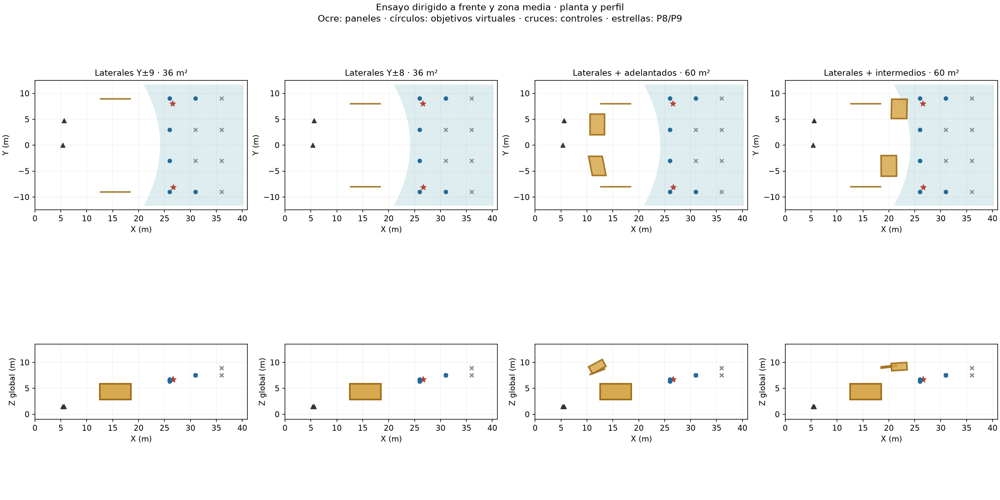
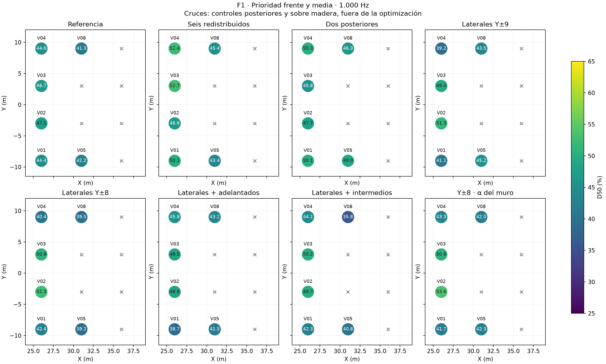
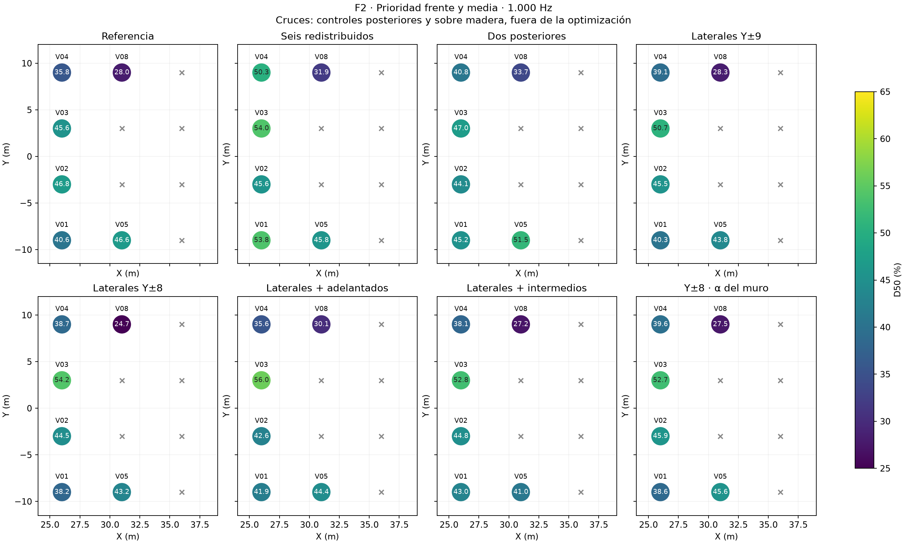
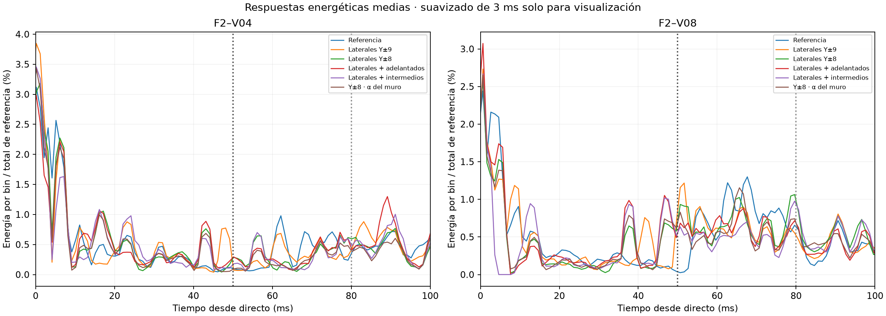

# Reflectores laterales y combinaciones para frente y zona media

**Aula Magna UTFSM — 9 de noviembre de 2026.**

## 1. Resultado y decisión

Se calcularon **cinco condiciones nuevas** a 1.000 Hz: cuatro distribuciones físicas de paneles y un control numérico de material. Se ejecutaron 30 corridas principales y diez pilotos. La evaluación principal se limita a **seis posiciones virtuales del frente y la zona media, con dos fuentes: doce combinaciones**. Los puntos posteriores quedan fuera de la selección y permanecen como controles.

El menor error medio de D50 respecto de 50 % entre las ocho condiciones comparadas corresponde a **Dos posteriores**, con 4,36 puntos porcentuales y 3/12 respuestas dentro de D50 = 48–52 % y C80 = −2 a +2 dB. Entre las nuevas, el menor error es de **Laterales Y±9**, con 7,21 puntos y 3/12.

**Ninguna de las condiciones nuevas resuelve simultáneamente las doce respuestas virtuales y los tres pares de campo prioritarios.** El ensayo permite separar mejoras locales de una mejora de cobertura; adelantar una trayectoria especular aislada no garantiza que mejore el balance energético completo.

## 2. Objetivo y controles

Se mantiene D50 de 48–52 % a 1.000 Hz, con C80 entre −2 y +2 dB como criterio de proyecto. No se interpreta como un óptimo musical universal. El frente incluye V01–V04 (X = 26 m); la franja media incluye V05/V08 (X = 31 m). V06/V07 están sobre madera, no sobre los bloques de butacas; V09–V12 son posteriores. Todos esos controles se conservan sin penalizar sus indicadores al seleccionar el conjunto.

Se observan también F1–P8, F1–P9 y F2–P8 como pares de campo prioritarios. F2–P9 se mantiene como control secundario. P1/P2/P4/P7 representan la platea baja abierta; P3/P5/P6, bajo balcón. Las coordenadas y sus límites de levantamiento son los del [mapa de receptores](MAPA-DE-RECEPTORES-VIRTUALES-PLATEA-ALTA.md).

## 3. Hipótesis geométrica que se puso a prueba

En el modelo existe un recorrido especular visible desde F2 al lateral opuesto (Y = −11,665 m) y luego a V08. El punto de reflexión [16,833; −11,665; 4,171] m pertenece a superficies de material 115 y sus dos tramos están libres en la envolvente original. Su retardo relativo al directo es **55,17 ms**. En V04 hay otro recorrido visible de **61,77 ms**. El retorno simple del plano posterior hacia F2–V08 tiene el primer tramo obstruido, de modo que no se lo identifica como una reflexión posterior visible.

Se adelantó el plano lateral con paneles independientes para explorar si parte del retorno podía pasar a la ventana anterior a 50 ms:

| Par | Muro actual | Panel Y = −9 m | Panel Y = −8 m |
|---|---:|---:|---:|
| F2–V04 | 61,77 ms | 48,44 ms | 43,62 ms |
| F2–V08 | 55,17 ms | 42,72 ms | 38,27 ms |

Estos tiempos proceden del método geométrico de fuente imagen y del tamaño finito del panel. **No identifican automáticamente un pico de la respuesta energética como perteneciente a ese muro.** Las salidas analizadas son histogramas de energía por receptor, no un registro etiquetado de todas las interacciones de cada partícula. La causalidad del efecto se evalúa comparando las variantes completas.

## 4. Geometrías y materiales

Los nuevos paneles laterales son verticales, de 6 × 3 m y 20 mm de espesor. Sus centros son X = 15,5 m, Z = 4,4 m y Y = ±9 o ±8 m. Ocupan X = 12,5–18,5 m y Z = 2,9–5,9 m. Son planos internos a la sala, separados del muro, no un cambio aplicado sobre el material del muro existente. Las combinaciones incorporan el par adelantado o el intermedio del primer ciclo, conservando sus posiciones y orientaciones.

| Condición | Paneles | Área frontal | α a 1.000 Hz | Dispersión |
|---|---:|---:|---:|---:|
| Laterales Y±9 | 2 | 36 m² | 0,05000 | 0,05 |
| Laterales Y±8 | 2 | 36 m² | 0,05000 | 0,05 |
| Laterales + adelantados | 4 | 60 m² | 0,05000 | 0,05 |
| Laterales + intermedios | 4 | 60 m² | 0,05000 | 0,05 |
| Y±8 · α del muro | 2 | 36 m² | 0,24795 | 0,05 |

El reflector nominal usa α = 0,05 y dispersión = 0,05, con ley Lambert para la fracción dispersada. Se idealiza una superficie rígida sellada tipo tablero sobre bastidor; no se ha caracterizado un producto concreto. Se modelan ambas caras y cantos como sólidos opacos. El área tabulada corresponde a una cara principal, no a la suma de superficies expuestas ni al área de absorción equivalente.

El control «Y±8 · α del muro» mantiene exactamente la malla de Y±8, pero asigna a sus paneles α = 0,24794628455412168, igual al muro efectivo 115 a 1.000 Hz; conserva dispersión 0,05. Es un control numérico, no la definición de un producto de madera. **Igualar el coeficiente por contacto no conserva la absorción total de la sala:** se añaden caras y se interceptan recorridos diferentes. La comparación con Y±8 nominal estudia la sensibilidad al material; la comparación con la referencia incluye geometría y superficie expuesta.

## 5. Procedimiento y comprobaciones

Se mantuvieron fuentes y receptores, materiales originales, potencia sonora global Lw = 90 dB y espectro de la base, fuentes omnidireccionales, 18 °C, humedad relativa 57 % y velocidad 342 m/s. La absorción del aire está activada y la transmisión de las superficies, desactivada. El espectro global de 90 dB no equivale a asignar 90 dB a la banda de 1.000 Hz ni a imponer ese nivel en las butacas. No se modela la directividad del line array.

Se calculó una fuente por corrida, 600.000 partículas, tres semillas (20261019/20261020/20261021), duración 4 s, paso 1 ms y radio receptor 0,31 m. Se promediaron las respuestas energéticas lineales de las tres semillas y después se calcularon los indicadores. Los promedios de zona son medias de los indicadores por combinación, sin fusionar fuentes o posiciones.

Las integraciones se refieren al tiempo directo distancia/342: D50 = 100·E(0–50 ms)/Etotal y C80 = 10·log10[E(0–80 ms)/E(>80 ms)]. Se incluye el frente directo captado por la esfera antes del centro geométrico del arribo. La energía nativa ya es lineal y no se vuelve a elevar al cuadrado. Los rangos entre semillas son descriptivos; no son intervalos de confianza.

Se reutilizaron 18 corridas principales de referencia, seis redistribuidos y dos posteriores, compatibles en sus condiciones. El análisis reúne **48 corridas principales, 336 respuestas medias y 1.008 respuestas individuales**. La fracción máxima de partículas perdidas de las 30 nuevas es 0.000195.

Las cinco mallas conservan los 2.340 vértices y 4.692 caras originales como prefijo, tienen envolventes cerradas, volumen de aire consistente con los sólidos añadidos, fronteras marcadas y vecindades tetraédricas recíprocas. Ningún centro tetraédrico queda dentro de un panel. Los 42 segmentos directos de las dos fuentes a los 21 receptores permanecen libres. Se verificó que las esferas receptoras quedan fuera de los paneles y que no hay intersecciones mutuas.

| Condición | Holgura vertical mínima muestreada | Volumen de aire |
|---|---:|---:|
| Laterales Y±9 | 3,31 m | 9543,014 m³ |
| Laterales Y±8 | 3,31 m | 9543,014 m³ |
| Laterales + adelantados | 3,31 m | 9542,534 m³ |
| Laterales + intermedios | 3,31 m | 9542,534 m³ |
| Y±8 · α del muro | 3,31 m | 9543,014 m³ |

Las holguras se muestrearon sobre los pisos del modelo; no son levantamientos del recinto. El modelo no incorpora todos los detalles de iluminación, escenografía ni equipos. Los OBJ y mallas nativas documentan las variantes calculadas; no se creó un nuevo proyecto `.proj` de interfaz.

## 6. Resultados de cobertura: doce combinaciones objetivo

«Cumplen» requiere ambos parámetros dentro de sus rangos. Un promedio de zona cercano a 50 % no implica que todos los puntos cumplan. Error significa media de |D50 − 50|, en puntos porcentuales.

| Condición | D50 frente | D50 media | D50 conjunto | Error a 50 % | Cumplen /12 | C80 >+2 dB /12 |
|---|---:|---:|---:|---:|---:|---:|
| Referencia | 43,95 % | 39,52 % | 42,47 % | 7,53 | 0 | 0 |
| Seis redistribuidos | 50,70 % | 41,65 % | 47,68 % | 4,55 | 2 | 1 |
| Dos posteriores | 46,37 % | 45,13 % | 45,96 % | 4,36 | 3 | 1 |
| Laterales Y±9 | 44,59 % | 40,20 % | 43,13 % | 7,21 | 3 | 0 |
| Laterales Y±8 | 45,19 % | 36,66 % | 42,35 % | 8,87 | 1 | 1 |
| Laterales + adelantados | 44,74 % | 39,81 % | 43,09 % | 7,91 | 2 | 1 |
| Laterales + intermedios | 45,63 % | 36,18 % | 42,48 % | 8,02 | 2 | 0 |
| Y±8 · α del muro | 45,78 % | 39,35 % | 43,63 % | 7,55 | 1 | 1 |

## 7. Casos deficitarios y energía temporal

Cada celda muestra D50 (%) / C80 (dB). Los dos puntos siguientes están dentro del objetivo, no son controles posteriores.

| Condición | F2–V04, frente lateral | F2–V08, media lateral |
|---|---:|---:|
| Referencia | 35,79 / -0,53 | 27,98 / -0,05 |
| Seis redistribuidos | 50,32 / 1,88 | 31,94 / 0,07 |
| Dos posteriores | 40,82 / 1,07 | 33,69 / 0,73 |
| Laterales Y±9 | 39,10 / -0,32 | 28,26 / -0,13 |
| Laterales Y±8 | 38,68 / -0,29 | 24,74 / -0,76 |
| Laterales + adelantados | 35,64 / -0,87 | 30,14 / -0,20 |
| Laterales + intermedios | 38,06 / -0,51 | 27,17 / -0,96 |
| Y±8 · α del muro | 39,56 / -0,35 | 27,46 / -0,51 |

Para F2–V08 se separan variaciones de energía absoluta respecto de la referencia. ΔE en dB corresponde a un cociente de energías, no a la diferencia de D50. La fracción 50–80 ms se expresa respecto de la energía total de cada variante.

| Condición | ΔE 0–50 ms | ΔE 50–80 ms | ΔE 80–300 ms | ΔE total | Fracción 50–80 ms |
|---|---:|---:|---:|---:|---:|
| Referencia | 0,00 dB | 0,00 dB | 0,00 dB | 0,00 dB | 21,73 % |
| Seis redistribuidos | 0,80 dB | -0,48 dB | 0,15 dB | 0,23 dB | 18,46 % |
| Dos posteriores | 1,12 dB | 0,07 dB | -0,05 dB | 0,31 dB | 20,53 % |
| Laterales Y±9 | -0,20 dB | -0,39 dB | -0,19 dB | -0,24 dB | 21,01 % |
| Laterales Y±8 | -0,72 dB | -0,36 dB | 0,23 dB | -0,19 dB | 20,90 % |
| Laterales + adelantados | 0,20 dB | -0,77 dB | -0,07 dB | -0,12 dB | 18,73 % |
| Laterales + intermedios | -0,68 dB | -1,53 dB | -0,04 dB | -0,55 dB | 17,34 % |
| Y±8 · α del muro | -0,51 dB | -0,88 dB | -0,19 dB | -0,43 dB | 19,59 % |

Las curvas usan la misma normalización por la energía total de referencia. El suavizado de 3 ms solo facilita la lectura; los parámetros se integran sin suavizar. Un panel puede adelantar una reflexión candidata, interceptar otras, aumentar retornos posteriores y cambiar la energía total captada. Por eso la mejora no se deduce del retardo aislado ni se suma algebraicamente entre tratamientos.

En Y±8 nominal, F2–V08 pierde 0,72 dB de energía anterior a 50 ms y aumenta 0,23 dB en 80–300 ms. El cambio de una trayectoria candidata hacia antes de 50 ms no compensa el resto de las modificaciones. Con el material equivalente al muro, D50 queda en 27,46 %: el déficit tampoco se resuelve igualando el coeficiente de absorción. Estos son efectos netos de las variantes, no una identificación etiquetada de cada reflexión.

## 8. Puntos de campo prioritarios

| Condición | F1–P8 | F1–P9 | F2–P8 | F2–P9, control | Cumplen prioritarios /3 |
|---|---:|---:|---:|---:|---:|
| Referencia | 43,77 / 0,58 | 44,43 / 0,50 | 48,90 / 1,19 | 37,17 / -0,35 | 1 |
| Seis redistribuidos | 50,12 / 1,59 | 50,35 / 1,40 | 54,60 / 1,84 | 50,28 / 1,73 | 2 |
| Dos posteriores | 46,10 / 1,29 | 49,06 / 1,62 | 50,17 / 1,58 | 40,69 / 0,78 | 2 |
| Laterales Y±9 | 41,43 / 0,02 | 40,73 / -0,09 | 44,98 / 0,43 | 36,50 / -0,62 | 0 |
| Laterales Y±8 | 40,48 / -0,10 | 40,45 / -0,16 | 42,59 / -0,01 | 42,16 / 0,14 | 0 |
| Laterales + adelantados | 40,39 / -0,06 | 45,33 / 0,51 | 44,91 / 0,43 | 44,10 / 0,41 | 0 |
| Laterales + intermedios | 41,21 / 0,20 | 46,28 / 0,79 | 47,54 / 0,66 | 46,57 / 0,84 | 0 |
| Y±8 · α del muro | 40,09 / 0,08 | 40,95 / 0,16 | 45,50 / 0,59 | 42,03 / 0,16 | 0 |

## 9. Efectos sobre otras zonas

Cambios medios respecto de referencia. Se informa ΔT30 de las mismas respuestas energéticas, con los ajustes y valores individuales conservados en los datos. Una diferencia pequeña frente a la dispersión entre semillas no permite declarar un efecto estable.

| Condición | Zona | ΔD50 (puntos) | ΔC80 (dB) | ΔT30 (s) | ΔEDT (s) | Δenergía total (dB) |
|---|---|---:|---:|---:|---:|---:|
| Laterales Y±9 | Platea baja | 0,52 | 0,16 | 0,00 | 0,02 | -0,03 |
| Laterales Y±9 | Bajo balcón | -0,77 | -0,06 | 0,06 | 0,02 | -0,05 |
| Laterales Y±9 | Posteriores sobre butacas | -0,98 | -0,21 | 0,02 | 0,03 | 0,02 |
| Laterales Y±8 | Platea baja | 0,48 | 0,12 | 0,01 | 0,01 | -0,08 |
| Laterales Y±8 | Bajo balcón | 0,07 | -0,04 | 0,03 | 0,03 | -0,06 |
| Laterales Y±8 | Posteriores sobre butacas | 1,00 | -0,06 | 0,06 | 0,01 | 0,02 |
| Laterales + adelantados | Platea baja | 0,82 | 0,06 | -0,02 | 0,07 | -0,09 |
| Laterales + adelantados | Bajo balcón | -1,32 | -0,36 | -0,01 | 0,15 | -0,05 |
| Laterales + adelantados | Posteriores sobre butacas | 1,80 | 0,06 | 0,02 | 0,02 | 0,25 |
| Laterales + intermedios | Platea baja | 1,94 | 0,37 | 0,01 | -0,01 | -0,08 |
| Laterales + intermedios | Bajo balcón | -0,29 | -0,06 | -0,01 | 0,06 | -0,02 |
| Laterales + intermedios | Posteriores sobre butacas | 0,56 | -0,05 | -0,01 | -0,06 | 0,06 |
| Y±8 · α del muro | Platea baja | 1,44 | 0,22 | -0,03 | -0,03 | -0,10 |
| Y±8 · α del muro | Bajo balcón | -0,26 | 0,05 | 0,06 | -0,05 | -0,08 |
| Y±8 · α del muro | Posteriores sobre butacas | 1,32 | 0,12 | 0,03 | -0,01 | -0,24 |

## 10. Incertidumbre y decisión de continuación

En los siguientes casos se conserva el rango mínimo–máximo entre semillas junto al indicador de la respuesta media. No se usa el número de cumplimientos como una prueba estadística independiente.

| Condición | F2–V08 D50 medio | Rango D50 entre semillas | C80 medio | Rango C80 entre semillas |
|---|---:|---:|---:|---:|
| Referencia | 27,98 % | 24,72–29,80 % | -0,05 dB | -0,57–0,22 dB |
| Seis redistribuidos | 31,94 % | 28,28–34,02 % | 0,07 dB | -0,40–0,49 dB |
| Dos posteriores | 33,69 % | 30,45–36,03 % | 0,73 dB | 0,27–1,07 dB |
| Laterales Y±9 | 28,26 % | 27,59–29,17 % | -0,13 dB | -0,39–0,20 dB |
| Laterales Y±8 | 24,74 % | 23,68–26,30 % | -0,76 dB | -1,14–-0,34 dB |
| Laterales + adelantados | 30,14 % | 28,47–32,64 % | -0,20 dB | -0,33–-0,07 dB |
| Laterales + intermedios | 27,17 % | 25,05–29,92 % | -0,96 dB | -1,25–-0,59 dB |
| Y±8 · α del muro | 27,46 % | 27,05–27,67 % | -0,51 dB | -1,00–0,17 dB |

El ensayo evalúa cinco condiciones concretas a una banda y con la resolución indicada. Un resultado negativo no descarta todas las orientaciones ni todos los reflectores laterales. Tampoco justifica trasladar puntos porcentuales de la predicción a las mediciones reales como una corrección lineal.

La siguiente búsqueda deberá conservar el objetivo frente/media y comparar **orientaciones segmentadas o curvas de reflectores adelantados/intermedios**, con atención específica a V04/V08 y al posible sombreado de reflexiones útiles. Los retornos posteriores anteriores se conservan como referencia de redistribución, aunque los receptores posteriores ya no sean objetivo. No conviene añadir área de forma indiscriminada ni elegir una variante por un único promedio.

Antes de ampliar bandas o aumentar partículas, se debe seleccionar una geometría con mejora espacial consistente. Después corresponderá sensibilidad a posición/orientación y material, confirmación con mayor resolución y evaluación a 500 Hz y 1/2/4/8 kHz. No se atribuye este resultado a un QRD físico ni se ha simulado una combinación nueva con absorción posterior.

## 11. Datos y documentos relacionados

- [Medias por receptor](../prediccion/estudio-difusion/reflectores-frente-media/resultados/medias.csv), [resultados por semilla](../prediccion/estudio-difusion/reflectores-frente-media/resultados/semillas.csv) y [comparaciones energéticas](../prediccion/estudio-difusion/reflectores-frente-media/resultados/comparaciones.csv).

- [Resumen por zona](../prediccion/estudio-difusion/reflectores-frente-media/resultados/resumen-grupos.csv), [verificación de cálculos](../prediccion/estudio-difusion/reflectores-frente-media/resultados/verificacion-calculos.json) y [verificación de mallas](../prediccion/estudio-difusion/reflectores-frente-media/resultados/verificacion-mallas.json).

- [Carpeta del experimento](../prediccion/estudio-difusion/reflectores-frente-media/README.md): geometrías, parámetros, configuraciones y salidas nativas.

- [Prioridad frente/media](PRIORIDAD-FRENTE-Y-ZONA-MEDIA-PLATEA-ALTA.md), [siete geometrías anteriores](RESULTADOS-GEOMETRIAS-COBERTURA-PLATEA-ALTA.md), [plan de reflectores](PLAN-DE-ESTUDIO-DE-REFLECTORES-PLATEA-ALTA.md), [base teórica](BASE-TEORICA-Y-METODOLOGIA-PREDICCION.md) y [documento central de avances](AVANCES-Y-ESTADO-DEL-ESTUDIO-ACUSTICO.md).

