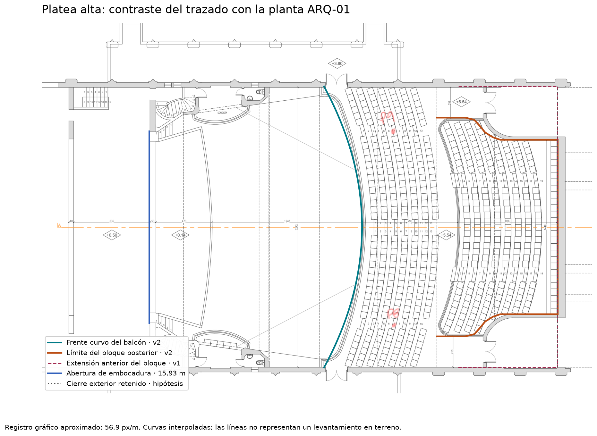
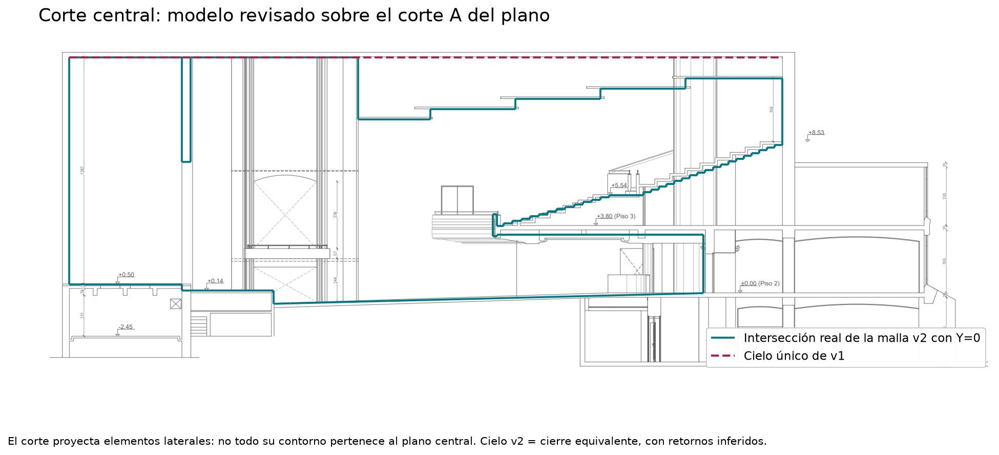

# Revisión del modelo contra ARQ-01

> Corrección v2.1: se eliminaron superficies superpuestas detectadas por TetGen. La geometría y la exportación 3DS pasan ahora el mallado con los ejecutables instalados de I-Simpa, con y sin reparación. Ver [diagnóstico y pasos para reimportar](../../prediccion/diagnostico/LEEME.md). El proyecto abierto en la interfaz aún debe reimportarse.

Fecha: 19/10/2026. Objetivo: mejorar la geometría existente antes de simular en I-Simpa.

Se revisaron los PDF originales y marcado de `datos/`, las plantas de acceso y platea y el corte A, junto con `Frente escenario.jpeg`, `Fondo bajo balcon.jpeg` y `Butacas.jpeg`. Las cotas escritas prevalecen sobre las lecturas gráficas. Las cifras leídas a escala siguen siendo aproximaciones aunque tengan dos decimales. El corte combina secciones y proyecciones de elementos laterales: no toda línea pertenece a la sección central.

## Cambios

| Elemento | Modelo anterior | Revisión v2 | Base y límite |
|---|---|---|---|
| Cielo | Plano único a +13,32 m | Cinco planos a +9,80; +10,40; +10,95; +11,55 y +12,12 m | Lectura del corte; se conservan +13,32 m en escenario y tramo delantero. Encuentros inferidos. |
| Bloque posterior alto | Ancho uniforme 23,33 m | Contorno desde unos 18,17 m hasta 14,49 m al fondo | Cota 1449 y trazado de planta; se modela el límite de las gradas, no un muro alto sobre toda la curva. |
| Circulaciones altas | Ausentes | Descanso entre bloques de unos 1,50 m y plataformas laterales a +5,54 m | Nivel del plano. Extensión posterior y conexión con anexos inciertas. |
| Caja escénica | Ancho completo de sala | Ancho interior posterior 19,03 m | Cota 1903; se excluyen circulaciones laterales externas. |
| Embocadura | Abertura completa | Jambas en X=6,35–6,85 m; abertura 15,93 m; dintel +7,40 m | Ancho/espesor por planta. Altura estimada, no acotada inequívocamente. |
| Proscenio | Piso extendido a todo el ancho | Frente limitado a 16,80 m; piso lateral bajo | Cota 1680. Se omiten pequeñas escaleras y ornamentación. |
| Frente balcón | Solo canto de losa | Antepecho curvo de unos 0,25 m, hasta +4,45 m | Corte y foto; perfil ornamental equivalente. |
| Curvatura balcón | Flecha 2,80 m | Flecha aproximada 3,15 m | Ajuste a planta con parábola; no radio medido. |
| Fondo bajo balcón | Muro sobre línea curva de pilares, X≈32,55 m | Cierre central en X≈35,80 m, curvo lateralmente | Planta y foto confirman espacio detrás de pilares; puertas y tabiques simplificados. |
| Pilares | Ausentes | Cuatro pilares cilíndricos | Y≈±3,50 y ±6,00 m, siguiendo línea curva; diámetro estimado 0,60 m. |
| Piso platea | Frente -0,80 m | Frente aproximado -0,60 m, pendiente hasta +0,00 m | Lectura del corte; pequeños desniveles omitidos. |

Se mantienen ancho general 23,33 m; fondo escénico a borde central 11,55 m; borde escénico a frente central del balcón 12,48 m; desarrollos superiores 7,96 y 8,26 m. La cota 8,52 m de acceso referencia la línea curva de pilares, no justifica un muro acústico continuo.

## Contraste visual

El contorno coloreado delimita las gradas. Las franjas laterales a +5,54 m y el cierre exterior rectangular son una **hipótesis de envolvente**: falta un corte transversal que resuelva las alturas y divisiones de esa zona. No atribuir una reflexión definitiva a esas superficies sin estudiar esta incertidumbre.

La línea verde se obtiene intersectando los triángulos exportados con Y=0; no es un dibujo independiente. La roja indica el cielo anterior. La superposición deja visibles las discrepancias restantes.

## Incertidumbres que afectan la acústica

**Cielo:** el corte muestra planos solapados, sin definir inequívocamente sus juntas, comunicación con plénum ni sección transversal. Para cerrar el volumen, v2 usa un cielo equivalente escalonado con retornos verticales inferidos. No se afirma que esos retornos existan físicamente. Antes de atribuir ecos, estudiar una variante de paneles bajo cubierta si la documentación permite definir las aberturas; ajustar solo absorción no resuelve esa incertidumbre geométrica.

**Gradas:** los 13 y 19 módulos del generador siguen la numeración de escalones, no son un recuento de filas de butacas. La planta combina plataformas de asientos y escaleras de pasillo. Se conserva una escalera transversal equivalente; queda por reconstruir el reparto exacto de plataformas, escaleras radiales y barandas. Se añadió el descanso entre bloques. La extensión posterior de las circulaciones laterales a +5,54 m sigue siendo aproximada.

**Escenario:** no se modelaron telones, concha móvil, torres de paneles ni palcos laterales. La foto muestra elementos móviles cuya posición durante las mediciones no queda determinada por el plano. La altura del dintel de la embocadura es una hipótesis ajustable.

**Balcón:** el intradós permanece plano a +3,30 m. Se añadieron antepecho y pilares, pero no las vigas, casetones y molduras visibles en la foto. Sus dimensiones no están completamente definidas.

**Muros y audiencia:** puertas y tabiques se sustituyen por superficies equivalentes; no se incluyen vestíbulos como volúmenes acoplados. Los grupos de audiencia todavía incluyen partes sin butacas; no aplicar automáticamente absorción de asientos a toda su superficie. La división de muros altos es una agrupación inicial de caras, no un plano de instalación de tratamiento.

## Mediciones y resultados anteriores

Se preservaron las coordenadas F1/F2 y P1–P9. P5 queda dentro de la envolvente ampliada, sin desplazarlo. La inclusión se verifica en `verificacion-exportaciones.json`, pero no certifica el registro exacto de los puntos. P8/P9 corresponden a platea alta y sus alturas deben contrastarse con el piso local.

Las métricas derivadas del audio no cambian al revisar la malla. **Deben recalcularse las rutas, obstrucciones y atribuciones a paredes del diagnóstico anterior**, que utilizó v1, especialmente por el cambio de cielo y embocadura.

## Validación y próximo paso

Malla cerrada, normales al aire, caras con área positiva y dos caras por arista. Los cuatro pilares conectados explican Euler=-6. Se comprueban las geometrías reimportadas desde PLY y 3DS con un lector independiente.

Estos controles y las superposiciones no equivalen a un mallado aprobado en I-Simpa. La siguiente etapa es importar la escena, revisar las hipótesis principales y calibrar el estado existente contra las respuestas de impulso antes de añadir tratamientos o refuerzo.
