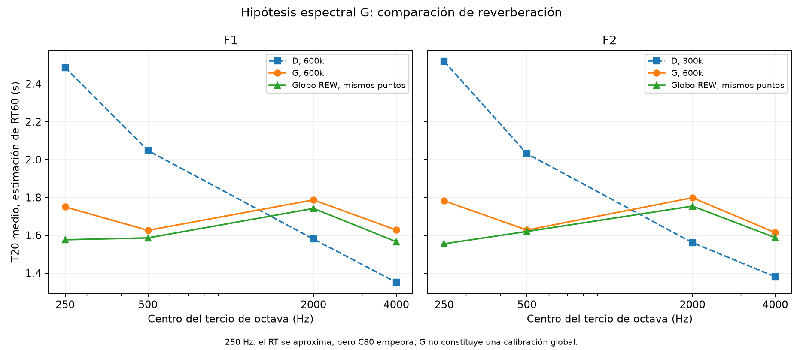

# Ensayos para acercar la base a las mediciones

Se conserva la geometría. Se distinguen controles de capacidad y una hipótesis de absorción equivalente; ninguno identifica por sí solo la construcción real. Las simulaciones nuevas de esta etapa usan 600.000 partículas, una banda por proceso y semilla 20261019. Son exploratorias: no se traslada automáticamente la convergencia a 1 kHz al resto de bandas.

## Capacidad del piso de escenario

Se compara D con α=1 únicamente en el piso de escenario (material 111, unos 209,52 m²) a 250 y 500 Hz. α=1 es un límite diagnóstico, no un producto o material propuesto. Las medias se emparejan con las referencias de globo F1 aceptadas (T20>0, |r|≥0,99 y exclusión de F1-P3).

| Banda | Caso | n | T20 simulado (s) | T20 medido (s) |
|---|---|---:|---:|---:|
| 250 Hz | D | 6 | 2.486 | 1.577 |
| 250 Hz | escenario_alpha1 | 6 | 2.151 | 1.577 |
| 500 Hz | D | 8 | 2.048 | 1.586 |
| 500 Hz | escenario_alpha1 | 8 | 1.787 | 1.586 |

Incluso en este control ideal, el RT permanece por encima del medido, especialmente a 250 Hz. Esto hace poco plausible atribuir todo el desajuste únicamente al escenario. La comparación no es una demostración matemática de monotonía de T20 para cualquier montaje: hay acoplamiento espacial, cambios de pendiente y muestreo probabilístico.

El modelo actual ya usa la referencia de piso de madera (α250=0,11 y α500=0,10). El hecho de que la tarima sea hueca no define por sí solo una nueva curva. Su masa, apoyos, cámara y amortiguamiento siguen sin conocerse.

## Hipótesis espectral G

D se ajustó añadiendo un mismo incremento a la absorción original de tres grupos de muro. G cambia esa curva efectiva por frecuencia y conserva todo lo demás, incluida la dispersión. Los valores iniciales se eligieron con un balance de absorción equivalente como aproximación de partida, sin optimizar contra C80 y sin identificar un material físico.

| Centro (Hz) | α efectivo D | α efectivo G |
|---:|---:|---:|
| 125 | 0,23095 | 0,23095 |
| 250 | 0,23295 | 0,60 |
| 500 | 0,23795 | 0,44 |
| 1000 | 0,24795 | 0,24795 |
| 2000 | 0,25795 | 0,17 |
| 4000 | 0,26795 | 0,11 |
| 8000 | 0,26795 | 0,26795 |

**α250=0,60 no debe presentarse como absorción del concreto rugoso.** La curva es un parámetro equivalente que puede compensar construcciones no representadas, áreas o directividad. No se añadieron absorbentes inexistentes a la geometría. Se interpola linealmente respecto al logaritmo de frecuencia entre los centros indicados; fuera de ellos se mantienen los extremos. A 1 kHz y en el resto de materiales, los valores se conservan.

La curva se fija antes de calcular F2: esta fuente se usa para contraste espacial adicional. Se comprueban RT y C80 por separado para evitar declarar calibrado un modelo por acertar solo un parámetro.

## Resultados de la hipótesis espectral

Referencias de RT: globos aceptados con |r|≥0,99. Para claridad se conservan todos los puntos no duplicados sin usar el r del RT como filtro; C80 negativo o cero es válido. Así, n_RT y n_C80 pueden diferir.

| Caso | Fuente | Hz | n_RT | T20 sim. (s) | T20 REW (s) | Error RT (%) | n_C80 | MAE C80 (dB) |
|---|---|---:|---:|---:|---:|---:|---:|---:|
| D | F1 | 2000 | 8 | 1.580 | 1.742 | -9.3 | 8 | 1.25 |
| D | F1 | 4000 | 8 | 1.352 | 1.566 | -13.7 | 8 | 1.13 |
| G | F1 | 2000 | 8 | 1.787 | 1.742 | +2.6 | 8 | 1.01 |
| G | F1 | 250 | 6 | 1.750 | 1.577 | +11.0 | 8 | 2.76 |
| G | F1 | 4000 | 8 | 1.628 | 1.566 | +3.9 | 8 | 1.05 |
| G | F1 | 500 | 8 | 1.626 | 1.586 | +2.5 | 8 | 1.55 |
| G | F2 | 2000 | 8 | 1.798 | 1.754 | +2.5 | 8 | 1.54 |
| G | F2 | 250 | 7 | 1.782 | 1.555 | +14.6 | 8 | 3.80 |
| G | F2 | 4000 | 8 | 1.614 | 1.588 | +1.7 | 8 | 1.07 |
| G | F2 | 500 | 8 | 1.628 | 1.620 | +0.5 | 8 | 2.23 |
| D | F1 | 250 | 6 | 2.486 | 1.577 | +57.7 | 8 | 1.63 |
| D | F1 | 500 | 8 | 2.048 | 1.586 | +29.1 | 8 | 1.83 |

## Evaluación de la hipótesis G

De las ocho combinaciones de fuente y banda ensayadas, 8/8 quedan dentro del objetivo de trabajo de ±15 % en el T20 medio; 5/8 tienen un error absoluto medio de C80 ≤2 dB frente a globos. Son criterios de trabajo de esta investigación, no tolerancias normativas ni demostración de precisión por punto.

No se debe seleccionar la variante solo por su RT medio. La distribución espacial de C80, la diferencia entre campañas, la identificación física de absorción y la convergencia en cada banda siguen siendo controles necesarios. Las bandas de 125 y 8000 Hz no se recalcularon en G; 1000 Hz conserva D exactamente en materiales y geometría.

## Implicación para la intervención

La calibración equivalente permite estudiar sensibilidad, pero una intervención debe reemplazar la propiedad efectiva de la superficie tratada por la curva del montaje real de tratamiento, evitando sumar dos veces su absorción. Si no se conoce qué construcciones representa el parámetro efectivo del muro, conviene comparar varias bases plausibles y documentar esa incertidumbre.

[Referencia de pisos y revestimientos: OSHA, tabla V-2](https://www.osha.gov/otm/section-3-health-hazards/chapter-5). La referencia de madera no identifica la tarima concreta del teatro.
