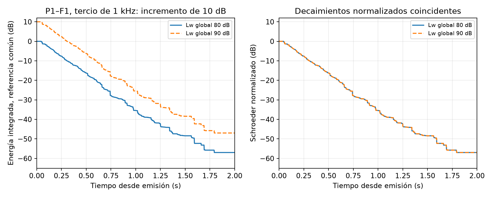

# Potencia de fuente de 90 dB y desajuste a 250–500 Hz

## Resultado de la prueba

Se interpreta la indicación como **Lw global = 90 dB re 1 pW**, equivalente a una potencia acústica total de 1 mW. No es potencia eléctrica ni presión sonora de 90 dB en las butacas. Se conserva la forma del espectro de ruido blanco del proyecto D y se incrementan 10 dB sus 27 bandas de tercio de octava, de 50 Hz a 20 kHz. No se asignan 90 dB a cada banda. La banda de 1 kHz queda en aproximadamente 70,14 dB de potencia sonora.

Se ejecutaron dos cálculos nativos SPPS, con la misma geometría, materiales, fuente F1, nueve receptores, 100.000 partículas por banda y semilla 20261019. **Esta prueba nueva calcula únicamente el tercio de octava de 1 kHz.**

| Resultado | Lw global 80 dB | Lw global 90 dB |
|---|---:|---:|
| T20 P1–F1, extrapolado a RT60 | 1,64724 s | 1,64724 s |
| Cambio de energía integrada recibida en P1 | Referencia | +10,00000 dB |

En los nueve puntos, la diferencia máxima entre T20 de ambas ejecuciones es 5,21 × 10⁻⁹ s: redondeo numérico. Las respuestas de energía son diez veces mayores, con la misma estructura temporal. T20 se obtiene por integración inversa de la energía y regresión entre −5 y −25 dB del decaimiento normalizado; se extrapola la pendiente a 60 dB. Los datos RECP ya representan energía, y no se vuelven a elevar al cuadrado.

Subir Lw no corrige el RT en este modelo lineal. En una medición real puede mejorar el margen sobre el ruido de fondo y la fiabilidad de la estimación; eso no implica que la sala cambie su absorción.

## Proyecto entregado

Abrir **E_fuente_Lw90.proj**. Ambas fuentes tienen Lw global 90 dB; F1 permanece activa y F2 desactivada. Se conservan la geometría, los materiales y las posiciones de D. Los dos ensayos nuevos están separados y rotulados en Results → SPPS. Cada uno incluye su configuración y malla; se retiraron de esta copia los resultados antiguos para evitar confundir sus niveles.

La configuración principal conserva las siete bandas y las 300.000 partículas de D para un cálculo espectral posterior. **Eso no significa que esas siete bandas hayan sido recalculadas a 90 dB.** Los resultados incluidos de esta prueba son solo de 1 kHz y 100.000 partículas. Su T20 no debe confundirse con la confirmación anterior de D, que empleó 1.200.000 partículas y obtuvo aproximadamente 1,650 s en P1.

Se verificaron integridad ZIP/XML, suma energética de las 27 bandas de cada fuente (89,99998 dB, por redondeo), conservación de materiales, geometría, grupos y receptores, y que el proyecto D original no cambiara. La entrega no se abrió en la interfaz gráfica de I-Simpa.

## Qué falta calibrar

La validación anterior de D, usando promedios emparejados con referencias de globo aceptadas, muestra:

| Centro de tercio de octava | T20 simulado F1 / F2 | T20 medido F1 / F2 |
|---|---:|---:|
| 250 Hz | 2,466 / 2,519 s | 1,577 / 1,555 s |
| 500 Hz | 2,052 / 2,032 s | 1,586 / 1,620 s |
| 1000 Hz | 1,702 / 1,733 s | 1,714 / 1,720 s |

Por tanto, el modelo necesita representar más pérdidas a 250–500 Hz, mientras que el aumento uniforme de absorción de paredes ya acortó demasiado los tiempos a 2–4 kHz. El objetivo de cada frecuencia debe ser su valor medido y su variación espacial; no imponer 1,7 s a todo el espectro.

**Calibrar el recinto existente y diseñar un tratamiento nuevo son trabajos diferentes.** No se debe incorporar un absorbente inexistente para declarar calibrado el modelo actual. El material efectivo de D tampoco identifica una propiedad real del concreto.

## Qué solución material ensayaría

Para una intervención nueva, ensayaría un **revestimiento resonante de madera perforada o ranurada, con cámara de aire y lana mineral**, cuya curva ensayada muestre absorción importante en 250–500 Hz y menor efecto en las bandas altas. Otra opción es un panel o membrana resonante. Su desempeño depende del conjunto: cara frontal, perforación o masa, dimensiones, fijaciones, profundidad de cámara y amortiguamiento. No basta especificar «madera» o «lana mineral».

Los paneles resonantes pueden agrupar resonancias amortiguadas para ampliar su banda de absorción; su sintonía requiere conocer masa, apoyos y cámara. [Referencia técnica de Hunecke sobre paneles resonantes](https://www.hunecke.de/en/knowledge/absorbers/panel-absorbers.html).

Como ejemplo de una familia comercial a investigar, la documentación de Topakustik distingue perforaciones orientadas a frecuencias bajas y medias y presenta curvas según montaje. Esto no valida cualquier panel de esa marca: debe seleccionarse la curva del producto y cámara concretos. [Brochure técnico Topakustik 2025, sección de absorción y tipos de perforación](https://topakustik.ch/mediathek/kataloge-und-handbucher/top_produktbroschure_2025_web_en.pdf).

Un absorbente poroso grueso separado del muro también puede actuar en estas bandas. Su respuesta depende del espesor, la separación y la resistividad al flujo; además suele absorber ampliamente en frecuencias superiores. Por eso no sería mi primera prueba con lana mineral expuesta sobre grandes superficies de este modelo. [Referencia técnica de Hunecke sobre absorbentes porosos](https://www.hunecke.de/en/knowledge/absorbers/porous-absorbers.html).

No se propone aún una superficie, espesor o coeficiente final: faltan una curva de absorción ensayada para el montaje y la comparación SPPS de la variante. Ninguno de estos tratamientos nuevos se ha simulado en esta entrega. La difusión para los ecos de platea alta es una intervención distinta y no sustituye esta revisión de absorción a 250–500 Hz.

## Cómo corregir primero la representación del estado actual

1. Mantener D como referencia de sensibilidad, con su material de pared explícitamente marcado como efectivo y no medido.
2. Revisar hipótesis del escenario hueco, respaldo y estructura de butacas, revestimientos y posibles cámaras en cielos. No hay evidencia suficiente para afirmar que estos últimos sean paneles sobre cámara. Mantener las cortinas laterales solo junto al escenario, según la confirmación del usuario.
3. Representar cada hipótesis mediante una construcción completa y una curva respaldada, sin duplicar su superficie con otra absorbente superpuesta. Mantener documentadas las áreas realmente conocidas y las aproximadas.
4. Comparar 250 y 500 Hz en F1 y F2 y los nueve puntos, incluyendo T20, T30, EDT y las curvas de decaimiento. Repetir después las otras bandas para detectar compensaciones. Una coincidencia de RT no garantiza ecos ni C80 correctos.
5. Si varias construcciones reproducen los datos con calidad similar, conservarlas como alternativas plausibles. Con estos datos no se puede identificar de forma única el material que falta.

Como control de orden de magnitud, usando V = 9543,73 m³ y ΔA ≈ 0,161 V (1/Tobjetivo − 1/Tmodelo), pasar de 2,50 a 1,56 s a 250 Hz requiere unos 370 m² de absorción equivalente adicional; pasar de 2,04 a 1,60 s a 500 Hz requiere unos 207 m². No son metros cuadrados de panel para instalar. Es una aproximación de Sabine, no una predicción espacial ni una solución SPPS.

El escenario tiene unos 209,52 m² de piso. Incluso el límite hipotético de llevar ese piso a α = 1 añadiría alrededor de 186 m² equivalentes a 250 Hz y 189 m² a 500 Hz respecto de la curva actual. Este balance sugiere investigar más elementos además del piso del escenario; no demuestra por sí solo qué superficie causa el desajuste, porque Sabine no describe el acoplamiento entre zonas.

## Archivos de trazabilidad

- `comparacion-niveles.json`: resultados numéricos de los nueve receptores.
- `Lw-global-80/` y `Lw-global-90/`: salidas nativas, configuración y registros de cálculo.
- `verificacion-entrega.json`: comprobaciones de la copia del proyecto.
- `../configuracion/probar_nivel_fuente_90.py`: script de las dos simulaciones.
- `../configuracion/entregar_fuente_90.py`: empaquetado y verificación de la entrega.
